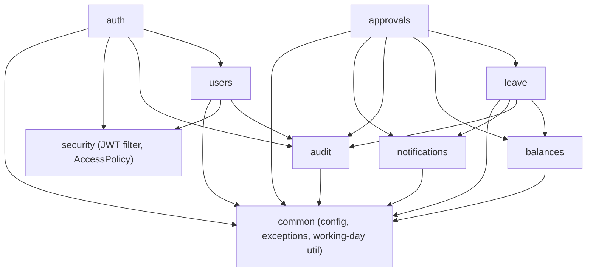
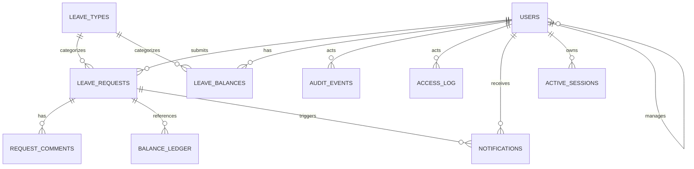

# Architecture Spine — company-leave-backend

## Design Paradigm

**Layered modular monolith, package-by-feature, direct service calls.** One Spring Boot process; one package per business domain (`auth`, `users`, `leave`, `approvals`, `balances`, `audit`, `notifications`), each internally layered `controller → service → repository`. Modules call each other's **service layer directly and synchronously** — no message/event bus. Module separation is a **source-tree and code-review convention** (AD-2), not a tool-enforced boundary: Spring Modulith's verification is deliberately not used here (AD-1).

## Invariants & Rules

### AD-1 — Module communication is direct, synchronous, no event bus

- **Binds:** all 7 domain packages (`auth`, `users`, `leave`, `approvals`, `balances`, `audit`, `notifications`)
- **Prevents:** half the codebase calling services directly while the other half waits on application events for the same kind of cross-module write — a mix no future builder can predict without reading every module.
- **Rule:** a module invokes another module only by calling a public `@Service` bean method, in-process, in the caller's thread. No `@Async`, no `ApplicationEventPublisher`, no message broker between domain modules. `spring-modulith-starter-core` and `spring-modulith-starter-test` (plus the `spring-modulith-bom` import) currently remain in `pom.xml` from the Story 1.1 scaffold — **open item:** the first story that touches `pom.xml` must remove them, since their presence implies boundary verification this design explicitly does not run.

### AD-2 — Cross-module access path: service-only

- **Binds:** all 7 domain packages
- **Prevents:** a module reaching into another module's `@Repository`/JPA entity directly, which would make the package split cosmetic once AD-1 removes automated verification.
- **Rule:** a module's `@Repository` and `@Entity` classes are package-private or otherwise only referenced inside that module. Every cross-module read or write goes through the owning module's `@Service` interface.



`audit` and `notifications` are leaves among domain modules (they call `common`/`security` only, never another domain module). `common` and `security` depend on nothing domain-specific. No edge above may be reversed without a new AD.

**Table ownership** (binding detail of AD-2 — resolves which module a given table belongs to, so no module reaches past another's service on the theory that its package name "obviously" covers that table):

| Table | Owning module | Others call |
| --- | --- | --- |
| `users` | `users` | `users.UserService` |
| `leave_types` | `leave` | `leave.LeaveTypeService` (read-only lookup) |
| `leave_requests`, `request_comments` | `leave` | `leave.LeaveRequestService`, incl. `applyDecision(requestId, decision, comment, approverId)` — called by `approvals`; `approvals` never writes `leave_requests` itself |
| `leave_balances`, `balance_ledger` | `balances` | `balances.BalanceService` |
| `audit_events`, `access_log` | `audit` | `audit.AuditService` |
| `notifications` | `notifications` | `notifications.NotificationService` |
| `active_sessions` | `security` | `security.SessionRegistry` (not `auth` — see AD-8) |

### AD-3 — Shared `common` package stays inert

- **Binds:** `common`, all 7 domain packages
- **Prevents:** `common` becoming an undeclared coupling point once AD-1 drops automated verification — any business rule placed there is invisible cross-module sharing.
- **Rule:** `com.company.leave.common` holds only stateless utilities (working-day calculator), cross-cutting config (`@ConfigurationProperties`, Jackson, Flyway wiring), exception types, and the single error-advice class (AD-11). No `@Entity`, `@Repository`, or business-rule `@Service` may live there.

### AD-4 — Audit and ledger writes share the triggering transaction

- **Binds:** `leave`, `approvals`, `balances`, `audit`
- **Prevents:** a code path that changes request/balance state without a matching audit or ledger row (the PRD's named risk), **and** the double-or-zero-audit-row ambiguity of a cross-module chain — e.g. `approvals.approveRequest()` calling `leave.applyDecision()`, where both modules could plausibly think they own the audit write.
- **Rule:** `[ADOPTED]` the module that owns the mutated table (per the Table ownership list under AD-2) is the only one that calls `AuditService`/`BalanceLedgerService`, inside its own `@Transactional` method, before returning — never deferred to `@Async` or a listener. A calling module from another package (e.g. `approvals` calling `leave.applyDecision(requestId, decision, comment, approverId)`) passes the acting user's id as an explicit parameter; it never re-derives it from `SecurityContext` inside the owning module, and it never writes its own duplicate audit row for the same state change. If a cross-module action needs two distinct audit entries (e.g. "request approved" and, separately, a ledger deduction), each owning module writes exactly one row for the table it owns, in the one transaction.

### AD-5 — Balance invariant enforced in the service layer, backed by a DB constraint

- **Binds:** `balances`, `leave`, `approvals`
- **Prevents:** a reservation or adjustment path that only checks `available = total − reserved ≥ 0` in application code, with nothing to catch a bug that bypasses the service.
- **Rule:** `BalancesService` is the only writer of `leave_balances`/`balance_ledger` and rejects any change that would take `reserved_days` or the computed available below zero. A `CHECK` constraint on `leave_balances` (`total_days - reserved_days >= 0`) is added as defense-in-depth, not as the primary guarantee.

### AD-6 — Audit and access-log immutability is a DB trigger, not an app convention

- **Binds:** `audit`
- **Prevents:** an app-layer-only guarantee (e.g. "no service method ever calls update/delete") that a bug, a migration script, or a manual `psql` session could silently violate.
- **Rule:** `[ADOPTED]` a Flyway-managed Postgres `BEFORE UPDATE OR DELETE` trigger on `audit_events` and `access_log` raises an exception (FR44). The service layer additionally exposes no update/delete method for either table — belt-and-braces, not the primary control.

### AD-7 — Auth: self-issued JWT in an HttpOnly cookie

- **Binds:** `auth`, `security`, every protected endpoint
- **Prevents:** a mix of session-cookie code in some controllers and bearer-header code in others, and — now that this is hand-rolled rather than Spring's auto-configured resource server — a module reaching for its own ad hoc token parsing instead of the one `JwtService`/`JwtAuthenticationFilter` pair.
- **Rule:** `[ADOPTED — revised 2026-10-22]` this is a hand-rolled JWT, not Spring Security's OAuth2 Resource Server — there is no external IdP, no issuer/JWK endpoint, nothing OAuth2 actually buys a single-process POC. `auth` uses `security.JwtService` (built on `io.jsonwebtoken` / jjwt) to sign a short-lived (15 min) JWT with a single HMAC secret from an env var, embedding `sub` (user id), `role`, and the AD-8 `token_id` claim. The token is returned to the Angular client as an `HttpOnly; Secure; SameSite=Strict` cookie, never exposed to JS, matching the PRD's cookie requirement. A custom `security.JwtAuthenticationFilter` (a plain `OncePerRequestFilter`, registered in the `SecurityFilterChain` via `addFilterBefore`) reads the cookie, calls `JwtService.parseAndValidate(token)` (signature + expiry via jjwt), then does the AD-8 `active_sessions` check, and on success populates `SecurityContextHolder` with an authority built from the `role` claim — that authority is what `security.AccessPolicy` (AD-10) and any `@PreAuthorize`/`hasRole(...)` check reads. `spring-boot-starter-security-oauth2-resource-server` is removed from `pom.xml`; `spring-boot-starter-security` stays (filter chain, `PasswordEncoder`, method security), and `io.jsonwebtoken:jjwt-api/-impl/-jackson` is added for signing/parsing.

### AD-8 — Idle timeout and revocation via an active-session registry

- **Binds:** `auth`, `security`, `users`
- **Prevents:** relying on JWT expiry alone, which can't express a 30-minute *idle* timeout or immediate logout/revocation — a stateless token is valid until it expires no matter what the user does. Also prevents the AD-1 dependency graph being violated: AD-1 forbids a `security → auth` edge, so the table the JWT filter checks on every request cannot be owned by `auth`.
- **Rule:** a Postgres table `active_sessions (token_id, user_id, last_seen_at, expires_at)` backs every JWT, **owned by `security`** (table ownership list under AD-2), exposed as `security.SessionRegistry`. `auth` calls `SessionRegistry.createSession(userId)` at login to get a `token_id` to embed as a JWT claim; it never touches the table itself. The security filter validates the JWT signature **and** calls `SessionRegistry.touchOrReject(tokenId)`, which 401s if the row is missing or `last_seen_at` is more than 30 minutes old, otherwise bumps `last_seen_at`. Logout (`auth`), an HR-initiated password reset (`users`, FR20), and a new lockout (`auth`, AD-9) each call `SessionRegistry.revokeAllForUser(userId)`, deleting that user's rows so a reset or lockout can't be bypassed by an already-issued token.

### AD-9 — Login lockout stays on `users`, independent of the token model

- **Binds:** `auth`, `users`
- **Prevents:** the switch to JWT (AD-7) being read as license to move lockout logic into a token claim or the security filter — it would then live in two places once AD-8's registry is added.
- **Rule:** `[ADOPTED]` 5 failed logins locks the account for 15 minutes via `users.failed_logins`/`users.locked_until`, checked at the `/api/auth/login` boundary before a JWT is ever issued. Unaffected by AD-7/AD-8.

### AD-10 — RBAC and data-scoping go through one `AccessPolicy` component

- **Binds:** every controller in every module
- **Prevents:** the PRD's named risk — RBAC gaps from each module inventing its own role/scope check — and the narrower gap of two modules inventing two different contracts for "check one resource" vs. "filter a collection."
- **Rule:** `security.AccessPolicy` is the only place role and ownership checks are written, with exactly two shapes — no controller or service writes its own `if (user.getRole() == ...)` check:
  - **Single-resource check**, called after the service loads the resource (it needs the resource's owner/manager id first): `void requireOwnerManagerOrHr(long resourceOwnerId, long resourceManagerId)` — passes if the current user *is* `resourceOwnerId`, *or is* `resourceManagerId` (the owner's direct manager), *or* holds `HR_ADMIN`; otherwise throws `AccessDeniedException` (→ `RBAC_DENIED` per AD-11). Used for e.g. "cancel this request," "decide this request."
  - **Collection-scope check**, called before a list query: `UserScope currentScope()` returns one of `EmployeeOwn(long userId) | ManagerTeam(long managerId) | HrAll` (a sealed type). The repository method takes that `UserScope` and applies the matching `WHERE` clause itself (`findByScope(UserScope)`), so every "my requests / my team / all" query is built the same way everywhere.
  - **Role-only gate**, no resource involved: `void requireRole(Role... allowed)` — throws unless the current user's role is one of `allowed`. Used for e.g. HR-only account-management endpoints.

### AD-11 — One error envelope — `[ASSUMPTION]`

- **Binds:** every module's controllers
- **Prevents:** each endpoint inventing its own error JSON shape, which the Angular client would have to special-case per call.
- **Rule:** all non-2xx responses are Spring's RFC 7807 `ProblemDetail`, produced by one `@RestControllerAdvice` in `common`, with a stable machine-readable `code` property drawn from one canonical `common.ErrorCode` enum (e.g. `BALANCE_INSUFFICIENT`, `RBAC_DENIED`, `ACCOUNT_LOCKED`, `VALIDATION_FAILED`, `NOT_FOUND`) — no module invents its own string literal for a code that enum already covers; a genuinely new error class adds a value to that one enum. Not explicitly confirmed with the user — correct in review if a different shape is wanted.

### AD-12 — Notification failures are best-effort: caught, logged, never propagated

- **Binds:** `notifications`, `leave`, `approvals`
- **Prevents:** one caller treating `sendNotification()` as fire-and-forget (swallowing failures) while another lets an exception from it propagate and roll back the `leave`/`approvals` transaction that triggered it — the PRD treats notifications as a side effect (a DB row + a log line), not a guaranteed, transaction-critical delivery.
- **Rule:** `NotificationService.sendNotification(...)` catches every exception internally (template rendering, its own DB write), logs it at `ERROR`, and returns normally. It never throws to its caller. `leave`/`approvals` call it last, after their own audit/balance writes (AD-4), so a notification failure can never undo a state change that already succeeded.

### AD-13 — Deployment envelope: one reverse proxy is the only ingress

- **Binds:** all modules (via `common`/`security`), FR55
- **Prevents:** AD-7's `Secure` cookie flag being unenforceable in practice — a `Secure` cookie is dropped by browsers over plain HTTP, and FR55 requires HTTPS, but no AD fixed how the backend actually sees HTTPS — plus each service in `docker-compose.yml` guessing its own hostnames/secrets independently.
- **Rule:** `docker-compose.yml` defines `postgres`, `backend`, `frontend`, and a reverse-proxy service terminating HTTPS with a local self-signed certificate (FR55); the proxy is the only service exposed outside the compose network, so every request that reaches the backend has already crossed HTTPS and the `Secure` cookie flag is always satisfiable, in the `demo` profile as much as any later real deployment. Backend config (`DB_URL`, `DB_USERNAME`, `DB_PASSWORD`, the AD-7 JWT signing secret) comes entirely from `docker-compose.yml` environment variables using in-network service hostnames (`postgres`, not `localhost`); `application.yml`'s `localhost` defaults are only for running the backend outside compose during development. No secret is committed to the repo or baked into an image.

## Consistency Conventions

| Concern | Convention |
| --- | --- |
| Naming (packages, entities, DTOs) | Package per domain, lower-case singular (`auth`, `leave`, `balances`…). JPA entities PascalCase singular (`LeaveRequest`, `BalanceLedgerEntry`, `ActiveSession`). DTOs suffixed `Request`/`Response` (`CreateLeaveRequestRequest`, `LeaveRequestResponse`). Tables `snake_case` plural, matching the PRD's core-tables list. |
| Data & formats | Surrogate keys `BIGINT GENERATED ALWAYS AS IDENTITY`. All timestamps `timestamptz`; JVM pinned to UTC (already done in `CompanyLeaveApplication`). `start_date`/`end_date` are `DATE`, not timestamp. Leave amounts are whole-day integers (FR1: whole days only). Errors per AD-11. |
| State & cross-cutting | Mutation only via the owning module's service (AD-2). Auth per AD-7/AD-8; authz per AD-10. Config via env vars only, no hard-coded secrets (PRD requirement). Logging: SLF4J/Logback to stdout; no external APM — out of scope for a POC. |

## Stack

| Name | Version |
| --- | --- |
| Java | 21 |
| Spring Boot (parent) | 4.1.1 — already pinned in `pom.xml`; 4.1.2 shipped 2026-10-22 as a patch release, not required for this spine; supersedes the PRD's stated "Spring Boot 3" (see Deferred) |
| Spring Framework | 7.x (transitive via Boot 4) |
| Spring Security (classic, no OAuth2 Resource Server) | as in `pom.xml` — `spring-boot-starter-security-oauth2-resource-server` removed, custom JWT filter per AD-7 |
| `io.jsonwebtoken` (jjwt-api / jjwt-impl / jjwt-jackson) | 0.13.0 — hand-rolled JWT sign/verify for AD-7, confirmed current (last 0.x line before 0.14 drops Java 7 support, irrelevant on Java 21) |
| Spring Data JPA | as in `pom.xml` |
| Flyway (`flyway-database-postgresql`) | as in `pom.xml` |
| PostgreSQL | 18 |
| Maven | wrapper already committed (`mvnw`) |
| Lombok | as in `pom.xml`, boilerplate reduction only |
| JUnit 5 / Spring Boot Test / Testcontainers (Postgres) | as in `pom.xml` |
| Spring Mail | present but unused until real SMTP dispatch is integrated (PRD: `sendNotification()` writes a DB row + log line only) |

## Structural Seed

```text
backend/
  pom.xml
  src/main/java/com/company/leave/
    auth/            # login, JWT issue, active_sessions, lockout check (controller/service/repository)
    users/            # accounts, roles, manager link
    leave/             # requests, working-day calc, modify, cancel, comments
    approvals/        # manager decisions, team-scope checks
    balances/          # balances, reservation, ledger
    audit/             # audit_events, access_log, History tab data
    notifications/     # template render + sendNotification() DB write
    security/          # AccessPolicy (AD-10), JWT filter/decoder config (AD-7), SessionRegistry + active_sessions (AD-8)
    common/            # config, exceptions, ProblemDetail advice (AD-11), working-day util — AD-3
  src/main/resources/
    application.yml
    db/migration/       # Flyway: schema + audit/access_log immutability trigger + active_sessions table; seed data as separate incremental migrations
    templates/email/
  src/test/java/...     # JUnit 5, Testcontainers(Postgres); RBAC/approval/audit-write tests per module
```



`ACTIVE_SESSIONS` is new versus the PRD's core-tables list (AD-8); every other table is as the PRD already specifies.

## Capability → Architecture Map

| Area (FRs) | Lives in | Governed by |
| --- | --- | --- |
| Leave requests (FR1–FR9) | `leave` | AD-1, AD-2, AD-4, AD-5 |
| Approvals (FR10–FR17) | `approvals` | AD-1, AD-2, AD-4, AD-10 |
| Users & access (FR18–FR26) | `users`, `auth`, `security` | AD-7, AD-8, AD-9, AD-10 |
| Balances (FR27–FR31) | `balances` | AD-4, AD-5 |
| Audit (FR42–FR45) | `audit` | AD-4, AD-6 |
| Notifications (FR50–FR54) | `notifications` | AD-1, AD-12 (direct, synchronous, best-effort call from `leave`/`approvals`) |
| Security (FR55–FR59) | `security`, `auth` | AD-7, AD-8, AD-9, AD-13 |

## Deferred

- **PRD says "Spring Boot 3", `pom.xml` pins 4.1.1.** Treated as reality overriding a stale PRD line, not re-asked — worth a one-line PRD correction so the two documents stop disagreeing.
- **Spring Modulith boundary verification.** Explicitly not used (AD-1) — if a future phase wants tool-enforced boundaries instead of the code-review convention in AD-2, that is a paradigm change, not an amendment.
- **Phase 2 FRs (FR32–FR41, FR48, FR49):** balance history view, carryover, reports, exports, audit export, before/after audit values. `audit_events.details_json` already has room for before/after values when this lands.
- **Backups/retention (FR46, FR47, FR60, FR61):** not planned for this POC; no backup/restore script or retention documentation in this spine.
- **CI/CD and multi-environment promotion:** out of scope — this spine fixes a single-environment, `docker compose up` POC per the PRD; revisit if this moves toward a real deployment.
- **Real SMTP dispatch (Mailpit + Spring Mail wiring):** deferred; `notifications` already produces everything a real send needs (template, DB row), only the transport is missing.
- **`access_log` read API/UI:** backend-only record for this POC (checked directly against the DB in tests); a view/export is Phase 2, alongside FR48/FR49.
