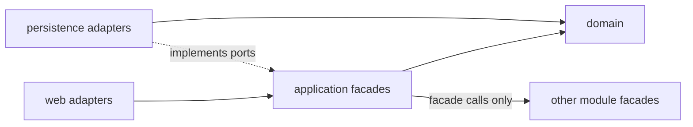
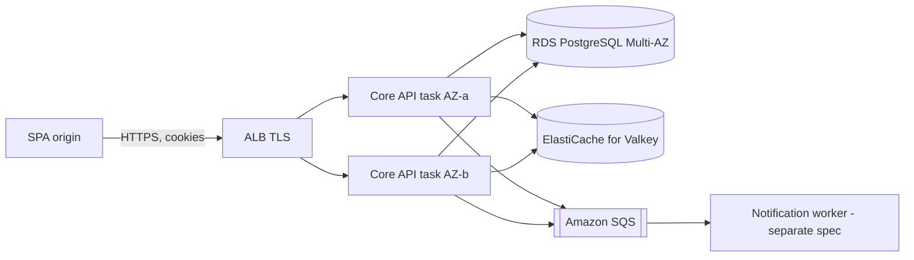
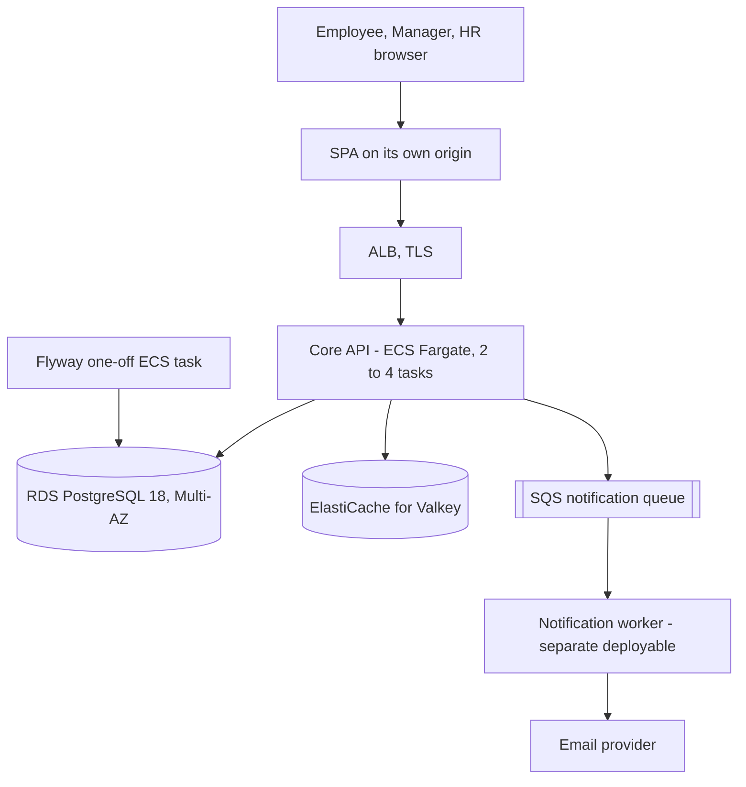
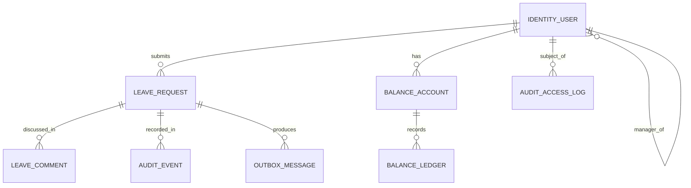

# Architecture Spine: emp-leave-tracker core API

## Design Paradigm

**Modular monolith**: one Spring Boot deployable, split into modules. Each module is layered as web adapter, application facade, domain, and persistence adapter. Persistence entities are separate from domain types; the domain never imports JPA.

| Module | Owns (tables) | Package root |
| --- | --- | --- |
| identity | `identity_user` (sessions live in Redis; their events go to `audit_event`) | `com.example.leave.identity` |
| leave | `leave_request`, `leave_comment`, `leave_type` | `com.example.leave.leave` |
| approval | no tables; policy facade that checks the reporting line, then calls `LeaveFacade.decide` | `com.example.leave.approval` |
| balance | `balance_account`, `balance_ledger` | `com.example.leave.balance` |
| audit | `audit_event`, `audit_access_log` | `com.example.leave.audit` |
| outbox | `outbox_message` (also the notification history, FR53) | `com.example.leave.outbox` |
| idempotency | `idempotency_key` | `com.example.leave.idempotency` |
| shared | ids, clock, problem-details, security primitives; no business rules, no tables | `com.example.leave.shared` |

Each module exposes one application-service facade package (`...application`). Nothing else in the module is visible to other modules.

## Inherited Invariants

Not applicable. This is the root spine for the core API.

## Invariants & Rules

### Dependency direction



### AD-1 [ADOPTED] Modular monolith with facades

- **Binds:** all code
- **Prevents:** two units inventing different layering, or splitting into extra services early
- **Rule:** each module exposes one application-service facade package; other modules call only that facade, never its repositories, entities, or tables. ArchUnit enforces this (see AD-22).

### AD-2 Single owner per table

- **Binds:** all tables
- **Prevents:** two owners of one entity, such as a balance written by both leave and HR admin code
- **Rule:** every table has exactly one owning module, listed in the Design Paradigm table, and only that module writes it. Table names are `snake_case` and prefixed by the owner module's name. Read-only cross-module access goes through the owner's facade. Reporting (Phase 2) owns its own read models and reads other modules only through their facades.

### AD-3 Dependency direction and purity of domain

- **Binds:** all code
- **Prevents:** domain logic leaking into controllers or repositories
- **Rule:** web depends on application, application depends on domain, persistence adapters implement domain ports. Domain has no Spring or JPA imports. Persistence entities are distinct classes from domain types. ArchUnit enforces this in CI; a violation fails the build.

### AD-4 One mutation path and one transaction per state change

- **Binds:** leave, approval, balance, audit, outbox, idempotency, identity (lockout and login audit)
- **Prevents:** two mutation paths, events committed without their state change, state changes committed without audit, and failed-login counters rolled back by their own error response
- **Rule:** each user operation has exactly one entry service, named in the Capability map (for example, submit leave = `LeaveFacade.submit`). That service opens one transaction. Facades it calls on the same path join that transaction (REQUIRED propagation). Writes to `audit_event`, `outbox_message`, and `idempotency_key` use MANDATORY propagation: they must join the caller's transaction and fail if none exists, so they can never commit alone. Three paths use REQUIRES_NEW instead, because the request that triggers them returns an error or is read-only: the failed-login counter and its audit row (AD-8); authorization-denial audit and read-access audit (AD-5, AD-9). Read endpoints open a read-only transaction. Controllers and repositories never change `leave_request` or `balance_*` state. State transitions live only in domain code. Integration tests (AD-22) cover each entry service.

### AD-5 Append-only audit trail

- **Binds:** audit module; FR42-FR45, FR26, NFR audit requirements
- **Prevents:** edited or deleted audit history, and unlogged data access
- **Rule:** `audit_event`, `audit_access_log`, and `balance_ledger` are append-only. PostgreSQL triggers reject UPDATE and DELETE on each. The application role has no DDL rights and no trigger-disable rights; schema changes run under a separate migration role (AD-18). `audit_event` rows hold actor id, action, entity type and id, before and after JSON, and `occurred_at` in UTC. `audit_access_log` records reads of employee leave data and every authorization denial (AD-9), each with actor, target, decision, and time. Only the audit facade inserts audit rows.

### AD-6 JWT access token, 15 minutes, HS256

- **Binds:** identity; all authenticated endpoints
- **Prevents:** token forgery and inconsistent token checks
- **Rule:** the access token lasts 15 minutes and is signed HS256 with a 256-bit key held in AWS Secrets Manager. One service both signs and verifies, so no public key distribution is needed. It is delivered in an HttpOnly, Secure cookie with path `/api/` and SameSite=Lax (AD-12), so every API call carries it. Claims: `sub` (the `identity_user.id`), `sid` (the session id, used for idle extension in AD-7), `role`, `iat`, `exp`. The resource server validates signature and `exp` on every request and never trusts client-supplied role or scope data. Role changes take effect at the next access-token issue, at most 15 minutes later.
- **Accepted risk (user decision; PRD FR58 and the logout and inactivity NFR, PRD lines 818-820, to be amended):** logout and the 30-minute inactivity timeout are not enforced on access tokens. A logged-out access token stays valid for up to 15 minutes.

### AD-7 Refresh session in Redis

- **Binds:** identity
- **Prevents:** inactivity bypassed by timer-driven refresh, spurious logouts from concurrent tabs, and replayed refresh tokens going unnoticed
- **Rule:**
  - The refresh cookie value is `<sid>.<secret>`: the session id plus a 256-bit random secret. It is HttpOnly, Secure, and scoped to path `/api/v1/auth`. Refresh finds the session by `sid` and compares the hash of `secret`. The access token's `sid` claim (AD-6) lets the resource server extend the idle TTL on API calls.
  - Redis stores, under the session id: the SHA-256 hash of the current refresh token, the SHA-256 hash of the previous token with its rotation time, the user id, and an absolute expiry of 8 hours from login.
  - Inactivity: the session's idle TTL is 30 minutes. The resource server extends it on each authenticated API request, using the access token's `sid`. Refresh calls and timers never extend it. A refresh against an expired idle TTL returns 401.
  - Rotation is atomic (Redis Lua script). Presenting the current token rotates it and sets a new refresh cookie. Redis keeps the previous token encrypted (data key from AWS KMS) for 30 seconds. Presenting the previous token within that window returns a new access token and re-sets the refresh cookie to the current value; no new refresh token is minted, so the other tab's cookie stays valid (covers two tabs and lost responses). Presenting the previous token after the window revokes the session.
  - The absolute expiry (8 hours from login) is checked on every refresh and every idle extension. Past it, the session record is deleted.
  - Logout deletes the session record and expires both cookies.
- **Accepted risk:** see AD-6.

### AD-8 Passwords, lockout, and reset

- **Binds:** identity; FR18-FR20, FR56-FR57
- **Prevents:** weak hashing, inconsistent lockout state, and unbounded temporary credentials
- **Rule:**
  - Passwords are 8 to 72 characters (the BCrypt input limit; longer input is rejected, not truncated) and must contain at least one letter and one digit.
  - BCrypt cost 12.
  - Five consecutive failed logins lock the account for 15 minutes. The counter and `locked_until` live on `identity_user` in PostgreSQL and are committed in a REQUIRES_NEW transaction (AD-4).
  - Login responses are identical for an unknown user and a wrong password.
  - HR creates accounts and sets a temporary password. The user must change it at first login. A temporary password expires after 24 hours.
  - HR-initiated reset works the same way: a new temporary password, forced change, 24-hour expiry.

### AD-9 Roles, data scope, and status codes

- **Binds:** all facades; FR10-FR14, FR21-FR25, FR45
- **Prevents:** cross-team leakage, controller-level data queries, and inconsistent status codes
- **Rule:**
  - Roles are `EMPLOYEE`, `MANAGER`, `HR_ADMIN`. The access check runs in the facade, deny by default.
  - Each facade method takes the caller identity and applies a data-scope resolver: self for an employee, direct reports for a manager, all employees for HR.
  - The reporting line is owned by identity (`identity_user.manager_id`). Other modules read it only through identity's facade and never store a copy.
  - Status codes: missing or invalid token returns 401; role is checked before scope. A role not permitted for the operation returns 403 (an employee calling decide on any request). An authorized role on a record outside its scope returns 404, so existence is not revealed (a manager deciding on a colleague's request).
  - The request history (FR45) is served by `LeaveFacade.history`, under the same scope as the request.

### AD-10 REST contract

- **Binds:** all endpoints
- **Prevents:** incompatible error shapes, list shapes, date shapes, and breaking changes
- **Rule:** REST under `/api/v1`, JSON only. Errors are RFC 9457 problem details. Single resources are plain JSON objects. List endpoints return `{ "items": [...], "page": n, "size": n, "total": n }`, offset-paged, default size 20, maximum 100. Resource ids are UUIDs. Leave dates are ISO 8601 `LocalDate`; timestamps are ISO 8601 UTC. OpenAPI 3 is generated from code and published. Breaking changes need `/api/v2`; additive changes stay in v1.

### AD-11 Leave day arithmetic

- **Binds:** leave, balance; FR2, FR31
- **Prevents:** client-side or inconsistent day counts, and day counts depending on mutable calendar data
- **Rule:** leave days = end date minus start date plus 1, in whole calendar days, as an integer. An end date before the start date is rejected with 422. Weekends and public holidays are counted. The count does not read any holiday calendar. No half-days in the MVP. The server computes the count at submission and stores it on the request; balance and audit use that stored value. Modification recomputes it and writes the change to audit.

### AD-12 Cookies and CSRF for the separate SPA

- **Binds:** identity, web adapter
- **Prevents:** CSRF, cross-origin credential leaks, and broken email deep links
- **Rule:**
  - The SPA runs on its own origin. ASSUMPTION: SPA and API share a registrable domain (for example `app.example.com` and `api.example.com`). The SPA hosting choice is an open question and must keep this.
  - Access and refresh cookies use `SameSite=Lax`. Lax keeps cookies on top-level navigations from notification email links; the SPA's own API calls are same-site under either setting. Lax does not protect state-changing requests on its own, so the CSRF rule below applies.
  - CORS allows only the SPA origin, with credentials, from configuration; never a wildcard.
  - State-changing requests require a synchronizer CSRF token. `GET /api/v1/auth/csrf` returns the token in the response body; the SPA keeps it in memory and sends it in the `X-CSRF-TOKEN` header. The server binds each token to the session (or, before login, to a short-lived anonymous pre-session). A missing or mismatched token returns 403. No CSRF cookie is set, so the cross-origin cookie read problem does not arise. Auth cookies are host-only (no `Domain` attribute), so a sibling subdomain cannot plant them.
  - If the deployment is not same-site, SameSite must move to `None` and the CSRF rule stays.

### AD-13 Balance ledger, holds, and the negative-balance block

- **Binds:** balance, leave; FR6, FR27-FR31
- **Prevents:** double-spend of a balance under concurrent submissions, ambiguous "available" semantics, and negative balances
- **Rule:**
  - `balance_account` holds one row per employee and leave type. The balance module creates all rows when the user is created (REQUIRED, audited), and creates rows for all existing users when HR adds a leave type (audited). A row always exists, so `FOR UPDATE` always locks something. The lock is `FOR UPDATE` only; there is no version column.
  - `balance_ledger` is the source of truth. Entry kinds: `HOLD` (negative delta: a submitted request reserves days), `RELEASE` (positive delta: a hold is cancelled, rejected, or replaced by a modification), `ADJUST` (signed delta from HR, with a mandatory reason). Every entry carries `leave_request_id`, nullable for `ADJUST`.
  - Available balance = sum of all ledger deltas for the account. Pending requests count against it immediately.
  - Approval writes no ledger entry: the hold is the debit. Rejection and cancellation write a `RELEASE`.
  - Modification of a PENDING request, in one transaction: `RELEASE` the old hold, check and `HOLD` the new days, write audit.
  - Global lock order, for every operation that writes both: first the `leave_request` row (AD-14), then `balance_account` rows in ascending (employee id, leave type) order. Submission, modification, cancellation, decision, and HR adjustment all follow this order, so no two paths can deadlock. An HR `ADJUST` locks its `balance_account` row first, and it does not touch `leave_request`.
  - Submission and modification lock the `balance_account` row (`SELECT ... FOR UPDATE`) before reading the balance. A resulting balance below zero is rejected. An `ADJUST` that would make the balance negative is rejected too; HR cannot override this block (the FR31 HR-approval exception is not adopted).
  - Modification of a pending request across leave types, in one transaction: after the `leave_request` lock, lock the old and target `balance_account` rows together in ascending order; then `RELEASE` on the old account, check the net balance, and `HOLD` on the target account.

### AD-14 Leave request lifecycle

- **Binds:** leave, approval; FR4, FR7-FR8, FR12-FR13, FR15
- **Prevents:** illegal state transitions, two owners of status, and silent edits after a decision
- **Rule:**
  - States: `PENDING`, `APPROVED`, `REJECTED`, `CANCELLED`.
  - Allowed transitions: submit creates `PENDING`; a manager's decision moves `PENDING` to `APPROVED` or `REJECTED`; the employee moves `PENDING` to `CANCELLED`.
  - Modification is allowed only while `PENDING`, and before and after values go to audit. `APPROVED` and `REJECTED` requests cannot change. A wrong approved request is corrected by an HR `ADJUST` and a new request.
  - Rejection requires a comment. Approval takes an optional comment. Both are stored as `leave_comment` rows. Nothing is stored on `leave_request` except the status and the decision timestamp and actor.
  - The leave module owns the `status` column and the transition table, which is one enum map in the domain; any other transition throws.
  - The approval module never writes `leave_request`. It is a policy facade: it checks the MANAGER role first (403 otherwise), then the manager's reporting line through identity (404 if outside scope), then calls `LeaveFacade.decide(...)`, the only path into a decision. It owns no tables and is called by the web adapter.
  - Managers add discussion comments through `LeaveFacade.addComment`, stored in `leave_comment` (FR15).
  - Every decide, modify, and cancel first takes `SELECT ... FOR UPDATE` on the `leave_request` row, which is the first lock in the AD-13 order. `@Version` on `leave_request` is a backstop only, not the concurrency mechanism.

### AD-15 Notifications through a transactional outbox

- **Binds:** outbox, notification worker; FR50-FR54
- **Prevents:** lost or phantom emails, undeliverable messages, and duplicate or out-of-order delivery
- **Rule:**
  - The `outbox_message` row is written in the same transaction as the state change (AD-4), with its `eventId` (UUID) assigned at insert and never regenerated.
  - The recipient snapshot is message payload, not a copy of the reporting line; AD-9 governs the reporting line and is not violated. Each row carries the recipient's email address and display name, copied at write time, plus the requester's display name. The worker therefore needs no database or identity access. The queue is encrypted in transit and at rest (AD-23). Personal data is never logged (AD-20).
  - Event types and recipients: `LeaveRequestSubmitted` (to the manager), `LeaveRequestModified` (to the manager), `LeaveRequestApproved` and `LeaveRequestRejected` (to the employee), `LeaveRequestCancelled` (to the manager), `LeaveCommentAdded` (to the other party: the manager for an employee comment, the employee for a manager comment). Each payload carries request id, employee id and name, leave type, start and end date, day count, status, and the comment if any (FR54).
  - An employee with no `manager_id` cannot submit to a manager. The submit proceeds, no `LeaveRequestSubmitted` row is written, a warning is logged, and an alarm metric fires (AD-20). Nothing rolls back.
  - Message contract: JSON with `eventId`, `eventType`, `schemaVersion`, `occurredAt`, `recipient` (email, name), and the payload above. Contract changes bump `schemaVersion`.
  - Publishing runs in three steps: (1) claim: in a short transaction, select only the head `PENDING` row of each aggregate (lowest sequence, with no `CLAIMED` predecessor) using `FOR UPDATE SKIP LOCKED`, set it `CLAIMED` with `lease_until` = now + 60 seconds, and commit. A `CLAIMED` row whose lease has expired is reclaimable; (2) publish to SQS outside any database transaction; (3) mark `SENT` in a new short transaction. A retry republishes the same `eventId`.
  - Ordering is per aggregate: `sequence` = `leave_request.version`, assigned under the row lock in the state transaction. Every outbox-producing operation, including `addComment`, bumps `leave_request.version`. The publisher never publishes a row before its predecessor for the same aggregate is `SENT`. A `FAILED` predecessor halts only that aggregate: successors stay `PENDING`, an alarm fires, and an operator replay runbook (AD-23) re-queues the failed row. Multiple publisher tasks are allowed.
  - Delivery is at least once. The worker dedupes by `eventId`.
  - After 10 failed attempts with exponential backoff, a row is marked `FAILED`. An alarm fires on any `FAILED` row or any `PENDING` row older than 5 minutes (AD-20).
  - Notification history (FR53) is the set of `outbox_message` rows for a recipient, read through the outbox facade. `SENT` rows are retained for 3 years. A daily purge job owned by the outbox module deletes `SENT` rows older than 3 years; it is the only permitted delete on the outbox, and each run is logged.

### AD-16 Idempotent writes

- **Binds:** leave submission and approval decision endpoints; owned by the idempotency module
- **Prevents:** duplicate records from client retries, one key replaying another resource's response, and duplicate work from concurrent identical requests
- **Rule:**
  - These POST endpoints require an `Idempotency-Key` header. A missing header returns 400. The idempotency insert is the first statement of the state transaction.
  - `idempotency_key` has a unique constraint on (actor, method, route, path ids, key), a hash of the request body, the stored response, and an expiry 24 hours after creation. Every row is written as `COMPLETED` in the same transaction as the state change (AD-4, MANDATORY propagation). There is no in-progress state.
  - A concurrent duplicate blocks on the unique index until the first transaction commits. Its insert then fails, it rolls back, and it reads the stored response in a new transaction (not in the aborted one).
  - A same scope with a different body hash returns 422. A same scope with a matching body returns the stored response.
  - A daily job deletes expired rows.

### AD-17 Caching: Redis for sessions and leave types only

- **Binds:** all reads
- **Prevents:** stale balances and approvals
- **Rule:** Redis is the only cache. Permitted uses: refresh-session records (AD-7), and the leave type catalogue with a 1-hour TTL, evicted on any HR change to it. Holiday data is not cached and is not used in day counts (AD-11). Leave, balance, and audit data are never cached. Cache keys are prefixed by module name.

### AD-18 Forward-only Flyway migrations

- **Binds:** database
- **Prevents:** schema drift and breakage during rolling deploys
- **Rule:** migrations are versioned SQL, forward-only, and run under a separate migration role (AD-5). They run as a one-off ECS task before the service rollout, never at application startup. Changes follow expand-then-contract. A destructive change needs two releases. A database snapshot is taken before each production migration (AD-23).

### AD-19 Configuration and secrets

- **Binds:** deployment
- **Prevents:** secret leakage
- **Rule:** 12-factor configuration from environment variables. ECS injects secrets from AWS Secrets Manager, including the JWT key and the database credentials. No secrets in the image or repository. Startup fails if a required secret is missing.

### AD-20 Observability and log hygiene

- **Binds:** all modules; NFR-Reliability monitoring requirements
- **Prevents:** unreadable logs, personal data or credentials in logs, and silent failures
- **Rule:**
  - JSON logs with `X-Request-Id` (generated if absent) and the user id. Passwords, tokens, cookies, and email addresses are never logged. A log filter masks `Authorization` and `Cookie` headers.
  - Metrics through Micrometer; tracing through OpenTelemetry. Both export to AWS (CloudWatch metrics and X-Ray-compatible tracing).
  - Logs go to CloudWatch Logs with 90-day retention. Audit data is in the database (AD-5), not in logs.
  - CloudWatch alarms, routed to an on-call email topic (SNS), fire on: RDS unavailable, failed backup, ECS task health failing, 5xx rate above 1% for 5 minutes, outbox `FAILED` or stale `PENDING` rows (AD-15).
  - The choice of APM or error-tracking vendor beyond this stack is deferred (see Deferred).

### AD-21 Stateless runtime on ECS Fargate

- **Binds:** deployment; NFR-Reliability, NFR-Scalability
- **Prevents:** single points of failure and state stored in a container
- **Rule:** a stateless Docker image (Eclipse Temurin 21 base) runs on ECS Fargate, with at least 2 tasks across 2 availability zones behind an ALB that terminates TLS 1.2 or higher. Target-tracking autoscaling on CPU, 2 to 4 tasks. The database is RDS PostgreSQL Multi-AZ, the cache is ElastiCache for Valkey, and the queue is SQS. No local file state and no sticky sessions.



### AD-22 Test strategy that enforces the invariants

- **Binds:** all modules
- **Prevents:** untested invariants and rules that are only conventions
- **Rule:**
  - Domain logic has unit tests.
  - Integration tests use Testcontainers (PostgreSQL and Valkey or Redis) and LocalStack or an equivalent for SQS.
  - ArchUnit enforces AD-1 (facade-only access), AD-2 (no writes to another module's tables), AD-3 (dependency direction), and AD-4 (the mutation entry points). A violation fails the build.
  - Each of AD-4, AD-5, AD-7, AD-8, AD-9, AD-12, AD-13, AD-14, AD-15, and AD-16 has at least one integration test. Required cases include: lockout after five failures (AD-8); 403 versus 404 precedence (AD-9); CSRF mismatch (AD-12); the modify path and the concurrent ADJUST-versus-submit race (AD-13); the grace-window and inactivity cases (AD-7); a FAILED predecessor halting one aggregate (AD-15).
  - Performance test at 20 concurrent users against the NFR targets, run before each release. Security scan (OWASP Top 10) in CI on each release candidate. The tools are deferred (see Deferred).

### AD-23 Operations envelope

- **Binds:** deployment; FR46, FR55, FR60, FR61; NFR-Reliability, NFR-Security
- **Prevents:** undecided backup, recovery, environment, and rollout behavior
- **Rule:**
  - Environments: `dev`, `staging`, `prod`, each in its own AWS account. Staging mirrors prod's topology at smaller sizes.
  - Infrastructure as code is required, kept in the same repository, and reviewed like application code. The IaC tool is deferred.
  - Backups: RDS automated backups with 30-day retention and point-in-time recovery, plus a snapshot before each production migration. Automated backups are copied to a second region every 24 hours, encrypted with a dedicated customer-managed KMS key in that region. RPO 24 hours (PRD requirement; PITR gives finer granularity). RTO 24 hours.
  - Restore test: monthly restore of a backup into staging, logged.
  - Encryption at rest with AWS KMS for RDS, ElastiCache, SQS, and backups, including audit tables. TLS in transit everywhere.
  - Rollout: ECS rolling update with 100% minimum healthy tasks and health-checked draining. Zero downtime relies on AD-18 expand-then-contract.
  - Rollback: redeploy the previous image. Database rollback is by forward migration; restore from snapshot only for data loss.

### AD-24 Query performance and indexing

- **Binds:** leave, approval, balance, audit; NFR-Performance
- **Prevents:** slow list and balance queries that break the page and API targets
- **Rule:**
  - Indexes are required on: `leave_request (employee_id, status)`, `leave_request (status, start_date)` for the manager pending list, `balance_ledger (account_id, created_at)`, `audit_event (entity_type, entity_id, occurred_at)`, `outbox_message (status, created_at)`, `outbox_message (leave_request_id, sequence)`, and `identity_user (manager_id)`.
  - Connection pool: 20 connections per task, sized so REQUIRES_NEW transactions (AD-4) do not stall behind the request transaction. Database query budget: 300 ms p95 per request.
  - All list endpoints are paginated (AD-10). No unbounded queries.
  - Targets: API responses under 500 ms; primary pages under 3 s; reports under 5 s (Phase 2).

## Consistency Conventions

| Concern | Convention |
| --- | --- |
| Naming (entities, files, interfaces, events) | Tables are `snake_case` and prefixed by owner module, for example `leave_request`, `balance_ledger`, `identity_user`. Java classes are `PascalCase`. Facades are named `<Module>Facade`. Events are `<Entity><PastTenseVerb>`, for example `LeaveRequestApproved`. |
| Data & formats (ids, dates, error shapes, envelopes) | UUID ids. ISO 8601 `LocalDate` for leave dates, ISO 8601 UTC for timestamps. Errors are RFC 9457 problem details. Single resources are plain JSON; lists use the paged shape in AD-10. |
| State & cross-cutting (mutation, errors, logging, config, auth) | One entry service and transaction per operation (AD-4). Domain exceptions map to problem details in the web adapter only. Structured JSON logs without personal data (AD-20). Config and secrets per AD-19. Auth per AD-6, AD-7, AD-8, AD-12. Authorization denials are audited (AD-5, AD-9). |

## Stack

| Name | Version |
| --- | --- |
| Java (LTS) | 21 |
| Spring Boot | 4.1.1 (spring.io; 4.1.0 superseded) |
| Spring Security, Spring Data JPA, Spring Data Redis, Hibernate | managed by Spring Boot 4.1.1 BOM |
| Flyway | managed by Spring Boot 4.1.1 BOM (12.4.0 under 4.1.0; do not override) |
| PostgreSQL server | 18.6 (latest minor per postgresql.org; EOL 2030-11-14). Confirm RDS availability in target region |
| PostgreSQL JDBC driver | 42.7.11 (managed by Spring Boot 4.1.1 BOM) |
| Cache: ElastiCache for Valkey | 9.1 (Redis OSS on ElastiCache stops at 7.1, so Redis 8.x is not available) |
| Nimbus JOSE (JWT) | pin at build start (not in the managed list; confirm) |
| Testcontainers | 2.0.5 managed by Spring Boot 4.1.1 BOM; use 2.x module names |
| ArchUnit | pin at build start |
| Build tool | Maven, wrapper committed to repo |
| Container base | Eclipse Temurin 21 JRE |

## Structural Seed

### Container and deployment view



### Core entity relationships



### Source tree (scaffold only)

```text
core-api/
  pom.xml
  src/main/java/com/example/leave/
    identity/        # AD-6, AD-7, AD-8, AD-9
    leave/           # AD-11, AD-14
    approval/        # AD-9, AD-14 (no tables)
    balance/         # AD-13
    audit/           # AD-5
    outbox/          # AD-15
    idempotency/     # AD-16
    shared/          # ids, clock, problem details only
  src/main/resources/db/migration/   # Flyway, AD-18
  src/test/          # AD-22
```

## Capability → Architecture Map

| Capability / Area | Entry service | Lives in | Governed by |
| --- | --- | --- | --- |
| Submit leave request (FR1-FR3, FR9) | `LeaveFacade.submit` | leave, balance, audit, outbox, idempotency | AD-4, AD-11, AD-13, AD-16 |
| Modify or cancel pending request (FR7, FR8) | `LeaveFacade.modify` / `LeaveFacade.cancel` | leave, balance, audit, outbox | AD-4, AD-11, AD-13, AD-14, AD-15 |
| Status, history, and leave history (FR4, FR5, FR45) | `LeaveFacade.history` | leave, audit | AD-9, AD-10 |
| Balance view and HR adjustment (FR6, FR27-FR31) | `BalanceFacade.adjust` / `BalanceFacade.view` | balance, audit | AD-2, AD-5, AD-9, AD-13 |
| Manager pending list (FR10, FR11, FR14) | `LeaveFacade.pendingFor` | leave, identity (reporting line via facade) | AD-9, AD-24 |
| Approve or reject, comment (FR12, FR13, FR15, FR16, FR17) | `LeaveFacade.decide` (policy: approval) | approval (policy), leave, balance, audit, outbox, idempotency | AD-4, AD-9, AD-13, AD-14, AD-16 |
| Accounts, roles, temp passwords, reset (FR18-FR20) | `IdentityFacade.createUser` / `resetPassword` | identity, balance (initial rows), audit | AD-2, AD-5, AD-8, AD-9, AD-13 |
| Login, sessions, lockout (FR56-FR58) | `IdentityFacade.login` / `refresh` / `logout` | identity (Redis session), audit | AD-6, AD-7, AD-8, AD-12 |
| Authorization and data-access logs (FR22-FR26, FR59) | audit facade (called by all) | audit | AD-5, AD-9 |
| Audit trail (FR42-FR44) | audit facade | audit | AD-5 |
| Email notifications and history (FR50-FR54) | outbox publisher; `OutboxFacade.historyFor` | outbox | AD-15 |
| HTTPS, backups, retention, encryption (FR46, FR47, FR55, FR60, FR61) | deployment | infrastructure | AD-21, AD-23 |
| Performance targets (NFR) | all read paths | database | AD-10, AD-17, AD-24 |

## Deferred

- **Operator replay runbook for outbox FAILED rows** (AD-15). Owner: ops. Written before go-live (AD-23).
- **Reporting and exports** (FR34-FR41, Phase 2). The reporting module owns its read models and reads other modules through their facades only (AD-2). Design at Phase 2 start.
- **Carryover and forfeiture** (FR33, Phase 2). Revisit with the Phase 2 leave policy design.
- **Multi-level approval and escalation.** Out of MVP scope per PRD.
- **Notification worker internals.** Separate spec. Only the message contract (AD-15) is fixed here.
- **IaC tool choice** (for example CDK or Terraform). AD-23 requires IaC; the tool is chosen at infrastructure setup.
- **CI/CD tooling.** AD-22 and AD-3 assume a CI gate that blocks merges on build, ArchUnit, and tests. The CI product is chosen at implementation start.
- **APM or error-tracking vendor** beyond CloudWatch and OpenTelemetry (AD-20). Revisit before go-live.
- **Performance test tool and OWASP scanner** (AD-22). Chosen at implementation start.
- **Key rotation** procedure for the JWT signing key and database credentials. Revisit with the ops runbook (AD-23).
- **Third-party API access** (API keys or OAuth). Phase 3.
- **Disaster recovery runbook detail** beyond AD-23's backup and restore rules. Revisit before go-live (PRD launch checklist).

## Open Questions

- **Cache product change:** the user chose "ElastiCache Redis"; the spine uses ElastiCache for Valkey 9.1 because Redis 8.x is not offered there. Confirm, or name an alternative. Spot-check the AWS engine page before provisioning.
- **SPA hosting:** AD-12 needs the SPA on a subdomain of the API's registrable domain. The hosting choice (for example S3 with CloudFront) is open.
- **Leave type catalogue owner:** assumed HR_ADMIN through reference-data endpoints. Holiday display is out of this spine's scope.
- **PRD amendment:** PRD FR58 and the logout and inactivity NFR (lines 818-820) need updating to the accepted risk in AD-6. Owner: product.
- **Spring Boot 4.1.1 pin:** re-read managed versions from the 4.1.1 BOM at first build (Flyway, Testcontainers, JDBC).
- **Phase labels:** AD-5 requires before and after JSON in the MVP, while PRD FR49 marks it Phase 2. The spine is stricter. FR7 (modify pending requests) is in the MVP FR list but excluded in the MVP scope list; the spine follows FR7.
