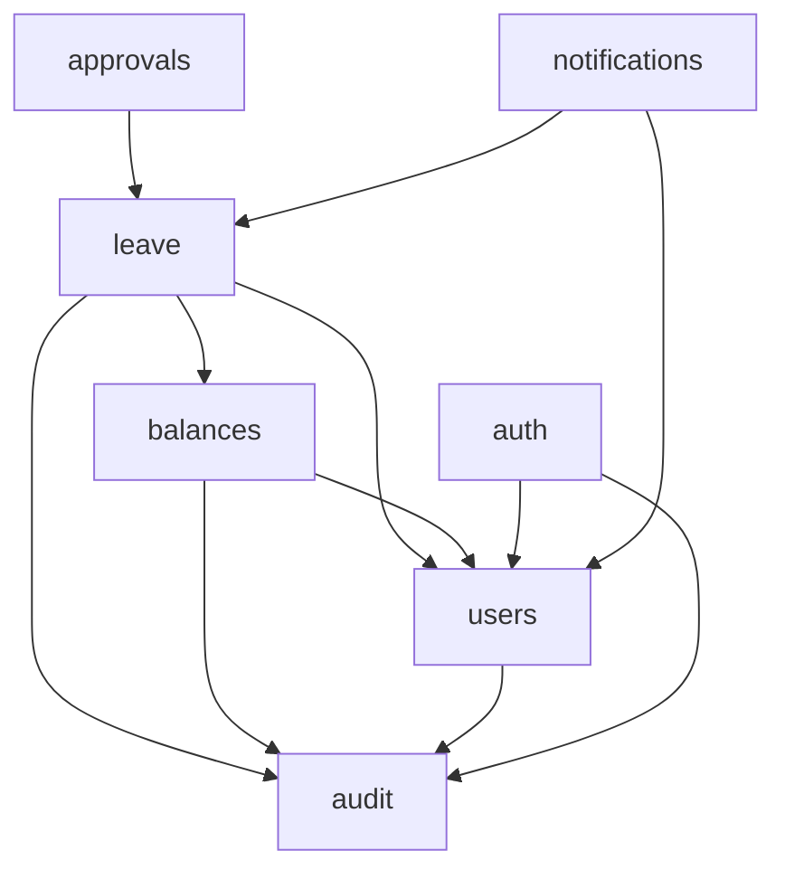
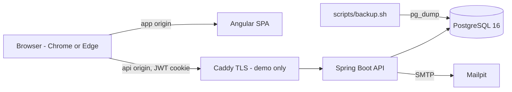
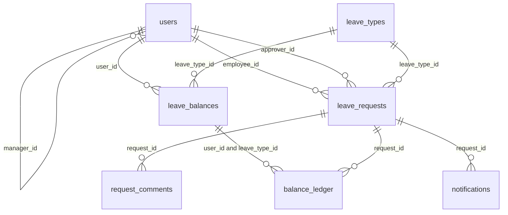

# Architecture Spine: emp-leave-tracker POC backend

## Design Paradigm

**Modular monolith.** It is one Spring Boot deployable, organized package-by-feature under `com.company.leave`. Each module's **root package is its public API**: one `*Service`, plus the DTO records, events and exceptions it exposes. The `internal/` and `web/` subpackages are private. Modules collaborate **synchronously** by calling each other's public service inside the caller's transaction. The only asynchronous seam is email, which runs after commit. Spring Modulith enforces the graph below: each module declares `allowedDependencies` in its `package-info.java`, and an `ApplicationModules.verify()` test fails the build on any undeclared edge, any cycle or any access to another module's internals.



Arrows mean "may call the public API of". `notifications → leave` also covers subscribing to `leave`'s events. `common` is a shared module that every module may use and that depends on no module: errors, `CurrentUser`, `Clock`, working days, `PasswordPolicy` and `PasswordEncoder`. `auth → audit` exists only so `auth` can register `audit`'s access-log filter in the security chain. `auth` never writes audit rows.

## Invariants & Rules

### AD-1: Module boundaries and public API [ADOPTED]

- **Binds:** all modules
- **Prevents:** modules reaching into another module's repositories or entities, cycles, and a mix of events and direct calls for the same flow.
- **Rule:** A module calls another module only through that module's root-package `*Service`, passing DTO records in and out. There is no `dto/` subpackage. JPA entities and repositories never leave `internal/`. **No SQL in one module may reference another module's tables**; foreign-key constraints are the only exception. The graph above is the complete allowed set, and adding an edge means amending this spine and the module's `allowedDependencies`.

### AD-2: Single owner per table

- **Binds:** all tables, all modules
- **Prevents:** two writers of one entity.
- **Rule:** Only the owning module issues INSERT/UPDATE/DELETE against its tables. Every other module reads and writes through the owner's service.

| Module | Owns (sole writer) | Serves |
| --- | --- | --- |
| `users` | `users` (including `email`, `full_name`, `failed_logins`, `locked_until`, `must_change_password`, `active`) | `/api/users/**`. `UserSummary(id, fullName, email, role, managerId)` is the only user DTO shared across modules. `UsersService.setPassword(userId, raw, mustChange)` is the only place passwords are hashed |
| `auth` | none | `/api/auth/**` (login, logout, change-password, csrf, me). Security filter chain, JWT encode/decode, cookie writer |
| `leave` | `leave_requests`, `request_comments` | `/api/requests/**` including history and comments, `/api/team/leave`. `getDecisionContext(id)` for FR11 |
| `approvals` | none | `/api/approvals/**`. Decisions go through `LeaveService` |
| `balances` | `leave_types`, `leave_balances`, `balance_ledger` | `/api/balances/**`, `/api/leave-types`, `GET /api/balances/{userId}/ledger` |
| `audit` | `audit_events`, `access_log` | `/api/audit`, the access-log filter |
| `notifications` | `notifications` | `/api/notifications` |

### AD-3: Transaction boundary

- **Binds:** all module services, controllers, `auth`
- **Prevents:** partial writes (status changed without a ledger or audit row), lazy loading in controllers, and bookkeeping lost to a rollback.
- **Rule:** `@Transactional` sits only on public module service methods. The use-case entry point opens the transaction and the other services it calls join it. Controllers are never transactional, and `spring.jpa.open-in-view=false`.
- **Exceptions, and the only ones:**
  - `AuthService.login` is **not** transactional. `UsersService.recordLoginFailure` and `recordLoginSuccess` each commit on their own, so lockout survives a failed login (FR57).
  - `access_log` rows and `notifications` rows are written in `REQUIRES_NEW`.

### AD-4: Leave request state machine

- **Binds:** `leave`, `approvals`, FR4, FR7, FR8, FR12, FR13
- **Prevents:** illegal transitions, edits after a decision, a race between approve and cancel, and two code paths that change status.
- **Rule:**
  - Status is one of `PENDING`, `APPROVED`, `REJECTED` or `CANCELLED`.
  - The only transitions are:
    - submit → `PENDING`
    - `PENDING` → `APPROVED` or `REJECTED`, by the approver
    - `PENDING` → `CANCELLED`, by the owner
  - Edits are allowed only while `PENDING`, only by the owner, and **may not change `leave_type_id`** (400 `LEAVE_TYPE_CHANGE_NOT_ALLOWED`).
  - Reject requires a non-blank comment (400 `COMMENT_REQUIRED`). The decision comment is stored only in `leave_requests.decision_comment` and the decision's audit row, never in `request_comments`.
  - Every transition and edit first locks the request row (`PESSIMISTIC_WRITE`) and re-checks the status. A loser gets 409 `INVALID_TRANSITION`.
  - Terminal states are immutable. Requests are never deleted.
  - All transitions live in one place inside `leave`.

### AD-5: Approver snapshot and decision authority

- **Binds:** `leave`, `approvals`, `users`, FR10, FR16, FR17, FR19
- **Prevents:** one unit authorizing decisions against `approver_id` while another uses the live `manager_id`.
- **Rule:**
  - **Setting the approver at submit:** `approver_id` is the requester's own id when the requester's role is `HR_ADMIN` (self-approval). Otherwise it is the requester's `manager_id`.
  - **Manager links:** every non-HR user has a `manager_id`, and top-level managers point to an HR user.
  - **Deciding:** approve and reject are allowed only when the caller is `approver_id`. The Pending dashboard lists by `approver_id`. A self-approval writes `selfApproved: true` in the audit details.
  - **Team visibility** (FR14, FR23) uses the live `manager_id`. Decision authority uses `approver_id` only.

### AD-6: Balance mutation and the no-negative rule

- **Binds:** `balances`, `leave`, FR6, FR12, FR13, FR27–FR31
- **Prevents:** double-spending through concurrent submissions, negative balances, untracked changes, and different meanings of "total" or of ledger signs.
- **Rule:**
  - `leave_balances` has one row per (user, leave type), and a missing row means 0 days available. `available = total_days − reserved_days`.
  - Every operation locks the balance row (`PESSIMISTIC_WRITE`), then writes exactly one `balance_ledger` row in the same transaction.
  - `change_days` is the signed change to the column the operation touches:

| Operation | total_days | reserved_days | Ledger kind | change_days |
| --- | --- | --- | --- | --- |
| Submit | unchanged | + n (refused if n > available) | `reserve` | + n |
| Edit with delta ≠ 0 | unchanged | + delta (refused if delta > available) | `reserve` / `release` | ± delta |
| Approve | − n | − n | `deduct` | − n |
| Reject / cancel | unchanged | − n | `release` | − n |
| HR set | := x (refused if x < reserved) | unchanged | `set` | x − old total |
| HR adjust | ± x (refused if result < reserved) | unchanged | `adjust` | ± x |

  - An edit with delta 0 makes no balance call and writes no ledger row.
  - A refusal returns 409 `INSUFFICIENT_BALANCE`.
  - A database `CHECK (reserved_days >= 0 AND reserved_days <= total_days)` is the backstop.
  - HR set and adjust require a non-empty reason.

### AD-7: Audit trail

- **Binds:** all writing modules, `audit`, FR9, FR16, FR42–FR45, FR47
- **Prevents:** missing or duplicate audit rows, rows that differ in shape for the same action, and edited history.
- **Rule:**
  - **Exactly one audit row per use case per aggregate**, written by the module that owns that aggregate, through `AuditService.record(entity, entityId, action, actorId, details)`, inside the business transaction.
  - `approvals` and `auth` never write audit rows. Balance operations nested inside a leave use case are recorded by the ledger only.
  - `details` uses exactly the camelCase keys in the catalog below. Adding an action means adding a row to the catalog.
  - **History (FR45)** is served by `leave`: the audit rows for `LEAVE_REQUEST` with that request id merged with `request_comments` by `createdAt`, unpaged.
  - A Postgres trigger rejects UPDATE and DELETE on `audit_events`, `access_log` and `balance_ledger`. No purge code exists anywhere.

| Action | entity / entityId | details keys |
| --- | --- | --- |
| `LEAVE_REQUEST_SUBMITTED` | `LEAVE_REQUEST` / request id | `leaveTypeId`, `startDate`, `endDate`, `workingDays` |
| `LEAVE_REQUEST_EDITED` | `LEAVE_REQUEST` / request id | `startDate`, `endDate`, `workingDays`, `notesChanged` |
| `LEAVE_REQUEST_CANCELLED` | `LEAVE_REQUEST` / request id | none |
| `LEAVE_REQUEST_APPROVED` | `LEAVE_REQUEST` / request id | `comment`, `selfApproved` |
| `LEAVE_REQUEST_REJECTED` | `LEAVE_REQUEST` / request id | `comment`, `selfApproved` |
| `REQUEST_COMMENT_ADDED` | `REQUEST_COMMENT` / comment id | `requestId` |
| `LEAVE_BALANCE_SET` | `LEAVE_BALANCE` / user id | `leaveTypeId`, `totalDays`, `reason` |
| `LEAVE_BALANCE_ADJUSTED` | `LEAVE_BALANCE` / user id | `leaveTypeId`, `changeDays`, `reason` |
| `USER_CREATED` | `USER` / user id | `role`, `managerId` |
| `USER_PASSWORD_RESET` | `USER` / user id | none |
| `USER_PASSWORD_CHANGED` | `USER` / user id | none |
| `USER_LOCKED` | `USER` / user id | `lockedUntil` |

### AD-8: Authorization and access logging

- **Binds:** every endpoint, every permission bean, FR21–FR26, FR59
- **Prevents:** authorization logic scattered across inline SpEL and services, inconsistent 403/404 responses, denials that go unlogged, and internal calls (e.g. the email listener) being denied.
- **Rule:**
  - **Where checks live:**
    - Every controller method has a `@PreAuthorize`. Role-only checks may be inline (`hasRole('HR_ADMIN')`).
    - Record-level checks live **only** in that resource's permission bean, which sits in the owning module's `web/`: `@leavePermissions`, `@balancePermissions`, `@userPermissions`.
    - Module services never consult the `SecurityContext` for scope. They trust their caller and take an explicit `actorId`.
  - **Single-request permissions:**
    - `canView` = owner, `approver_id`, the owner's live manager, or any HR user.
    - `canEdit` and `canCancel` = owner.
    - `canDecide` = `approver_id`.
    - `canComment` = `canView`, in any status.
  - **Missing or out-of-scope records:** a permission bean returns false for a missing record, so the response is 403. A 404 is used only for unknown routes.
  - **List scope is per endpoint:**

| Endpoint | Scope |
| --- | --- |
| `GET /api/requests`, `/api/balances/me`, `/api/notifications` | caller only, every role |
| `GET /api/approvals/pending` | `approver_id = caller` |
| `GET /api/team/leave` | caller's live direct reports |
| `GET /api/balances`, `/api/users`, `/api/audit`, ledger | HR only, everyone |

  - **Access logging:** `audit`'s access-log filter is the only writer of `access_log`. It is registered inside the security chain right after the bearer-token authentication filter. It captures the actor before the request and the status after, and it writes in its own transaction. It writes:
    - `allowed=false` for every 403;
    - `allowed=true` for sensitive reads: request detail, history and comments; balances; users; audit;
    - `resource` as one of `LEAVE_REQUEST`, `BALANCE`, `USER`, `AUDIT`, `NOTIFICATION`.
  - Hiding features in the UI is never treated as a security control.

### AD-9: Authentication with a stateless JWT cookie [ADOPTED]

- **Binds:** `auth`, `users`, `common`, all endpoints, FR20, FR55–FR58
- **Prevents:** tokens in `localStorage`, two writers of the auth cookie, roles that never match, and a forced password change being bypassed.
- **Rule:**
  - **Token:** `POST /api/auth/login` issues an HS256 JWT. `auth` declares its own `NimbusJwtEncoder`/`NimbusJwtDecoder` beans using `JWT_SECRET`, a key of at least 32 bytes.
  - **Claims:** `sub` (user id), `role`, `must_change_password`, `auth_time`.
  - **Principal:** `auth`'s `JwtAuthenticationConverter` maps `role` to the single authority `ROLE_<role>`. Code reads the caller **only** through `common`'s `CurrentUser` (`long id()`, `Role role()`).
  - **Cookie:**
    - The token travels only in an `HttpOnly; Secure; SameSite=Strict` cookie, read by a custom cookie `BearerTokenResolver`.
    - **One `AuthCookieWriter` in `auth` is the only code that sets or clears this cookie.**
    - Sliding re-issue (`exp = now + 30 min`, never beyond `auth_time + 8 h`) runs before the handler and skips login, logout and change-password, which write the cookie themselves.
  - **Forced password change:** a token with `must_change_password=true` gets 403 `PASSWORD_CHANGE_REQUIRED` everywhere except `/api/auth/change-password`, `/api/auth/logout` and `/api/auth/me`.
  - **Lockout:**
    - 5 consecutive failures set `locked_until = now + 15 min`, and a success resets the counter (both per AD-3).
    - Unknown user, wrong password, a locked account and an inactive account all return 401 `INVALID_CREDENTIALS`.
  - **Passwords:** `common`'s `PasswordPolicy` (at least 8 characters, letters and numbers) and its BCrypt `PasswordEncoder` are the only implementations.
  - **Accepted risk:** there is no server-side revocation. A copied token stays valid for up to 30 minutes after logout, a password reset, deactivation or a role change.

### AD-10: Origins, CORS and CSRF [ADOPTED]

- **Binds:** `auth` security chain, the contract between SPA and API
- **Prevents:** wildcard CORS, cookies silently not being sent, and CSRF protection silently switched off for cookie-authenticated requests.
- **Rule:**
  - **Origins:** the SPA and the API run on separate origins that **share one registrable domain**: `localhost:4200` / `localhost:8080` in dev, `app.` / `api.` subdomains in production. A cross-site deployment is outside this contract.
  - **CORS:** the allow-list is the explicit origins in `CORS_ALLOWED_ORIGINS`, with credentials allowed and never a wildcard.
  - **CSRF:**
    - CSRF tokens are stored in a cookie through `CookieCsrfTokenRepository`, never in a server session.
    - The SPA gets the token from `GET /api/auth/csrf`, which returns it in the response body, and sends it as `X-XSRF-TOKEN` on every state-changing request, including login.
    - **The security chain must not exempt cookie-carried JWTs from CSRF.** Spring's `oauth2ResourceServer()` configurer skips CSRF whenever a bearer token is resolved, so the bearer-token filter is wired without that exemption.
    - A test asserts that a POST with a valid cookie but no `X-XSRF-TOKEN` returns 403 `CSRF_INVALID`.

### AD-11: Email after commit

- **Binds:** `notifications`, `leave`, FR50–FR54
- **Prevents:** emails sent for rolled-back actions, approvals failing or hanging because of SMTP, and emails sent to the wrong person.
- **Rule:**
  - **Events:** `leave` publishes `LeaveRequestSubmitted`, `LeaveRequestApproved` and `LeaveRequestRejected`. They carry only ids and are exposed in `leave`'s root package. Comments publish nothing (FR15).
  - **Listener:** `notifications` handles them with `@TransactionalEventListener(phase = AFTER_COMMIT)`. The listener:
    - loads details through `LeaveService` and `UsersService`;
    - sends through the `NotificationSender` interface (SMTP to Mailpit), with `spring.mail` connect, read and write timeouts of 5 s;
    - writes the `notifications` row in `REQUIRES_NEW`;
    - **catches every exception and logs it**, so a committed action never returns an error.
  - **Recipients:** "submitted" goes to `approver_id` and is skipped when the approver is the requester. "Approved" and "rejected" go to the requester.
  - **Links:** email links use `APP_BASE_URL`.
  - Spring Modulith's event-publication starters are not added.
  - **Accepted risk:** an email is lost if SMTP fails or the app crashes after commit.

### AD-12: Working-day computation

- **Binds:** `leave`, `balances`, `common`, FR1, FR2
- **Prevents:** the client and server, or two modules, counting days differently.
- **Rule:** `working_days` is the number of Monday–Friday dates in `[start_date, end_date]`, inclusive and whole days only, with holidays ignored. It is computed only by `common`'s working-day function, on the server, at submit and edit. It is stored on the request and reused unchanged for every balance operation and audit row. A request with zero working days or with `end_date < start_date` returns 400 `VALIDATION_FAILED`.

### AD-13: Schema migrations, reference data and seed data [ADOPTED]

- **Binds:** all modules, `backend/src/main/resources/db/`
- **Prevents:** version collisions, schema changes outside Flyway, a demo seed that breaks a later migration, clashes between shared database functions, and environments with no leave types or no admin.
- **Rule:**
  - **Schema:** Flyway is the only thing that changes the schema, and Hibernate runs with `ddl-auto=validate`.
  - **Versioned migrations:** named `V<yyyyMMddHHmm>__<module>_<description>.sql` in `db/migration`. Each file touches only the tables and database functions of the module it names, and database functions carry that module's name as a prefix (e.g. `audit_reject_mutation`). Applied migrations are never edited. `spring.flyway.out-of-order=true` in the `dev` profile only.
  - **Leave types:** Vacation, Sick, Parental and Sabbatical are reference data inserted by a versioned `balances` migration.
  - **First HR admin:** created at startup from `BOOTSTRAP_ADMIN_USERNAME`, `BOOTSTRAP_ADMIN_EMAIL` and `BOOTSTRAP_ADMIN_PASSWORD`, only if no HR user exists, and with `must_change_password=true`.
  - **Demo seed:** the demo users, team and balances are a single idempotent, repeatable `db/seed/R__demo_seed.sql`, which Flyway runs after all versioned migrations. That location is added only by the `demo` profile.

## Consistency Conventions

| Concern | Convention |
| --- | --- |
| Naming | DB: `snake_case` with plural tables. Java: `com.company.leave.<module>`, plus `.internal` and `.web`. Roles: `EMPLOYEE`, `MANAGER`, `HR_ADMIN` |
| IDs | `bigint` identity columns, serialized as JSON numbers |
| Dates & times | Leave dates are ISO `LocalDate`. Timestamps are `timestamptz`, serialized as ISO-8601 UTC. "Now" comes only from the injected `Clock` |
| API shape | Prefix `/api` with no version segment. JSON fields in camelCase, enums as `UPPER_SNAKE` strings. Bodies are Java records, never entities. Paged lists (audit search, notifications) return Spring Data `PagedModel` explicitly |
| Errors | `common` defines `ApiException(HttpStatus, code)`. Modules throw its subclasses and **never declare exception handlers**. A single `@RestControllerAdvice` in `common`, plus the security chain's entry point and access-denied handler, all write the same RFC 9457 `ProblemDetail` with a `code` field |
| Error codes | 400 `VALIDATION_FAILED`, `COMMENT_REQUIRED`, `LEAVE_TYPE_CHANGE_NOT_ALLOWED` · 401 `UNAUTHENTICATED`, `INVALID_CREDENTIALS` · 403 `ACCESS_DENIED`, `CSRF_INVALID`, `PASSWORD_CHANGE_REQUIRED` · 404 `NOT_FOUND` (routes only) · 409 `INSUFFICIENT_BALANCE`, `INVALID_TRANSITION` |
| Validation | Bean Validation on request records at the controller. Business rules (balance, transitions) are checked in services. Scope is checked in permission beans (AD-8) |
| Config & secrets | Settings come from environment variables: `DB_URL`, `DB_USERNAME`, `DB_PASSWORD`, `JWT_SECRET`, `CORS_ALLOWED_ORIGINS`, `MAIL_HOST`, `MAIL_PORT`, `APP_BASE_URL`, `BOOTSTRAP_ADMIN_*`. `application.yml` holds non-secret defaults only. Profiles: `dev` (default), `demo`, `test` |
| Logging | Logs go to stdout. Logs never contain passwords, tokens or request notes |
| Tests | Postgres in Testcontainers, never H2. The suite always includes Modulith `verify()`, one RBAC test per acceptance scenario 6–9, the audit-trigger test (scenario 13), the lockout test (scenario 14) and the CSRF-rejection test |

## Stack

| Name | Version |
| --- | --- |
| Java | 21 |
| Spring Boot (parent; scaffold bumped from 4.0.8) | 4.1.1 |
| Spring Modulith (`spring-modulith-bom`, core + test only) | 2.1.1 |
| Spring Security + `spring-boot-starter-security-oauth2-resource-server` | managed by Boot 4.1.1 |
| Flyway, Hibernate, Testcontainers, Lombok | managed by Boot 4.1.1 |
| PostgreSQL (image tag) | 16 |
| Mailpit (image tag) | v1.31 |
| Caddy (image tag, demo TLS) | 2.11 |
| Build | Maven wrapper (existing) |

## Structural Seed



| Environment | How it runs |
| --- | --- |
| dev | Postgres and Mailpit via `docker compose`. The API via `./mvnw spring-boot:run` (profile `dev`, http on localhost, which Chrome and Edge treat as a secure context for `Secure` cookies). The SPA via `ng serve` on :4200 |
| demo | Full `docker compose up`: postgres (waits for `pg_isready`), mailpit, backend, frontend and caddy, with profile `demo` (seed data plus TLS) |
| production | Out of POC scope (see Deferred) |



```text
./                                  # repo root (= PRD's leave-poc/)
  backend/                          # existing Initializr scaffold, moved here
    pom.xml  mvnw
    src/main/java/com/company/leave/
      common/                       # errors, CurrentUser, Clock, working days, PasswordPolicy
      auth/ users/ leave/ approvals/ balances/ audit/ notifications/
        package-info.java           # @ApplicationModule(allowedDependencies = ...)
        <Module>Service.java  *Dto.java  *Event.java   # public API (root package)
        internal/                   # entities, repositories, impl
        web/                        # controllers, permission beans
    src/main/resources/
      application.yml
      db/migration/   db/seed/      # AD-13
      templates/email/
    src/test/java/...               # Testcontainers, Modulith verify, RBAC
  frontend/                         # Angular (out of scope here)
  scripts/backup.sh
  docker-compose.yml
```

Endpoints added beyond the PRD list: `GET /api/auth/csrf`, `GET /api/auth/me`, `GET /api/leave-types`, `GET /api/balances/{userId}/ledger` (HR).

## Capability → Architecture Map

| Capability / Area | Lives in | Governed by |
| --- | --- | --- |
| Submit, edit, cancel, status, history (FR1–FR9) | `leave` | AD-4, AD-6, AD-7, AD-12 |
| Pending dashboard, context, approve/reject, team view, comments (FR10–FR17) | `approvals`, `leave` | AD-4, AD-5, AD-8 |
| Accounts, roles, manager link, password reset (FR18–FR20) | `users` | AD-2, AD-5, AD-9, AD-13 |
| RBAC, scoping, access log (FR21–FR26, FR59) | permission beans, `auth` chain, `audit` filter | AD-8 |
| Balances, ledger, no-negative rule (FR27–FR31) | `balances` | AD-6 |
| Audit, History tab, retention (FR42–FR45, FR47) | `audit`, `leave` (History) | AD-7 |
| Email and notification history (FR50–FR54) | `notifications` | AD-11 |
| Login, lockout, timeout, HTTPS (FR55–FR58) | `auth`, `users`, Caddy | AD-3, AD-9, AD-10 |
| Backups (FR46, FR60, FR61) | `scripts/backup.sh` | Deferred |

## Deferred

- **Token revocation** (logout, reset or deactivation taking effect immediately): an accepted risk under AD-9. Revisit before production, e.g. with a `token_version` check.
- **Email retry and outbox:** an accepted risk under AD-11. Production swaps the `NotificationSender` implementation and adds a retry queue.
- **Backup scheduling:** `backup.sh` runs `pg_dump` against the compose Postgres and writes `backups/leave-YYYY-MM-DD.sql.gz`. The daily trigger (cron or Windows Task Scheduler) is documented in the README. Restore is documented but untested (FR61).
- **Caddy routing detail** (hostnames and ports per origin in demo): it can't cause divergence because AD-10 fixes the contract.
- **Health and readiness endpoints** (Actuator): not needed for the local demo, and to be added with production monitoring.
- **Production envelope:** cloud hosting, IaC, CI/CD, managed TLS, encryption at rest, managed backups and DR, APM, alerting, log shipping, caching, load testing and OWASP testing (per the PRD's deferred table).
- **Phase 2:** before/after audit values (`details` has room for them), audit export, reports, balance history view, carryover, public holidays (would change AD-12), comment notifications, multi-level approval (would change AD-5).
- **Login rate limiting** beyond lockout, and API versioning: not needed at POC scale.
