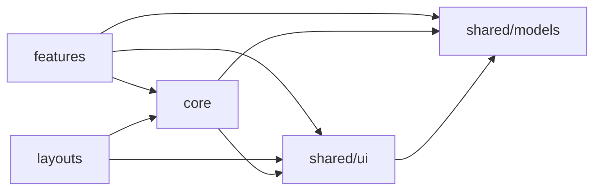
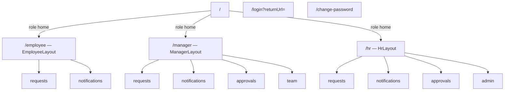
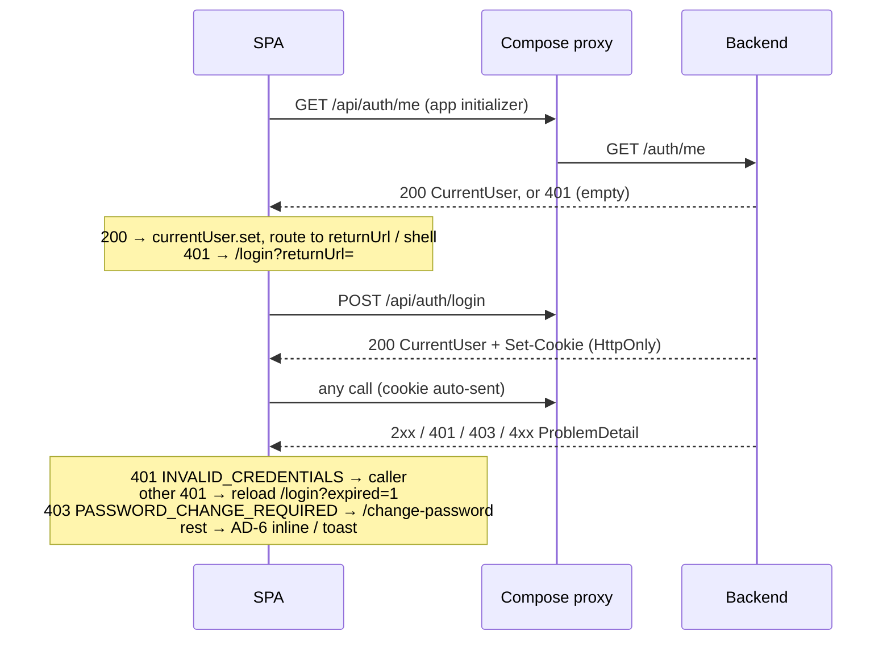

# Architecture Spine — company-leave-frontend

## Design Paradigm

**Signals-first standalone Angular SPA.** Standalone components only, OnPush, and zoneless change detection. State lives in services as `signal()` / `computed()`, with no store library. Reads use `httpResource()` keyed on data-version signals, and writes use `HttpClient`. The layers are `models ← shared/ui ← core ← features/layouts` (each arrow points at a layer the one beside it may import). Three role-based shells mount the same shell-agnostic feature routes. The backend is the security boundary; the frontend only shapes the UX.

## Inherited Invariants

| Inherited | From parent | Binds here |
| --- | --- | --- |
| AD-7 — JWT in HttpOnly/Secure/SameSite=Strict cookie | company-leave-backend | Frontend never reads, stores or sends a token; no `Authorization` header. The browser attaches the cookie to same-origin `/api` calls. |
| AD-8 — 30-min idle timeout via active-session registry | company-leave-backend | Expiry surfaces only as an empty-body 401 on the next call; the frontend runs no idle timer (AD-6). |
| AD-10 — RBAC `EMPLOYEE` / `MANAGER` / `HR_ADMIN`, enforced server-side | company-leave-backend | Guards, hidden nav and hidden buttons are UX only; a 403 `ACCESS_DENIED` must still render (AD-6). |
| AD-11 — RFC 7807 `ProblemDetail` with canonical `code` | company-leave-backend | `code` is the only branching key for error UX, and `detail` is the displayed text. The code values are those in `openapi.yaml` (`ACCESS_DENIED`, …), which `common.ErrorCode` mirrors. |
| AD-13 — reverse proxy is the only HTTPS ingress | company-leave-backend | SPA and API share one origin; the proxy strips `/api` before the backend. No CORS, no absolute API URLs (AD-12). |

## Invariants & Rules

### AD-1 — State: signals in route-scoped feature services, no store library

- **Binds:** all services and components
- **Prevents:** competing state models (store vs services), and root-singleton feature state that survives navigation or a user switch and shows stale or another user's data.
- **Rule:** a feature's API-backed state lives in its `*.service.ts` as `httpResource()` refs plus `signal()` / `computed()`. The service is provided in the feature route's `providers`, never `providedIn: 'root'`. Components inject services, read signals, and hold only view-local state. Cross-feature state lives only in `core/` root singletons: `AuthService`, `DataVersionService`, `LeaveTypeService`, `ToastService`. No global store and no `BehaviorSubject` state holders.

### AD-2 — Organization and layering

- **Binds:** `shared/`, `core/`, `layouts/`, `features/*`
- **Prevents:** features coupling to each other (e.g. `approvals` importing `requests`), and the `shared` ↔ `core` import cycle that appears once shared UI needs a core service.
- **Rule:** everything is standalone. Each `features/<name>/` exposes one lazy `<name>.routes.ts`. Import direction is strictly the diagram below; a feature never imports another feature.
  - **`shared/models`:** generated API types (AD-10). Imports nothing.
  - **`shared/ui`:** stateless, injection-free components and pipes such as `StatusBadge`, `BalanceCard`, `HistoryTimeline`, `CommentThread` and enum label pipes. Inputs and outputs only.
  - **`core`:** root services, guards and the interceptor, plus `core/ui` for components and pipes that inject a core service: `ToastOutlet`, `LoadError`, `ConfirmDialog`, `LeaveTypeNamePipe`.



### AD-3 — Routing: role shells, shell-agnostic features, one link builder

- **Binds:** `app.routes.ts`, `layouts/`, `core/auth/`, `core/routing/`, all features
- **Prevents:** the same feature behaving differently per shell, builders disagreeing on who sees what, and hard-coded or conflicting cross-feature URLs (e.g. links from a notification, an approval or the audit trail to a request).
- **Rule:**
  - **Outside the shells:** `/login` and `/change-password` (the latter guarded by `authGuard`).
  - **`/`** redirects to the current role's shell home, `<shell>/requests`.
  - **Shells:** `/employee`, `/manager` and `/hr`, each with `canActivate: [authGuard, passwordChangeGuard, roleGuard(role)]`. A wrong-role URL is rewritten to the same child path under the user's own shell if the role has that feature, otherwise to the shell home.
  - **Feature routes:** every shell mounts the **same** feature `*.routes.ts` per the table. Request detail (with History and comments) has one canonical path, `<shell>/requests/:requestId`, viewable by owner, manager and HR.
  - **Links:** all cross-feature URLs come from `core/routing/AppLinks` (`requestDetail(id)`, `myRequests()`, `approvals()`, …), which resolves the current shell. In-feature links are relative.

| Feature route | EMPLOYEE | MANAGER | HR_ADMIN |
| --- | --- | --- | --- |
| `requests` (my requests, submit/edit/cancel, `:requestId` detail, my balances) | ✓ | ✓ | ✓ |
| `notifications` | ✓ | ✓ | ✓ |
| `approvals` (pending list with context panel, approve/reject) | — | ✓ | ✓ |
| `team` (approved team leave by date range) | — | ✓ | — |
| `admin` (users, balances + ledger, audit) | — | — | ✓ |



### AD-4 — Auth: `GET /auth/me` at startup, nothing in browser storage

- **Binds:** `core/auth/`, `features/login`, `app.config.ts`
- **Prevents:** logging users out on refresh or deep link, which breaks PRD scenarios 5 and 9, and auth state in browser storage drifting from the server session.
- **Rule:**
  - **State:** `AuthService.currentUser` is a `signal<CurrentUser | null>`. It is set only from a 200 on `GET /api/auth/me` (fired once by `provideAppInitializer` before routing) or on `POST /api/auth/login`.
  - **Signed out:** with no user, `authGuard` redirects to `/login?returnUrl=<url>`. After login the app navigates to `returnUrl` if it lies inside the user's own shell, otherwise to the shell home.
  - **Temporary password:** while `mustChangePassword` is true, `passwordChangeGuard` permits only `/change-password`. A 204 there sets it to false and goes to the shell home.
  - **Logout:** calls `POST /api/auth/logout`, then does a full page load of `/login` so no in-memory state survives.
  - **Storage:** nothing auth-related is ever written to `localStorage` or `sessionStorage`.
  - **Login errors** render inline on the form: 401 `INVALID_CREDENTIALS`, and 423 `ACCOUNT_LOCKED` with its `detail`.

### AD-5 — API access and freshness: `httpResource()` reads keyed on data versions, writes bump versions

- **Binds:** all feature services, `core/data/`
- **Prevents:** stale screens after a write in another feature (e.g. HR approving their own request in `approvals` while My Requests and My Balances still show it as pending), with no way to fix it without a feature-to-feature import (AD-2).
- **Rule:**
  - **Who calls the API:** only services touch `HttpClient` / `httpResource()`. All URLs are relative to `/api`.
  - **Versions:** `core/data/DataVersionService` holds one version signal per data area: `requests`, `balances`, `approvals`, `notifications`, `users`, `audit`.
  - **Reads:** every `httpResource` request function reads the version(s) of the areas it shows, so a bump refetches it.
  - **Writes:** mutations are service methods returning `Observable<T>`. On success, **and on 409**, they bump every affected area: submit, edit or cancel → requests + balances; approve or reject → requests, balances, approvals, notifications; comment → requests + approvals; user create/reset → users; balance set/adjust → balances.
  - **Not allowed:** optimistic updates, list patching and polling. Comments refresh on navigation, page refresh or an in-page Refresh action (FR15).

### AD-6 — Errors: classify by `code`, show each error exactly once

- **Binds:** `core/interceptors/`, `core/errors/`, `core/ui/`, all features
- **Prevents:** wrong-password 401s being treated as session expiry (and vice versa), redirect-plus-toast double reporting, and read failures disappearing silently, since `httpResource` errors never reach `ErrorHandler`.
- **Rule:**
  - **Interceptor:** one functional `authInterceptor`.
    - A 401 whose body `code` is `INVALID_CREDENTIALS` passes through to the caller.
    - Any other 401 is session expiry: full page load of `/login?returnUrl=…&expired=1`, which shows "Your session expired", and the error is swallowed (`EMPTY`).
    - A 403 `PASSWORD_CHANGE_REQUIRED` navigates to `/change-password` and is swallowed.
    - Everything else passes through. The interceptor shows no UI and never matches on URL.
  - **Reads:** a page renders `resource.error()` once, at page level, via `core/ui/LoadError`. It shows `ProblemDetail.title`/`detail`, or a generic message for non-ProblemDetail errors. This covers 403 `ACCESS_DENIED` (scenario 9) and 404. Templates read `value()` only behind `hasValue()`, because `value()` throws on an errored resource and that would also reach `ErrorHandler`.
  - **Writes:** a component passes an `error` callback only for the codes it renders inline: `INSUFFICIENT_BALANCE`, `INVALID_TRANSITION`, `COMMENT_REQUIRED`, `LEAVE_TYPE_CHANGE_NOT_ALLOWED`, and `VALIDATION_FAILED` at form level. Any other code goes to `ToastService.showProblem(err)`. A subscription with no `error` callback reaches the custom `ErrorHandler` through `provideBrowserGlobalErrorListeners()`, which toasts `detail`.
  - **Busy state:** busy flags are cleared in `finalize()`.

### AD-7 — Styling: Tailwind 4 utilities + Angular CDK behaviour, tokens in one place

- **Binds:** all templates, `shared/ui`, `core/ui`, `src/styles.css`
- **Prevents:** hand-rolled inaccessible dialogs, overlays and focus handling (the PRD requires keyboard navigation on main flows), and colour/spacing values drifting across components.
- **Rule:**
  - **Styling:** Tailwind utility classes in templates only. No per-component stylesheets beyond a rare `:host` rule, and no component-library CSS.
  - **Configuration:** Tailwind 4 CSS-first, scaffolded with `ng new --style=tailwind`. `.postcssrc.json` registers `@tailwindcss/postcss`; `src/styles.css` holds `@import "tailwindcss";` and a single `@theme` block of tokens, including one colour per `RequestStatus`. There is no `tailwind.config.*`, and no arbitrary hex values in templates.
  - **Behaviour:** dialogs, overlays, focus traps and the live announcer come from Angular CDK, only through `core/ui` wrappers (`ConfirmDialog`, `ToastOutlet`, mounted once in the app root). Features never use CDK overlays directly.

### AD-8 — Forms: Signal Forms only, server is the validation authority

- **Binds:** every form (login, change-password, submit/edit request, comment, decision, create user, set/adjust balance)
- **Prevents:** two form paradigms, and client and server disagreeing on rules or on value shapes (dates shifting by a day, `""` vs `null`).
- **Rule:**
  - **API:** Signal Forms from `@angular/forms/signals` (`form()` plus the `[formField]` directive). No `ReactiveFormsModule` or `FormsModule`.
  - **Client validation:** client validators only mirror the documented server rules. These are: required fields; end ≥ start; password ≥ 8 characters with letters and numbers; non-blank reject comment; reason required for balance set/adjust; manager required unless the role is HR_ADMIN. The server response stays authoritative (AD-6).
  - **Dates:** date fields are native `<input type="date">`, whose `yyyy-MM-dd` string is sent unchanged, never via `Date`.
  - **Optional text:** trimmed, and sent as `null` when blank.
  - **Server values only:** the UI never computes working days or availability for a decision; it shows the server's `workingDays` / `availableDays`.
  - **Edit form:** reuses the submit form with leave type read-only.
  - **Labels:** every input has a `<label>`.

### AD-9 — Testing: lean Vitest units + Playwright journeys against the real stack

- **Binds:** `core/`, all features, `e2e/`
- **Prevents:** test effort spread across DOM detail while the cross-cutting auth, error and freshness paths, where regressions hurt most, go untested.
- **Rule:**
  - **Unit (Vitest):** tests for `AuthService` (including the `/auth/me` bootstrap), `authInterceptor` (401 classified by code, `PASSWORD_CHANGE_REQUIRED`), the guards with `returnUrl`, `DataVersionService`, `AppLinks`, `ErrorHandler` and `ToastService`. Feature components get render smoke tests only.
  - **E2E (Playwright):** runs against `docker compose` at `https://localhost` (`ignoreHTTPSErrors`) with seeded users. It covers three journeys:
    1. Submit → manager approves → balance and History update (scenarios 1, 3).
    2. An employee deep-links to another employee's request and sees the access-denied state (scenario 9).
    3. An over-balance submit shows inline `INSUFFICIENT_BALANCE` (scenario 10).
  - **No snapshot tests.**

### AD-10 — API types are generated from `openapi.yaml`, never hand-written

- **Binds:** `shared/models/`, every consumer of API data
- **Prevents:** two builders hand-writing different interfaces for one schema, or the types silently drifting from the spec.
- **Rule:**
  - **Generation:** `npm run gen:api` runs `openapi-typescript ../backend/src/main/resources/openapi.yaml --properties-required-by-default -o src/app/shared/models/api.ts`. It produces types only. The output is committed and never hand-edited.
  - **Install:** `package.json` carries `"overrides": { "openapi-typescript": { "typescript": "$typescript" } }`, because openapi-typescript 7.13 declares a TypeScript 5 peer dependency.
  - **Imports:** `shared/models/index.ts` re-exports named aliases (`export type LeaveRequest = components['schemas']['LeaveRequest']`). Code imports only these aliases.
  - **Spec changes:** any spec change regenerates `api.ts` in the same change, and generation failing on a dangling `$ref` blocks the change.
  - **View types** may wrap generated types but never re-declare their fields.

### AD-11 — Display: names, never raw ids

- **Binds:** all templates, `core/reference/`, pipes
- **Prevents:** screens showing `#3` or hard-coded leave-type ids, which contradicts the PRD rule that people appear as username plus a readable role.
- **Rule:**
  - **People on non-HR screens:** use the API's `*Username` fields (`employeeUsername`, `approverUsername`, `authorUsername`, `actorUsername`).
  - **People on HR admin screens:** resolve `userId` / `actorId` / `managerId` through the admin feature's `GET /api/users` resource.
  - **Leave types:** `core/reference/LeaveTypeService`, a root `httpResource` on `GET /api/leave-types` loaded once per session, plus `LeaveTypeNamePipe`. A `leaveTypeName` field, where the API provides one, may be shown directly.
  - **Roles and enums:** roles via `RoleLabelPipe` (`HR_ADMIN` → "HR Admin"); each enum via one label pipe.
  - **Dates:** dates (`yyyy-MM-dd`) are shown as calendar dates with no timezone conversion; date-times are shown in browser local time.

### AD-12 — Dev and deploy envelope: same-origin `/api` through the compose proxy

- **Binds:** `environments/`, `proxy.conf.json`, `frontend/Dockerfile`, `frontend/nginx.conf`, the compose `frontend` service
- **Prevents:** absolute backend URLs or CORS/`withCredentials` workarounds that break the SameSite=Strict cookie, a dev proxy pointed at a backend that isn't exposed, and deep links returning 404 in nginx.
- **Rule:**
  - **API base:** the relative path `/api` in every environment; no file holds a backend host.
  - **Local dev:** `ng serve` proxies `/api` to the running compose proxy, `https://localhost`, with `secure: false`, `changeOrigin: true` and no path rewrite. The compose proxy strips `/api`, and the backend is not exposed.
  - **Build:** `frontend/Dockerfile` is a multi-stage build: Node build → `nginx` serving the `browser` output, with `try_files $uri $uri/ /index.html`. The compose proxy routes `/api/` → backend and everything else → frontend.
  - **Not used:** CORS, `withCredentials`, frontend secrets, and any environment beyond one.

### AD-13 — Action gating and list scoping mirror server rules

- **Binds:** `features/requests`, `features/approvals`, `features/admin`
- **Prevents:** builders gating the same action differently (e.g. Edit shown on a manager's view of a report's request), and "My Requests" showing other people's rows because unfiltered `GET /requests` returns team or all requests for managers and HR.
- **Rule:**
  - **My Requests:** always calls `GET /api/requests?employeeId=<currentUser.id>`.
  - **Edit and Cancel:** rendered only when `status === 'PENDING' && employeeId === currentUser.id`.
  - **Approve and Reject:** appear only in `approvals`, on rows from `GET /api/approvals/pending`. Reject stays disabled until the comment is non-blank (FR13); Approve's comment is optional.
  - **Comments:** can be posted from request detail and from the approvals context panel.
  - **HR password reset:** a `ConfirmDialog` that then shows the generated temporary password once. It is not a form.

## Consistency Conventions

| Concern | Convention |
| --- | --- |
| Naming | Feature folders `requests`, `approvals`, `team`, `admin`, `notifications`, `login`. File and class names as the Angular 22 CLI generates them by default (2025 style guide, e.g. `submit-request.ts`); never hand-renamed. Route files are `<feature>.routes.ts`. Selectors use the `app-` prefix. |
| Data & formats | Types per AD-10, ids as `number`, dates per AD-8/AD-11, enums as the generated string unions, errors as the generated `ProblemDetail`. |
| State & mutation | AD-1 and AD-5; no browser storage for app or auth state. |
| Layout & browsers | Desktop-first, targeting Chrome and Edge, latest two versions. Fully usable from 1024px wide; at smaller widths the shell nav collapses and tables scroll horizontally. |
| Accessibility | `header`/`nav`/`main` landmarks per shell, labelled inputs, CDK focus trap in dialogs, toasts announced via CDK `LiveAnnouncer`, and keyboard-operable main flows. |
| Logging | `console` in dev only; no client telemetry. |

## Stack

| Name | Version |
| --- | --- |
| Angular (core, router, forms, common/http) + CLI / `@angular/build` | 22.2.x |
| Angular CDK | 22.2.x |
| TypeScript | 6.0.x (Angular 22 requires `>=6.0 <6.1`) |
| Node.js (build image + local) | 24 LTS |
| Tailwind CSS + `@tailwindcss/postcss` | 4.3.x |
| openapi-typescript | 7.13.x |
| Vitest | as pinned by `ng new` |
| @playwright/test | 1.64.x |
| nginx (runtime image) | 1.30-alpine (replaces the placeholder's 1.27) |

## Structural Seed

```text
frontend/
  package.json            # scripts: start (ng serve --proxy-config), build, test, gen:api, e2e
  angular.json  proxy.conf.json  .postcssrc.json
  Dockerfile  nginx.conf  # multi-stage build → nginx + SPA fallback
  e2e/                    # Playwright journeys (AD-9)
  src/
    styles.css            # @import "tailwindcss"; @theme tokens
    app/
      app.config.ts       # router, provideHttpClient(withInterceptors), app initializer (/auth/me), ErrorHandler, global error listeners
      app.routes.ts       # login, change-password, three shells (AD-3)
      core/
        auth/             # AuthService, authGuard, passwordChangeGuard, roleGuard
        interceptors/     # authInterceptor
        errors/           # GlobalErrorHandler, ToastService
        data/             # DataVersionService
        routing/          # AppLinks
        reference/        # LeaveTypeService
        ui/               # ToastOutlet, LoadError, ConfirmDialog, LeaveTypeNamePipe
      layouts/            # employee/ manager/ hr/
      features/
        login/  requests/  approvals/  team/  admin/  notifications/
      shared/
        ui/               # StatusBadge, BalanceCard, HistoryTimeline, CommentThread, label pipes
        models/           # api.ts (generated), index.ts (aliases)
```



## Capability → Architecture Map

| Area (FRs) | Lives in | Governed by |
| --- | --- | --- |
| Submit / edit / cancel / status / history (FR1–FR5, FR7–FR9) | `features/requests` | AD-5, AD-8, AD-11, AD-13 |
| My balances (FR6, FR31 messaging) | `features/requests`, `shared/ui/BalanceCard` | AD-5, AD-6 |
| Pending approvals, context, approve/reject (FR10–FR13, FR16, FR17) | `features/approvals` | AD-3, AD-5, AD-6, AD-13 |
| Team leave (FR14) | `features/team` (MANAGER only) | AD-3, AD-11 |
| Comments + History tab (FR15, FR45) | `shared/ui/CommentThread`, `HistoryTimeline` in `requests` detail, `approvals`, `team`, `admin` | AD-2, AD-5, AD-13 |
| Accounts, roles, manager link, reset (FR18–FR20) | `features/admin` | AD-8, AD-11, AD-13 |
| RBAC UX (FR21–FR25) | guards, `layouts/`, `core/ui/LoadError` | AD-3, AD-6, inherited AD-10 |
| HR balances, set/adjust, ledger (FR27–FR30) | `features/admin` | AD-5, AD-6, AD-8, AD-11 |
| Audit view (FR42–FR44) | `features/admin` (`GET /api/audit`, read-only) | AD-3, AD-11 |
| Notification history (FR50–FR54) | `features/notifications` (links via `AppLinks`) | AD-3, AD-5 |
| Login, lockout, timeout, password change (FR55–FR59) | `features/login`, `core/auth`, `core/interceptors` | AD-4, AD-6, AD-12, inherited AD-7/AD-8/AD-13 |

## Deferred

- **Backend follow-up (open item, blocks AD-4 and AD-11 screens).** `openapi.yaml` was extended in this run. The backend must implement:
  - `GET /api/auth/me`, exempt from `PASSWORD_CHANGE_REQUIRED`;
  - `GET /api/leave-types`, served by the `leave` module;
  - the `*Username` display fields on `LeaveRequest`, `Comment`, `HistoryEntry` and `TeamLeaveEntry`.

  The spec also gained `components/responses/Unauthorized`, which repairs a dangling `$ref`. Operation-level examples do not yet show the new fields.
- **Backend spine AD-11 wording.** It names example codes (`RBAC_DENIED`, `BALANCE_INSUFFICIENT`) that differ from the implemented enum (`ACCESS_DENIED`, `INSUFFICIENT_BALANCE`). The frontend follows `openapi.yaml`; correct the backend spine on its next update.
- **Live updates (polling, WebSocket, SSE):** refresh-to-see per FR15.
- **i18n, dark mode, PWA/offline, SSR:** out of POC scope.
- **Full WCAG audit, Storybook/design system:** PRD baseline only.
- **CI/CD and multi-environment builds:** single-environment `docker compose` POC, as in the backend spine.
- **Access-log and audit export UI:** Phase 2 (FR48/FR49); no read API.
