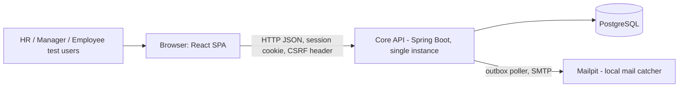
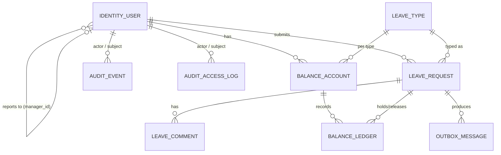

# POC PRD: Employee Leave Tracking System

**Source PRD:** `prd-emp-leave-tracker-2026-10-15/prd.md` (the "original PRD")
**Date:** 2026-10-22

---

## 0. How to read this document

| If you are... | Read |
| --- | --- |
| A manager or sponsor | §1 Purpose, §2 Summary, §3 Scope, §12 Assumptions/Risks/Open Questions, §13 Traceability, §14.4 Milestones |
| A developer | Everything, especially §6 Core-scope design, §7–§10 Technical, §11 Acceptance criteria, §14 Stack and structure |
| A reviewer checking nothing was dropped | §4 Inventory → §5 Disposition → §13 Traceability (every FR1–FR61 appears in all three) |

**Conventions**

- `FR1`–`FR61` are the original PRD's IDs, kept unchanged.
- `CS-n` are **core-scope requirements** from the POC brief that the original PRD does not state, or states differently.
- `IR-n` are **implicit requirements**: functional behavior stated outside the original PRD's "Functional Requirements" section (journeys, domain, web-app, and NFR sections).
- `AC-<id>.n` are acceptance criteria. `OQ-n` are open questions. `A-n` are assumptions. `R-n` are risks.
- **In POC** means it is built and demonstrable in the POC. **Deferred** means it is not built in the POC and is assigned to the production track (§15).
- Coverage: **Full** means the requirement as written is met. **Partial** means part is built and the gap is stated. **Deferred** means not built.
- Where the POC brief and the original PRD conflict, the **POC brief wins** for the POC. The conflict is recorded so the PRD can be amended (Appendix A).

---

## 1. Purpose

Build a proof of concept that:

1. Shows **every functional requirement** of the original PRD working end to end, or, if it cannot sensibly be built in a POC, states exactly what is missing and why.
2. Proves the four core-scope behaviors the sponsor cares about most:
   - employees manage their own leave requests;
   - managers manage and see their **reporting hierarchy**, including **indirect** reports;
   - **reportees cannot see each other's data**;
   - **every change** to leave records, approvals, and employee data is audited with timestamp, actor, and change details (before/after).
3. Shows **role dashboards with key metrics**.
4. Is written on the **production architecture's stack and module boundaries** (architecture spine, 2026-10-22), so the POC code becomes the production codebase. Production adds infrastructure and hardening; it does not rewrite the POC.

**What the POC is not:** it is not a production deployment. It runs locally or in one shared dev environment with **synthetic data only**. It must never hold real employee data (see R-8).

---

## 2. Summary for managers

- **Coverage:** all 61 original FRs are accounted for. **53 Full, 5 Partial, 3 Deferred, 0 dropped.** The 3 deferred FRs (HTTPS enforcement and two automated-backup FRs) are infrastructure concerns that only make sense in a hosted production environment.
- **Beyond the original MVP:** the POC also builds several items the original PRD labelled Phase 2: reports and CSV/Excel export (FR34–FR40), balance-change history (FR32), audit export (FR48), and before/after audit values (FR49). The sponsor asked for "all functional requirements", and the core scope requires change details and dashboards.
- **Three changes to the original PRD** come from the POC brief and need sign-off:
  1. Managers see **direct and indirect** reports. The original FR23 says direct reports only.
  2. Managers can **manage their reporting hierarchy**. This is not in the original PRD; the interpretation used is in OQ-1.
  3. Dashboards with key metrics are **in scope**. The original PRD deferred analytics dashboards to Phase 2.
- **Decisions needed before or during the build:** 18 open questions in §12.3. The most urgent are OQ-1 (what "manage hierarchy" means), OQ-2 (can indirect managers act or only view), OQ-3 (who approves for people with no manager), and OQ-6 (calendar days vs. working days). The POC proceeds on a stated, reversible default for each, and none of the defaults is irreversible.
- **Recommended stack:** Java 21 + Spring Boot (modular monolith) + PostgreSQL, with a React + TypeScript single-page app. This matches the production architecture spine already drafted.
- **Plan:** 8 ordered milestones (M0–M7, §14.4), then a 9-step production extension plan (§14.5).

---

## 3. Scope

### 3.1 Users and roles

| Role | Who | POC capabilities (summary) |
| --- | --- | --- |
| Employee | Every user who takes leave | Submit, modify, and cancel own pending requests; view own status, history, balances, and notifications; own dashboard |
| Manager | User with role `MANAGER` who has at least one report | Everything an Employee can do, plus: view the whole reporting subtree (direct and indirect); decide on and comment on **direct** reports' requests; reassign people within own subtree (OQ-1); team dashboard |
| HR/Admin | User with role `HR_ADMIN` | Everything an Employee can do, plus: manage accounts, roles, and reporting lines; reset passwords; view and adjust all balances; reports and exports; full audit log; organization dashboard |

One role per user, as in the original PRD's three-role RBAC. Whether a person can hold more than one role (for example, an HR admin who also manages a team) is OQ-5.

### 3.2 In scope

1. Authentication: username/password, lockout, inactivity timeout, HR-managed accounts and password resets.
2. Leave requests: submit, modify, and cancel while pending; status; history; comments; History tab.
3. Approvals: single-level approval by the **direct** manager; approve with an optional comment; reject with a required comment.
4. Reporting hierarchy: one manager per user; subtree visibility; reassignment with cycle prevention.
5. Data isolation: deny-by-default, scope enforced on the server for every read and write.
6. Balances: per employee and leave type, kept as a ledger; HR set and adjust with a reason; history; negative-balance block.
7. Carryover: rule configuration and a read-only preview (Partial, FR33).
8. Dashboards: Employee, Manager, and HR, with the key metrics in §6.3.
9. Reports: request list, status summary, employee history, balances; filters; CSV and Excel export.
10. Audit: append-only event log with before/after values for every mutation; data-access log; History tab; export.
11. Notifications: email on submit, modify, cancel, approve, reject, and comment; sent to a local mail catcher in the POC; in-app notification history.
12. Basic accessibility (WCAG 2.1 Level A behaviors on primary flows) and responsive layout.

### 3.3 Explicit exclusions (not in the POC)

| # | Excluded item | Why | Where it goes |
| --- | --- | --- | --- |
| X-1 | HTTPS/TLS termination and certificates (FR55) | Needs hosted infrastructure; the POC runs on `localhost` | Production P2 |
| X-2 | Automated daily backups, point-in-time recovery, off-site copies (FR46, FR60) | Needs managed database or backup infrastructure | Production P5 |
| X-3 | High availability, multi-AZ, autoscaling, zero-downtime deploys | Production-only concern | Production P2, P7 |
| X-4 | Encryption at rest and key management (KMS), secret rotation | Production-only concern | Production P3 |
| X-5 | Real email provider (SES or SMTP relay), bounce handling, queue (SQS) and worker | The POC sends to a local catcher (Mailpit) through the same outbox design | Production P4 |
| X-6 | APM, alerting, log aggregation, uptime monitoring | Production-only concern; the POC has structured logs and a health endpoint | Production P6 |
| X-7 | Load testing at 20/100 concurrent users, security testing (OWASP), penetration testing | Production-only concern | Production P3, P7 |
| X-8 | Formal compliance work (GDPR readiness, retention enforcement, data-protection impact assessment) | Production-only concern | Production P8 |
| X-9 | Multi-level approvals, escalation, delegation | Out of MVP in the original PRD (Phase 2) and not an FR | Phase 2 backlog |
| X-10 | Automated accrual, automated carryover application, policy engine | Phase 2 in the original PRD; carryover preview only in the POC (FR33 Partial) | Phase 2 backlog |
| X-11 | Calendar, HRIS, or payroll integrations; public API keys or OAuth | Phase 2/3 in the original PRD | Phase 2/3 backlog |
| X-12 | In-app real-time (push) notifications, mobile-native apps | Phase 2 in the original PRD | Phase 2 backlog |
| X-13 | SSO, MFA, self-service registration, self-service password reset | Not in the original PRD; self-registration explicitly excluded | OQ-12 |
| X-14 | Localization beyond English; multi-jurisdiction | English-only, single jurisdiction per the original PRD | Phase 2 backlog |
| X-15 | Real employee data | Synthetic seed data only | Must not change for the POC |

---

## 4. Requirements inventory (Task 1)

### 4.1 Original functional requirements (FR1–FR61)

Text is the original PRD's wording. "Orig. phase" is the label in the original PRD. "MVP" means unlabelled in the FR list.

**Leave Request Management** (original section: *Functional Requirements › Leave Request Management*)

| ID | Requirement | Orig. phase |
| --- | --- | --- |
| FR1 | Employees can submit leave requests specifying leave type (vacation, sick, parental, sabbatical) | MVP |
| FR2 | Employees can specify start and end dates for leave requests | MVP |
| FR3 | Employees can add optional notes or comments to leave requests | MVP |
| FR4 | Employees can view the status of their submitted leave requests (pending, approved, rejected) | MVP |
| FR5 | Employees can view their complete leave history | MVP |
| FR6 | Employees can view their current leave balance by leave type | MVP |
| FR7 | Employees can modify pending leave requests (change dates, type, notes) before manager approval | MVP (conflicts with the MVP exclusions list; see Appendix A) |
| FR8 | Employees can cancel pending leave requests | MVP |
| FR9 | System records the submission timestamp and submitting employee for each request | MVP |

**Approval Workflows** (*Functional Requirements › Approval Workflows*)

| ID | Requirement | Orig. phase |
| --- | --- | --- |
| FR10 | Managers can view a dashboard of pending leave requests from their direct reports | MVP |
| FR11 | Managers can view rich request context (employee name, dates, type, current balance, leave history) | MVP |
| FR12 | Managers can approve leave requests with optional comments | MVP |
| FR13 | Managers can reject leave requests with required comments explaining the reason | MVP |
| FR14 | Managers can view the team's leave history and approved leave dates | MVP |
| FR15 | Managers can add comments to requests for discussion with employees | MVP (conflicts with the MVP exclusions list; see Appendix A) |
| FR16 | System records manager approval/rejection decisions with timestamp and approver identity | MVP |
| FR17 | System prevents managers from approving/rejecting requests for employees outside their team | MVP |

**User & Access Management** (*Functional Requirements › User & Access Management*)

| ID | Requirement | Orig. phase |
| --- | --- | --- |
| FR18 | HR/Admins can create user accounts with username and password | MVP |
| FR19 | HR/Admins can assign roles (Employee, Manager, HR/Admin) to users at account creation | MVP |
| FR20 | HR/Admins can reset user passwords | MVP |
| FR21 | System enforces role-based access control (RBAC) with three roles: Employee, Manager, HR/Admin | MVP |
| FR22 | Employees can only view their own leave requests and data | MVP |
| FR23 | Managers can only view their direct reports' leave requests and data | MVP (amended by CS-3) |
| FR24 | HR/Admins can view all leave requests and employee data | MVP |
| FR25 | System prevents unauthorized access to data based on user role | MVP |
| FR26 | System logs all access to sensitive data (who accessed what, when) | MVP |

**Leave Balance Management** (*Functional Requirements › Leave Balance Management*)

| ID | Requirement | Orig. phase |
| --- | --- | --- |
| FR27 | HR/Admins can view all employees' leave balances | MVP |
| FR28 | HR/Admins can manually set employee leave balances | MVP |
| FR29 | HR/Admins can adjust employee leave balances (add or subtract days) | MVP |
| FR30 | System records all balance adjustments with timestamp, amount changed, and reason | MVP |
| FR31 | System prevents negative leave balances (or allows with explicit HR approval) | MVP |
| FR32 | HR/Admins can view the history of balance changes with reasons | Phase 2 |
| FR33 | HR/Admins can configure carryover rules (how much unused leave carries to next year) | Phase 2 |

**Reporting & Analytics** (*Functional Requirements › Reporting & Analytics (Phase 2+)*)

| ID | Requirement | Orig. phase |
| --- | --- | --- |
| FR34 | HR/Admins can generate a leave request list report (all requests with status) | Phase 2 |
| FR35 | HR/Admins can generate an approval status report (pending, approved, rejected counts) | Phase 2 |
| FR36 | HR/Admins can generate employee leave history reports | Phase 2 |
| FR37 | HR/Admins can filter reports by date range, employee, or leave type | Phase 2 |
| FR38 | HR/Admins can export reports to CSV format | Phase 2 |
| FR39 | HR/Admins can export reports to Excel format | Phase 2 |
| FR40 | Reports include complete audit trail information (who, what, when) | Phase 2 |
| FR41 | System generates reports with < 5 second response time | Phase 2 |

**Audit & Compliance** (*Functional Requirements › Audit & Compliance*)

| ID | Requirement | Orig. phase |
| --- | --- | --- |
| FR42 | System maintains an audit trail of all leave transactions (submission, approval, rejection) | MVP |
| FR43 | System records timestamp and user identity for every action | MVP |
| FR44 | Audit trail records are immutable (cannot be deleted or modified) | MVP |
| FR45 | Each leave request displays a "History" tab showing all approvals/rejections with timestamps | MVP |
| FR46 | System prevents data loss with daily automated backups | MVP |
| FR47 | System maintains audit logs for minimum 3 years | MVP |
| FR48 | HR/Admins can export detailed audit trail data for compliance reviews | Phase 2 |
| FR49 | System records before/after values for any data modifications | Phase 2 (pulled into POC by CS-6) |

**Notifications** (*Functional Requirements › Notifications*)

| ID | Requirement | Orig. phase |
| --- | --- | --- |
| FR50 | System sends email notifications to employees when their leave request is approved | MVP |
| FR51 | System sends email notifications to employees when their leave request is rejected | MVP |
| FR52 | System sends email notifications to managers when a new leave request is submitted | MVP |
| FR53 | Employees can view notification history | MVP |
| FR54 | System includes relevant request details in notification emails | MVP |

**System Administration & Security** (*Functional Requirements › System Administration & Security*)

| ID | Requirement | Orig. phase |
| --- | --- | --- |
| FR55 | System enforces HTTPS encryption for all data in transit | MVP |
| FR56 | System supports secure username/password authentication | MVP |
| FR57 | System enforces account lockout after 5 failed login attempts | MVP |
| FR58 | System enforces session timeout after inactivity | MVP |
| FR59 | System maintains access logs for all data access | MVP (duplicates FR26; see Appendix A) |
| FR60 | System supports daily automated backups | MVP (duplicates FR46) |
| FR61 | System provides backup and recovery capabilities | MVP |

### 4.2 Core-scope requirements from the POC brief (CS-1 to CS-6)

| ID | Requirement | Relation to original PRD |
| --- | --- | --- |
| CS-1 | Managers can manage their reporting hierarchy | **New.** The original PRD has HR-created accounts only and no hierarchy management FR. Interpretation: OQ-1 |
| CS-2 | Reportees cannot view each other's data (peers are isolated, including peer managers' teams) | Strengthens FR22 and the domain section's "no cross-team data leakage" |
| CS-3 | Managers can view direct **and indirect** reports | **Amends FR23** (direct only) and architecture spine AD-9 |
| CS-4 | Dashboards show key metrics (per role) | **New for MVP.** The original PRD defers analytics dashboards to Phase 2; FR10 covers only the pending-approvals dashboard |
| CS-5 | All changes to **employee data** are audited (timestamp, actor, change details) | **New.** The original audit FRs cover leave transactions only |
| CS-6 | All changes to leave records, approvals, and employee data carry **change details** | Pulls FR49 (before/after values) from Phase 2 into the POC |

### 4.3 Implicit requirements found outside the FR section (IR-1 to IR-14)

These are stated in the original PRD but not in its FR list. They are listed so nothing is lost silently.

| ID | Requirement (as stated in the original PRD) | Original section | POC |
| --- | --- | --- | --- |
| IR-1 | Password minimum 8 characters with letters and numbers | NFR › Security › Authentication | In POC |
| IR-2 | Lockout duration 15–30 minutes | NFR › Security › Authentication | In POC (15 min) |
| IR-3 | Session tokens invalidated on logout; secure cookie attributes (HttpOnly, Secure, SameSite) | NFR › Security › Session Management | In POC (`Secure` only meaningful over HTTPS; see FR55) |
| IR-4 | Frontend hides features the user's role cannot use | Web App › Permission Enforcement | In POC |
| IR-5 | Audit logging of all permission-based access decisions | Web App › Permission Enforcement; NFR › Data Privacy | In POC (denials and allowed reads; see FR26) |
| IR-6 | Employee is emailed when a manager comments ("The system sends an email notification to the employee") | Journey 4 | In POC |
| IR-7 | Employee is notified when the manager has *viewed* the request | Journey 1 | **Deferred** (conflicts with "email-only, not real-time" decision; OQ-9) |
| IR-8 | Request context shows team capacity impact | Journey 2 | **Partial**: an overlap indicator (other approved/pending leave in the manager's subtree on the same dates). No capacity model. |
| IR-9 | Leave balance reconciliation reports for HR | Journey 3; Domain › Risk Mitigations | In POC (balance report: ledger sum vs. held vs. used) |
| IR-10 | Managers can see a request was modified (change history) | Journey 4 | In POC (History tab shows before/after) |
| IR-11 | Export available to HR/Admin users only; exported data includes audit information | Web App › Data Export Capabilities | In POC |
| IR-12 | Role assignment cannot be changed without HR/Admin | Web App › RBAC | In POC |
| IR-13 | No approval can be made without complete request context | Domain › Risk Mitigations › Approval Integrity | In POC (decision screen always shows FR11 context) |
| IR-14 | Leave types: vacation, sick, parental, sabbatical | Executive summary; FR1 | In POC (seeded catalogue) |

Non-functional requirements (performance, scalability, reliability, accessibility) are covered in §7, split into POC and Production.

---

## 5. POC disposition and implementation notes (Task 3)

Status is **In POC** or **Deferred**. The coverage level (Full/Partial) is in §13.

| ID | Status | Implementation notes |
| --- | --- | --- |
| FR1 | In POC | `POST /leave-requests`. Leave type from the `leave_type` catalogue (four seeded types). |
| FR2 | In POC | `start_date`, `end_date` as ISO dates; `end >= start` validated (422). The server computes the day count with one `DayCountPolicy` (default: calendar days, per spine AD-11; OQ-6). |
| FR3 | In POC | Optional `note`, max 1000 characters. |
| FR4 | In POC | Statuses `PENDING`, `APPROVED`, `REJECTED`, `CANCELLED` (CANCELLED added to support FR8). |
| FR5 | In POC | "My requests" list, all statuses, all years, paged and filterable. |
| FR6 | In POC | Per type: `available` (ledger sum), `held` (pending holds), `used` (approved). See §9 for definitions. |
| FR7 | In POC | Only while `PENDING`. Changing dates or type releases the old hold and places a new one in one transaction. Before/after audited. Manager notified (`LeaveRequestModified`). |
| FR8 | In POC | Only while `PENDING`. Releases the hold. Manager notified. |
| FR9 | In POC | `submitted_at`, `submitted_by` on the request, plus an audit event. |
| FR10 | In POC | "Approvals" queue: pending requests whose employee's `manager_id` is the caller, oldest first. Indirect reports' pending requests are visible read-only in "Team" (CS-3). |
| FR11 | In POC | Decision panel: employee name, dates, day count, type, available/held balance for that type, the employee's last 12 months of requests, and the overlap indicator (IR-8). |
| FR12 | In POC | `POST /leave-requests/{id}/decision {decision: APPROVE, comment?}`. |
| FR13 | In POC | `decision: REJECT` requires a non-blank comment (422 otherwise). The hold is released. |
| FR14 | In POC | Team requests and team calendar list for the manager's whole subtree (CS-3). |
| FR15 | In POC | Comments on a request by the employee and their **direct manager** only. Indirect managers and HR read only (OQ-2, OQ-15). Every comment emails the other party (IR-6). |
| FR16 | In POC | `decided_at`, `decided_by` on the request, plus a decision comment row and an audit event. |
| FR17 | In POC | Only the employee's **current direct manager** can decide (OQ-2). Anyone else gets 403 (wrong role) or 404 (out of scope). Self-decision is impossible because `manager_id ≠ id`. |
| FR18 | In POC | HR creates the account with a temporary password. The user must change it at first login; it expires after 24 hours (spine AD-8). |
| FR19 | In POC | Role set at creation. HR can change it later (audited; CS-5). |
| FR20 | In POC | HR sets a new temporary password with forced change at next login. How the temporary password reaches the user is OQ-12 (POC: shown once to HR on screen). |
| FR21 | In POC | Roles `EMPLOYEE`, `MANAGER`, `HR_ADMIN`. Checks run in the application service (facade), deny by default, never only in the UI. |
| FR22 | In POC | The scope resolver returns `{self}` for employees. Every query is filtered by scope in SQL. |
| FR23 | In POC (amended) | The scope resolver returns `{self} ∪ subtree(caller)` for managers (CS-3). **This changes FR23**; PRD and spine AD-9 amendment needed. |
| FR24 | In POC | Scope = all users for `HR_ADMIN`. |
| FR25 | In POC | 401 unauthenticated; 403 role not permitted; 404 record outside scope (existence not revealed), per spine AD-9. |
| FR26 | In POC | `audit_access_log`: one row per API call that returns another person's or own sensitive data, plus every denial. Fields: actor, endpoint, subject ids, decision, time. Volume risk R-6. |
| FR27 | In POC | HR "Balances" table: all employees × all types. |
| FR28 | In POC | "Set to N" is written as an `ADJUST` ledger entry with `delta = N − current available` and a mandatory reason, so the ledger stays the source of truth. |
| FR29 | In POC | Signed `ADJUST` delta with a mandatory reason. |
| FR30 | In POC | Every ledger entry: actor, timestamp, delta, reason, request id (if any). Ledger is append-only. |
| FR31 | In POC | Submissions, modifications, and adjustments that would make `available < 0` are rejected. The "or allows with explicit HR approval" branch is **not built** (OQ-4). |
| FR32 | In POC | Ledger history view per employee and type (pulled forward from Phase 2; cheap because the ledger exists). |
| FR33 | In POC | Per-leave-type carryover rule (`max_carryover_days`, nullable = no carryover) editable by HR and audited, plus a **read-only year-end preview** (carry/forfeit per employee). **Applying** carryover to balances is not built until the policy is confirmed (OQ-7). |
| FR34 | In POC | Report: all requests with status, filterable (FR37). |
| FR35 | In POC | Report: counts by status (and by type), for a period. |
| FR36 | In POC | Report: one employee's full request history with decisions. |
| FR37 | In POC | Filters: date range (overlapping the leave dates), employee, leave type, status. |
| FR38 | In POC | `format=csv` on each report endpoint. |
| FR39 | In POC | `format=xlsx` via Apache POI (streaming writer). |
| FR40 | In POC | Report rows carry submitted by/at, decided by/at, last modified by/at, and decision comment. The full event trail is in the audit export (FR48). |
| FR41 | In POC | Measured on the POC seed (about 100 employees, 3 years, ~3,000 requests), single user. Concurrency not tested (Partial; production P7). |
| FR42 | In POC | `audit_event` row for every state change in the same transaction (submit, modify, cancel, comment, approve, reject, balance adjust, user/role/manager changes, carryover rule changes, login events). |
| FR43 | In POC | `actor_id`, `actor_role`, `occurred_at` (UTC) on every audit row. System actions use a fixed `SYSTEM` actor. |
| FR44 | In POC | PostgreSQL triggers reject `UPDATE`/`DELETE` on `audit_event`, `audit_access_log`, and `balance_ledger`. The app database role has no DDL or trigger rights. Stronger tamper evidence (hash chain, write-once storage) is production P5. |
| FR45 | In POC | Request detail page has a History tab: every event with actor, time, and before/after diff. |
| FR46 | **Deferred** | Automated backups need production infrastructure. The POC provides manual `scripts/backup.sh` and `restore.sh` (see FR61). |
| FR47 | In POC | The POC never deletes audit rows (no purge job exists) and the schema has no TTL. **Retention policy, archival, and guaranteed 3-year storage** are production P5/P8 (Partial). |
| FR48 | In POC | `GET /audit/events/export?format=csv|xlsx` with filters (date range, actor, subject employee, entity, action). HR only. |
| FR49 | In POC | `before` and `after` JSON on every update audit row. Create rows have `before = null`. Secrets (password hashes) are never written; a password reset is recorded as an event without values. |
| FR50 | In POC | `LeaveRequestApproved` outbox message, emailed to the employee via local SMTP (Mailpit). |
| FR51 | In POC | `LeaveRequestRejected`, including the reason. |
| FR52 | In POC | `LeaveRequestSubmitted`, emailed to the direct manager. No manager: no email; the request is flagged on the HR dashboard (OQ-3). |
| FR53 | In POC | "Notifications" page lists the caller's outbox messages (subject, time, status). Available to every role, not only employees. |
| FR54 | In POC | Email body: employee name, type, dates, day count, status, comment (if any), and a deep link to the request. |
| FR55 | **Deferred** | POC runs over HTTP on localhost. Production terminates TLS 1.2+ at the load balancer (spine AD-21). |
| FR56 | In POC | BCrypt (cost 12), identical error for unknown user and wrong password. |
| FR57 | In POC | 5 consecutive failures lock the account for 15 minutes. The counter is committed even though the login fails (separate transaction). HR can unlock early (audited). |
| FR58 | In POC | Server-side session, 30-minute idle timeout, 8-hour absolute limit, invalidated on logout. (The original PRD also says "8-12 hours"; see Appendix A.) |
| FR59 | In POC | Same mechanism as FR26 (FR59 duplicates FR26). |
| FR60 | **Deferred** | Duplicate of FR46. |
| FR61 | In POC | Manual backup and restore scripts (`pg_dump`/`pg_restore`) with a documented, tested restore of the POC database. Automation, PITR, off-site copies, RTO/RPO: production P5 (Partial). |
| CS-1 | In POC | See §6.1. Manager can view their subtree as a tree and reassign a person in their subtree to another manager in their subtree. HR can reassign anyone. Cycle prevention. Audited. Interpretation is OQ-1. |
| CS-2 | In POC | Enforced by the same scope resolver as FR22. Peer managers cannot see each other's teams. Automated isolation tests (§11, AC-CS-2). |
| CS-3 | In POC | Recursive query on `identity_user.manager_id`. See §6.1. |
| CS-4 | In POC | See §6.3. Metric list is a default pending OQ-8. |
| CS-5 | In POC | Audit for user create, profile edit, role change, manager change, activate/deactivate, password reset (event only), unlock. |
| CS-6 | In POC | Same as FR49. |
| IR-1 to IR-14 | See §4.3 | IR-7 Deferred; IR-8 Partial; the rest In POC. |

---

## 6. Core-scope design

### 6.1 Reporting hierarchy and visibility (CS-1, CS-2, CS-3, FR17, FR22–FR25)

**Model.** Each user has at most one `manager_id` (nullable, self-referencing). The org chart is a forest: users with no manager are roots (OQ-3).

**Subtree.** `subtree(m)` is every user reachable by following `manager_id` downward from `m`, excluding `m`. It is computed with a recursive CTE at request time and never cached, so a reassignment takes effect immediately.

**Visibility matrix (POC)**

| Data about person P | P themself | P's direct manager | P's indirect manager (any ancestor above direct) | Peer / colleague / other manager | HR_ADMIN |
| --- | --- | --- | --- | --- | --- |
| Leave requests, comments, History tab | View; create/modify/cancel own pending; comment | View; decide; comment | View only | **No access (404)** | View all; no decide (OQ-3, OQ-15) |
| Balances and ledger | View own | View | View | **No access** | View; set/adjust |
| Profile (name, email, role, manager) | View own | View | View | Name of own manager only | View; edit |
| Hierarchy | Own manager | Own subtree | Own subtree | **No access** | Whole org |
| Audit log (global) | No (only History tabs in scope) | No | No | No | Yes |
| Dashboards | Own metrics | Subtree metrics | Subtree metrics | No | Org metrics |

**Reassignment rules (CS-1, POC interpretation, OQ-1)**

1. HR can set any user's `manager_id` to any active user with role `MANAGER` or `HR_ADMIN`, or to null.
2. A manager can reassign a user **in their own subtree** to a new manager who is **the manager themself or in their own subtree**, and who has role `MANAGER`. A manager cannot move anyone out of their subtree, cannot change their own manager, and cannot change roles.
3. **Cycle prevention:** the new manager must not be the user or in the user's subtree (422).
4. **Pending requests follow the reporting line:** the decider is resolved at decision time from the employee's current `manager_id`. After a reassignment, pending requests move to the new direct manager's queue, and the new manager is emailed a summary of those pending requests.
5. Every reassignment writes an `audit_event` with before/after `manager_id` and the actor.

**Isolation guarantee.** Every application-service method takes the caller identity and applies the scope resolver before touching data. List queries are filtered in SQL (`employee_id IN scope`), never filtered after loading. A request for a record outside scope returns 404 and writes a `DENY` row to `audit_access_log`. Email and export content only includes records within the recipient's or caller's scope.

### 6.2 Approval routing

- Single level: only the employee's **current direct manager** decides (FR17, OQ-2).
- Indirect managers see the request (CS-3) but cannot decide or comment (OQ-2, OQ-15).
- Employees with no manager: the request is submitted and held, no manager email is sent, and the request appears on the HR dashboard under "Requests with no approver". Who decides is OQ-3. The POC does not let HR decide.
- Self-approval is impossible because an employee cannot be their own manager.

### 6.3 Dashboards and key metrics (CS-4, FR10)

Default metric set. **The list needs sponsor confirmation (OQ-8).** Every metric is computed only over the caller's scope. "Period" defaults to the current calendar quarter and can be changed.

| Dashboard | Metric | Definition |
| --- | --- | --- |
| Employee | Balance by type | `available`, `held`, `used` this leave year (§9.3) |
| Employee | My pending requests | Count of own `PENDING` |
| Employee | Upcoming approved leave | Next 3 approved requests with start ≥ today |
| Employee | Recent decisions | Last 5 approved/rejected with decider and date |
| Manager | Pending approvals (direct) | Count of `PENDING` where the manager is the direct manager (FR10), plus the oldest pending age in days |
| Manager | Who is out | People in the subtree on approved leave today and in the next 14 days |
| Manager | Decisions in period | Approved / rejected counts, and median time from submit to decision |
| Manager | Team balance snapshot | Subtree employees with `available` < 5 days in any type (threshold configurable) |
| Manager | Subtree size | Direct reports count and total (direct + indirect) |
| HR | Headcount | Active users by role |
| HR | Requests by status | Counts by status for the period (also FR35) |
| HR | Approval cycle time | Median and 90th percentile submit-to-decision time for the period |
| HR | Days taken by type | Sum of approved day counts by type for the period |
| HR | Requests with no approver | Pending requests whose employee has no manager (OQ-3) |
| HR | Recent audit events | Last 10 audit events |

Each tile links to the filtered list behind it. Numbers are computed live from the transactional tables; there are no materialized views in the POC.

### 6.4 Audit model (FR42–FR49, CS-5, CS-6, FR26/FR59)

Two append-only tables (§9):

- **`audit_event`**: *what changed*. One row per state change, written in the same database transaction as the change, so a change cannot commit without its audit row. Fields: `occurred_at`, `actor_id`, `actor_role`, `action` (for example `LEAVE_SUBMITTED`, `LEAVE_MODIFIED`, `LEAVE_APPROVED`, `USER_MANAGER_CHANGED`), `entity_type`, `entity_id`, `subject_user_id`, `before` (JSON), `after` (JSON), `reason`, `request_id` (correlation).
- **`audit_access_log`**: *who looked at what*. Fields: `occurred_at`, `actor_id`, `endpoint`, `subject_user_ids`, `decision` (`ALLOW`/`DENY`), `reason`. Denials are written in their own transaction so the error response does not roll them back.

**Audited actions (complete list for the POC)**

| Area | Actions |
| --- | --- |
| Leave | submitted, modified, cancelled, approved, rejected, comment added |
| Balance | ledger HOLD, RELEASE, ADJUST (with reason) |
| Employee data | user created, profile edited, role changed, manager changed, activated/deactivated, password reset (no values), unlocked |
| Security | login succeeded, login failed, account locked, logout, password changed (no values) |
| Configuration | carryover rule changed |
| Exports | report or audit export generated (who, which filters) |

Before/after JSON includes only business fields. Password hashes, session ids, and temporary passwords are never written to audit or logs.

---

## 7. Technical requirements (Task 4)

### 7.1 Non-functional requirements: POC vs production

| Area | Original PRD target | POC requirement | Production enhancement |
| --- | --- | --- | --- |
| Performance | Pages < 3 s; API < 500 ms; reports < 5 s; queries < 2–3 s | Meet these on the seed dataset with one user, measured with a simple script; indexes per spine AD-24 | Load test at 20 concurrent users (MVP) and the 100-concurrent goal (OQ-11); query budget and monitoring |
| Concurrency correctness | Zero data loss; integrity | Row locks on request and balance (spine AD-13/14) so concurrent submits cannot overspend; integration test for the race | Same, plus idempotency keys on submit/decide (spine AD-16) |
| Scalability | 100 → 500 employees without rewrite; horizontal scaling | Stateless app except the session store; no local file state | Multiple instances behind a load balancer; shared session store; autoscaling |
| Availability | 99% uptime | None (single local instance) | Multi-AZ app and database, health-checked rolling deploys |
| Security | TLS 1.2+, hashed passwords, lockout, 30-min timeout, secure cookies, RBAC at API and data level | Hashing, lockout, timeout, RBAC, CSRF protection, `HttpOnly` + `SameSite` cookies, no secrets in repo | TLS, `Secure` cookies, encryption at rest, KMS, secret rotation, OWASP scanning, pen test, rate limiting, SSO/MFA (OQ-12) |
| Audit | Immutable, 3-year retention, encrypted | Append-only via triggers; no purge | Encrypted at rest; separate migration role; tamper evidence; retention and archival policy |
| Backup/DR | Daily backups, 30-day retention, RPO/RTO 24 h, monthly restore tests | Manual backup/restore scripts, one documented restore | Automated backups, PITR, cross-region copy, monthly restore drill, DR runbook |
| Observability | APM, error tracking, log aggregation, alerting | JSON logs with request id; health endpoint; no personal data in logs | OpenTelemetry, CloudWatch (or chosen APM), alarms, on-call routing |
| Accessibility | WCAG 2.1 Level A; keyboard; screen readers | Semantic HTML, labels, keyboard on primary flows, visible focus, automated axe checks in e2e | Manual assistive-technology testing; accessibility audit |
| Browser support | Chrome, Edge latest; responsive | Chrome and Edge latest; layout works at phone width | Same, plus cross-browser regression in CI |
| Localization | English, single jurisdiction | English; dates shown as `DD MMM YYYY` (OQ-13) | Multi-language and jurisdiction (Phase 2) |
| Data retention | 3+ years, indefinite history | No deletion | Retention and archival policy (P8) |

### 7.2 Architecture (POC)

**Style:** modular monolith, matching architecture spine AD-1 to AD-4. One backend deployable, split into modules with one application-service facade each. One single-page web app. One PostgreSQL database.



**Modules (backend)**

| Module | Responsibility | Owns tables | Requirements |
| --- | --- | --- | --- |
| `identity` | Users, roles, credentials, sessions, lockout, **reporting line and subtree resolver** | `identity_user` (sessions in `spring_session*`) | FR18–FR25, FR56–FR58, CS-1, CS-3 |
| `leave` | Request lifecycle, comments, leave types, carryover rules | `leave_request`, `leave_comment`, `leave_type` | FR1–FR9, FR15, FR33, FR45 |
| `approval` | Policy facade: role and direct-manager check, then `LeaveFacade.decide` | none | FR10–FR17 |
| `balance` | Ledger, holds, adjustments, balance views | `balance_account`, `balance_ledger` | FR6, FR27–FR32 |
| `audit` | Event and access logging, History, export | `audit_event`, `audit_access_log` | FR26, FR42–FR49, FR59, CS-5, CS-6 |
| `outbox` | Notification messages, publisher, history | `outbox_message` | FR50–FR54, IR-6 |
| `dashboard` | Role dashboards (read-only, via other facades) | none | CS-4, FR10 |
| `reporting` | Reports and CSV/XLSX export (read-only, via other facades) | none | FR34–FR41, IR-9 |
| `shared` | ids, clock, problem details, scope types | none | — |

**Rules carried over from the spine and enforced from day one** (because they are what make the POC extendable):

- One entry service and **one transaction per state change**; audit and outbox rows join that transaction (spine AD-4).
- Modules call each other only through facades; enforced by ArchUnit tests (AD-1, AD-3).
- Each table has one owning module (AD-2).
- Domain code has no framework imports; persistence entities are separate from domain types (AD-3).
- REST contract: `/api/v1`, JSON, RFC 9457 problem details, paged lists `{items, page, size, total}`, UUID ids, ISO dates (AD-10).
- Day count and balance logic is server-side only (AD-11, AD-13).

**Deliberate POC simplifications** (each is an adapter swap, not a rewrite)

| Spine (production) | POC | Swap in production |
| --- | --- | --- |
| JWT access token (15 min) + Redis refresh session (AD-6, AD-7) | Server-side session via Spring Session JDBC (PostgreSQL), 30-min idle, 8-h absolute | Keep server-side sessions on Valkey/Redis, or adopt AD-6/AD-7 (OQ-14). Note: server-side sessions meet FR58 fully; the spine's JWT design accepts a 15-minute gap. |
| Outbox → SQS → notification worker → email provider (AD-15) | Outbox → in-process scheduled publisher → SMTP to Mailpit | Replace the publisher adapter with an SQS publisher; worker per its own spec |
| Idempotency-Key on submit/decide (AD-16) | Not built; UI disables the button while a request is in flight | Add the idempotency module |
| Valkey cache for leave types (AD-17) | No cache | Add if measurements need it |
| ECS Fargate, RDS Multi-AZ, ALB TLS (AD-21, AD-23) | Docker Compose on one machine | IaC per spine |
| CloudWatch, OpenTelemetry, alarms (AD-20) | JSON logs, actuator health | Add exporters and alarms |

### 7.3 Security baseline that is in the POC

Even though hardening is a production concern, these are built in the POC because retrofitting them is expensive:

- Deny-by-default authorization in facades; scope filtering in SQL.
- BCrypt password hashing; lockout; session fixation protection; logout invalidation.
- CSRF synchronizer token for state-changing requests (spine AD-12).
- `HttpOnly`, `SameSite=Lax` session cookie.
- Input validation on all request bodies; parameterized SQL only.
- No personal data, passwords, or tokens in logs.
- Synthetic data only (R-8).

---

## 8. Interfaces (Task 4)

### 8.1 REST API (`/api/v1`)

All endpoints require a session unless marked *public*. "Scope" is the caller's data scope (§6.1). Errors: 400 malformed, 401 not logged in, 403 role not allowed or CSRF failure, 404 not found **or out of scope**, 409 state conflict (for example, modifying a non-pending request), 422 validation failure, 423 account locked.

**Auth and session**

| Method & path | Who | Purpose | FR |
| --- | --- | --- | --- |
| `GET /auth/csrf` | public | Get CSRF token | IR-3 |
| `POST /auth/login` | public | Username/password login | FR56, FR57 |
| `POST /auth/logout` | any | End session | FR58, IR-3 |
| `POST /auth/password` | any | Change own password (forced after temp password) | FR18, FR20, IR-1 |
| `GET /auth/me` | any | Current user, role, manager, `hasReports` | FR21, IR-4 |

**Leave requests**

| Method & path | Who | Purpose | FR |
| --- | --- | --- | --- |
| `GET /leave-types` | any | Leave type catalogue | FR1 |
| `POST /leave-requests` | any | Submit own request `{leaveType, startDate, endDate, note?}` | FR1–FR3, FR9 |
| `GET /leave-requests?employeeId&status&leaveType&from&to&page&size` | any (scoped) | List requests in scope | FR4, FR5, FR14 |
| `GET /leave-requests/{id}` | any (scoped) | Detail with context (FR11 fields for managers) | FR4, FR11 |
| `PATCH /leave-requests/{id}` | owner | Modify pending request | FR7 |
| `POST /leave-requests/{id}/cancel` | owner | Cancel pending request | FR8 |
| `GET /leave-requests/{id}/comments` / `POST` | owner, direct manager | Discussion | FR15, IR-6 |
| `GET /leave-requests/{id}/history` | any (scoped) | History tab: audit events with before/after | FR45, IR-10 |
| `POST /leave-requests/{id}/decision` | direct manager | `{decision: APPROVE|REJECT, comment}` | FR12, FR13, FR16, FR17 |
| `GET /approvals/pending` | manager | Direct reports' pending, oldest first | FR10 |

**Hierarchy and users**

| Method & path | Who | Purpose | FR |
| --- | --- | --- | --- |
| `GET /org/tree?root={userId}` | manager (own subtree), HR (any) | Hierarchy tree | CS-1, CS-3 |
| `GET /org/team?depth=direct|all` | manager | Flat list of reports | CS-3, FR14 |
| `PUT /users/{id}/manager` | manager (within subtree), HR | Reassign `{managerId}` | CS-1 |
| `GET /users?q&role&active` | HR | List users | FR24 |
| `POST /users` | HR | Create `{username, displayName, email, role, managerId?}` → returns temp password once | FR18, FR19 |
| `PATCH /users/{id}` | HR | Edit profile, role, active flag | FR19, CS-5, IR-12 |
| `POST /users/{id}/password-reset` | HR | New temp password | FR20 |
| `POST /users/{id}/unlock` | HR | Clear lockout | FR57 |

**Balances and carryover**

| Method & path | Who | Purpose | FR |
| --- | --- | --- | --- |
| `GET /balances?employeeId` | any (scoped) | Balances by type | FR6, FR27 |
| `GET /balances/{employeeId}/ledger?leaveType` | any (scoped) | Ledger history | FR30, FR32 |
| `POST /balances/{employeeId}/adjustments` | HR | `{leaveType, mode: SET|DELTA, amount, reason}` | FR28, FR29, FR31 |
| `PUT /leave-types/{code}/carryover-rule` | HR | `{maxCarryoverDays|null}` | FR33 |
| `GET /leave-types/{code}/carryover-preview?year` | HR | Read-only projection | FR33 |

**Dashboards, reports, audit, notifications**

| Method & path | Who | Purpose | FR |
| --- | --- | --- | --- |
| `GET /dashboard?period` | any | Role-shaped metric payload (§6.3) | CS-4, FR10 |
| `GET /reports/requests?filters&format=json|csv|xlsx` | HR | Request list | FR34, FR37–FR40 |
| `GET /reports/status-summary?filters&format=…` | HR | Counts | FR35 |
| `GET /reports/employee-history/{employeeId}?format=…` | HR | Employee history | FR36 |
| `GET /reports/balances?format=…` | HR | Balance reconciliation | IR-9 |
| `GET /audit/events?filters` | HR | Audit search | FR42, FR43 |
| `GET /audit/events/export?filters&format=csv|xlsx` | HR | Audit export | FR48 |
| `GET /audit/access-log?filters` | HR | Access log | FR26, FR59 |
| `GET /notifications` | any | Own notification history | FR53 |
| `GET /actuator/health` | public | Liveness | — |

The OpenAPI document is generated from code and published at `/api/v1/openapi.json`.

### 8.2 Email notification contract

The outbox message shape is the spine AD-15 contract, so the production worker can consume POC messages unchanged.

```json
{
  "eventId": "uuid",
  "eventType": "LeaveRequestSubmitted | LeaveRequestModified | LeaveRequestCancelled | LeaveRequestApproved | LeaveRequestRejected | LeaveCommentAdded",
  "schemaVersion": 1,
  "occurredAt": "2026-10-22T09:15:00Z",
  "recipient": { "userId": "uuid", "email": "…", "name": "…" },
  "payload": {
    "requestId": "uuid", "employeeId": "uuid", "employeeName": "…",
    "leaveType": "VACATION", "startDate": "2026-11-02", "endDate": "2026-11-06",
    "dayCount": 5, "status": "PENDING", "comment": null, "link": "/requests/{id}"
  }
}
```

| Event | Recipient | FR |
| --- | --- | --- |
| LeaveRequestSubmitted | Direct manager | FR52 |
| LeaveRequestModified | Direct manager | FR7 (not an FR on its own; added so the manager is not deciding on stale details) |
| LeaveRequestCancelled | Direct manager | FR8 (same reason) |
| LeaveRequestApproved | Employee | FR50 |
| LeaveRequestRejected | Employee | FR51 |
| LeaveCommentAdded | The other party | FR15, IR-6 |

### 8.3 UI screens

Reuse the information architecture, personas, and design tokens of `leave-tracker-prototype-v1` and the UX spec (`ux-designs/ux-emp-leave-tracker-2026-10-15/ui-ux-design.md`).

| Screen | Roles | Requirements |
| --- | --- | --- |
| Sign in, change password | all | FR56–FR58, FR18, FR20 |
| Dashboard | all (role-shaped) | CS-4, FR10 |
| My requests, New/Edit request | all | FR1–FR8 |
| Request detail (Details, Comments, History tabs) | scoped | FR4, FR11, FR15, FR45 |
| Approvals | manager | FR10–FR13 |
| Team (list, calendar, balances, org tree) | manager | FR14, CS-1, CS-3 |
| People (accounts, roles, reporting lines) | HR | FR18–FR20, CS-1, CS-5 |
| Balances (table, adjust, ledger) | HR | FR27–FR32 |
| Carryover rules and preview | HR | FR33 |
| Reports and exports | HR | FR34–FR41 |
| Audit (events, access log, export) | HR | FR42–FR48, FR26 |
| Notifications | all | FR53 |

---

## 9. Data model (Task 4)

### 9.1 Entities



### 9.2 Tables (POC schema; production adds no new columns for the FRs)

**`identity_user`** (owner: identity)

| Column | Type | Notes |
| --- | --- | --- |
| `id` | uuid PK | |
| `username` | text unique | case-insensitive unique |
| `display_name`, `email` | text | email unique |
| `role` | text | `EMPLOYEE` / `MANAGER` / `HR_ADMIN` |
| `manager_id` | uuid FK → identity_user, null | `CHECK (manager_id <> id)`; cycles prevented in the service |
| `active` | boolean | |
| `password_hash` | text | BCrypt |
| `must_change_password`, `temp_password_expires_at` | boolean, timestamptz | FR18, FR20 |
| `failed_login_count`, `locked_until` | int, timestamptz | FR57 |
| `created_at`, `updated_at`, `version` | | optimistic version as a backstop |

Index: `(manager_id)`.

**`leave_type`** (owner: leave): `code` PK (`VACATION`, `SICK`, `PARENTAL`, `SABBATICAL`), `name`, `active`, `max_carryover_days` int null (FR33).

**`leave_request`** (owner: leave)

| Column | Type | Notes |
| --- | --- | --- |
| `id` | uuid PK | |
| `employee_id` | uuid FK | |
| `leave_type` | text FK | |
| `start_date`, `end_date` | date | `CHECK (end_date >= start_date)` |
| `day_count` | int | server-computed (OQ-6) |
| `note` | text null | ≤ 1000 chars |
| `status` | text | `PENDING`/`APPROVED`/`REJECTED`/`CANCELLED` |
| `submitted_at`, `submitted_by` | | FR9 |
| `decided_at`, `decided_by` | null | FR16 |
| `cancelled_at` | null | FR8 |
| `version` | int | also the outbox sequence |

Indexes: `(employee_id, status)`, `(status, start_date)`.

**`leave_comment`** (owner: leave): `id`, `request_id`, `author_id`, `kind` (`COMMENT`/`APPROVAL`/`REJECTION`), `body`, `created_at`. Comments are append-only (no edit or delete in the POC; OQ-16).

**`balance_account`** (owner: balance): `id`, `employee_id`, `leave_type`, unique `(employee_id, leave_type)`. Created for every type when a user is created, and for every user when a leave type is added.

**`balance_ledger`** (owner: balance, append-only): `id`, `account_id`, `kind` (`HOLD`/`RELEASE`/`ADJUST`), `delta` int (signed), `reason` text (required for `ADJUST`), `leave_request_id` null, `actor_id`, `created_at`. Index `(account_id, created_at)`.

**`audit_event`** (owner: audit, append-only): see §6.4. Index `(entity_type, entity_id, occurred_at)`, `(subject_user_id, occurred_at)`, `(actor_id, occurred_at)`.

**`audit_access_log`** (owner: audit, append-only): see §6.4. Index `(occurred_at)`, `(actor_id, occurred_at)`.

**`outbox_message`** (owner: outbox): `id` (= eventId), `event_type`, `schema_version`, `recipient_user_id`, `recipient_email`, `payload` jsonb, `leave_request_id`, `sequence`, `status` (`PENDING`/`SENT`/`FAILED`), `attempts`, `next_attempt_at`, `created_at`, `sent_at`, `last_error`. Index `(status, next_attempt_at)`, `(recipient_user_id, created_at)`.

**`spring_session`, `spring_session_attributes`**: managed by Spring Session JDBC (POC only; OQ-14).

### 9.3 Balance definitions

- **available** = sum of all ledger deltas for the account (holds already subtracted). This is what FR31 protects (`available ≥ 0`).
- **held** = sum of `HOLD` deltas for requests still `PENDING`, shown as a positive number.
- **used** = sum of day counts of `APPROVED` requests in the leave year.
- Approval writes no ledger entry: the hold becomes the debit. Rejection and cancellation write a `RELEASE` (spine AD-13).
- Leave year = calendar year (A-4).

### 9.4 Integrity rules

- Lock order for any operation touching both: `leave_request` row first (`SELECT … FOR UPDATE`), then `balance_account` rows in ascending (employee, type) order (spine AD-13).
- Status transitions only through the domain transition table: `PENDING → APPROVED | REJECTED | CANCELLED`. Anything else is 409.
- Triggers reject `UPDATE` and `DELETE` on `audit_event`, `audit_access_log`, `balance_ledger`.
- Migrations are forward-only Flyway SQL scripts (spine AD-18).

---

## 10. Production-only architecture additions (summary)

Production follows the architecture spine. The POC → production delta is:

| Concern | Production addition | Spine reference |
| --- | --- | --- |
| Hosting | AWS ECS Fargate (≥2 tasks, 2 AZs), ALB with TLS 1.2+, RDS PostgreSQL Multi-AZ | AD-21 |
| Sessions | Shared session store (Valkey) or JWT + refresh session | AD-6, AD-7, OQ-14 |
| Notifications | SQS queue, separate worker, real email provider | AD-15 |
| Idempotency | `Idempotency-Key` on submit and decide | AD-16 |
| Secrets/config | AWS Secrets Manager, 12-factor config | AD-19 |
| Encryption | KMS at rest for DB, cache, queue, backups | AD-23 |
| Backups/DR | Automated backups 30 days, PITR, cross-region copy, monthly restore test | AD-23 |
| Observability | OpenTelemetry, CloudWatch logs/metrics, alarms | AD-20 |
| Deploy | IaC, CI/CD, migrations as a one-off task, rolling deploys | AD-18, AD-23 |

---

## 11. Acceptance criteria (Task 5)

Format: *Given / When / Then*, compressed. "Seed" refers to the POC seed dataset (§14.3). All criteria are verified by an automated test (unit, integration, or e2e) unless marked *(manual)*.

### Leave Request Management

- **AC-FR1.1** Given an employee, when they submit a request with type VACATION and valid dates, then a request is created with status PENDING and appears in their list.
- **AC-FR1.2** When the leave type is not in the catalogue or is inactive, then 422 and nothing is stored.
- **AC-FR2.1** When `endDate < startDate`, then 422 with a field error. When the dates are equal, the request is accepted with `dayCount = 1`.
- **AC-FR2.2** The stored `dayCount` equals the `DayCountPolicy` result; a client-supplied day count is ignored.
- **AC-FR2.3** When the requested days exceed `available`, then 422 (see FR31).
- **AC-FR3.1** A note up to 1000 characters is stored and shown; omitting it is allowed; 1001 characters returns 422.
- **AC-FR4.1** The employee sees each own request's current status (PENDING, APPROVED, REJECTED, CANCELLED) on the list and detail pages, refreshed on reload.
- **AC-FR5.1** The employee's history shows all their requests across all years and statuses, newest first, paged, and filterable by status and type.
- **AC-FR6.1** The employee sees `available`, `held`, and `used` per leave type; after submitting a 3-day request, `available` drops by 3 and `held` rises by 3.
- **AC-FR7.1** Given a PENDING request, when the owner changes dates, type, or note, then the request updates, the hold is recomputed, the History tab shows before/after values, and the manager receives a LeaveRequestModified email.
- **AC-FR7.2** Given an APPROVED, REJECTED, or CANCELLED request, a modify returns 409 and nothing changes.
- **AC-FR7.3** A non-owner (including the manager) modifying the request gets 403/404.
- **AC-FR8.1** Given a PENDING request, when the owner cancels it, then status is CANCELLED, the hold is released (`available` restored), it is audited, and the manager is emailed.
- **AC-FR8.2** Cancelling a non-pending request returns 409.
- **AC-FR9.1** Every request stores `submitted_at` (UTC) and `submitted_by`, and an audit event `LEAVE_SUBMITTED` with the same actor and time exists.

### Approval Workflows

- **AC-FR10.1** Given manager Alex with direct reports, the Approvals page lists exactly the PENDING requests of Alex's direct reports, oldest first, and the dashboard shows the same count.
- **AC-FR10.2** Requests of Alex's indirect reports do not appear in Approvals (they appear read-only in Team).
- **AC-FR11.1** The decision panel shows employee name, dates, day count, type, the employee's available and held balance for that type, and their last 12 months of requests, and the overlap indicator.
- **AC-FR12.1** When the direct manager approves with or without a comment, then status is APPROVED, `decided_by`/`decided_at` are set, the comment (if any) is stored, and the employee is emailed.
- **AC-FR13.1** When the direct manager rejects with a blank comment, then 422. With a comment, status is REJECTED, the hold is released, and the employee is emailed the reason.
- **AC-FR13.2** Deciding an already-decided request returns 409.
- **AC-FR14.1** The manager's Team view lists requests (all statuses) and approved leave dates for every person in their subtree and no one else.
- **AC-FR15.1** The employee and the direct manager can add comments on a request; each comment shows author and time; the other party is emailed.
- **AC-FR15.2** An indirect manager, a peer, or HR posting a comment gets 403/404 (POC default; OQ-15).
- **AC-FR16.1** Every decision creates an audit event with actor, role, time, decision, and comment, visible in the History tab.
- **AC-FR17.1** A manager deciding a request of someone not their direct report gets 404 (outside subtree) or 403 (inside subtree but indirect), and a DENY row is written to the access log.
- **AC-FR17.2** An employee calling the decision endpoint gets 403.
- **AC-FR17.3** After a reassignment, the old manager can no longer decide the moved person's pending request; the new manager can.

### User & Access Management

- **AC-FR18.1** HR creates a user with username, name, email, role, and optional manager; a temporary password is shown once; a duplicate username or email returns 409.
- **AC-FR18.2** The new user must change the temporary password at first login before any other call succeeds; the temporary password stops working after 24 hours.
- **AC-FR18.3** Balance accounts exist for every leave type immediately after creation, at 0.
- **AC-FR19.1** The role chosen at creation is enforced on first login. HR can change it later; the change is audited with before/after; non-HR users cannot change roles (403).
- **AC-FR20.1** HR resets a password; the old password stops working; the user must change the new temporary password at next login; the audit event records the reset without any password value.
- **AC-FR21.1** Each endpoint in §8.1 rejects roles not listed for it with 403 (table-driven test across all endpoints).
- **AC-FR21.2** The UI hides navigation and actions the role cannot use (IR-4) *(e2e)*.
- **AC-FR22.1** Employee Sarah requesting any of Marcus's requests, balances, profile, or notifications (by id or by filter) gets 404 or an empty list; never Marcus's data.
- **AC-FR23.1** (amended) Manager Alex can view data of direct and indirect reports and cannot view data of anyone outside his subtree.
- **AC-FR24.1** HR sees all users' requests, balances, and profiles.
- **AC-FR25.1** Unauthenticated calls return 401; role violations 403; scope violations 404. No response body contains out-of-scope data.
- **AC-FR26.1** Viewing another person's request, balance, or profile writes an `ALLOW` access-log row with actor, endpoint, subject id(s), and time; every 403/404 scope denial writes a `DENY` row.

### Leave Balance Management

- **AC-FR27.1** HR's Balances page shows every active employee × every leave type with available, held, and used.
- **AC-FR28.1** HR sets an employee's VACATION balance to 20 with a reason; `available` becomes 20 and a single `ADJUST` ledger entry with the computed delta and the reason exists.
- **AC-FR29.1** HR adds +2 or −3 days with a reason; `available` changes by that amount.
- **AC-FR29.2** An adjustment with a blank reason returns 422.
- **AC-FR30.1** Every ledger entry shows actor, timestamp, delta, and reason; ledger rows cannot be updated or deleted (a direct SQL `UPDATE` fails).
- **AC-FR31.1** A submission, modification, or adjustment that would make `available < 0` returns 422 and nothing changes.
- **AC-FR31.2** Two concurrent submissions that each fit but together exceed the balance: exactly one succeeds *(integration test)*.
- **AC-FR32.1** HR (and scoped managers/employees for their own scope) can view the ledger history per type with reasons, newest first.
- **AC-FR33.1** HR sets VACATION `maxCarryoverDays = 5`; the change is audited with before/after.
- **AC-FR33.2** The year-end preview lists, per employee, the projected carry (min(available, 5)) and forfeit (remainder), and writes nothing to the ledger.
- **AC-FR33.3** (Partial) There is no action that applies carryover to balances; this is documented in the UI as "Preview only".

### Reporting & Analytics

- **AC-FR34.1** HR generates the request list report; it contains every request matching the filters with employee, type, dates, day count, status.
- **AC-FR35.1** The status summary returns counts for PENDING, APPROVED, REJECTED, CANCELLED for the filters, and the counts equal the request list row counts by status.
- **AC-FR36.1** The employee history report for one employee lists all their requests with decisions and comments.
- **AC-FR37.1** Filtering by date range returns requests whose leave overlaps the range; filtering by employee or leave type narrows results accordingly; filters combine with AND.
- **AC-FR38.1** `format=csv` downloads a UTF-8 CSV with a header row and the same rows as the JSON report.
- **AC-FR39.1** `format=xlsx` downloads a workbook that opens in Excel with the same rows and typed date columns.
- **AC-FR40.1** Each report row includes submitted by/at, decided by/at, last modified by/at, and the decision comment.
- **AC-FR41.1** On the seed dataset, each report (JSON, CSV, XLSX) returns in under 5 seconds on the reference dev machine *(measured; Partial)*.
- **AC-IR11.1** Non-HR users calling any report or export endpoint get 403; every export writes an audit event with the filters used.

### Audit & Compliance

- **AC-FR42.1** For each action in the §6.4 table, exactly one `audit_event` row is written, in the same transaction (a forced failure after the change rolls back both).
- **AC-FR43.1** Every audit row has non-null `actor_id`, `actor_role`, and `occurred_at` in UTC.
- **AC-FR44.1** `UPDATE` or `DELETE` on `audit_event` and `audit_access_log` as the application role fails; there is no API to change or delete audit rows.
- **AC-FR45.1** The request detail History tab shows every event for that request in time order with actor, time, and before/after for modifications.
- **AC-FR47.1** (Partial) No code path deletes audit rows (verified by test and by ArchUnit rule: no delete method on audit repositories).
- **AC-FR48.1** HR exports audit events filtered by date range, actor, subject, and action to CSV and XLSX; the export includes before/after JSON.
- **AC-FR49.1** For every update action (request modify, user edit, role change, manager change, carryover rule change), the audit row's `before` and `after` contain the changed fields with old and new values; secret fields never appear.
- **AC-CS5.1** Creating a user, editing their profile, changing role, changing manager, deactivating, resetting the password, and unlocking each produce an audit event with actor, time, and change details.

### Notifications

- **AC-FR50.1** After approval, one email arrives in Mailpit for the employee with the request details.
- **AC-FR51.1** After rejection, one email arrives for the employee including the rejection reason.
- **AC-FR52.1** After submission, one email arrives for the direct manager; an employee with no manager produces no email and the request appears under "Requests with no approver" on the HR dashboard.
- **AC-FR53.1** Each user's Notifications page lists the messages sent to them (type, time, status) and none sent to others.
- **AC-FR54.1** Every email contains employee name, leave type, start and end date, day count, status, comment (if any), and a link to the request.
- **AC-OUT.1** If SMTP is down, the state change still commits; the message stays PENDING and is sent after SMTP returns; after 10 failures it becomes FAILED and is visible to HR.
- **AC-IR6.1** A manager comment emails the employee; an employee comment emails the manager.

### System Administration & Security

- **AC-FR56.1** Valid credentials log in; invalid credentials and unknown usernames produce the same error message and the same status.
- **AC-FR57.1** Five consecutive failures lock the account for 15 minutes (even the correct password returns 423); the counter resets on success; HR can unlock early.
- **AC-FR58.1** After 30 minutes with no requests, the next call returns 401; after logout the old session cookie returns 401; a session never lasts more than 8 hours.
- **AC-FR59.1** Same as AC-FR26.1.
- **AC-FR61.1** (Partial, *manual*) Running `scripts/backup.sh` then `scripts/restore.sh` into an empty database restores all data, verified by row counts and a login.
- **AC-IR1.1** Passwords shorter than 8 characters, longer than 72, or without both a letter and a digit are rejected.
- **AC-SEC.1** State-changing requests without a valid CSRF token return 403.

### Core scope

- **AC-CS1.1** Manager Alex sees his subtree as a tree with direct and indirect reports.
- **AC-CS1.2** Alex reassigns Dana (in his subtree) to Lee (a manager in his subtree); Dana's pending requests now appear in Lee's Approvals; Lee is emailed; the audit row shows old and new manager.
- **AC-CS1.3** Alex cannot reassign someone outside his subtree (404), cannot move someone to a manager outside his subtree (422), and cannot change his own manager (403).
- **AC-CS1.4** Any reassignment that would create a cycle returns 422.
- **AC-CS1.5** HR can reassign anyone to any active MANAGER or HR_ADMIN, or clear the manager.
- **AC-CS2.1** For every pair of seeded users with no ancestor relationship, every read endpoint called by one for the other returns 404 or excludes that user's data *(generated isolation test matrix)*.
- **AC-CS2.2** A peer manager cannot see another manager's team, dashboard numbers, or org tree.
- **AC-CS3.1** With hierarchy Alex → Lee → Tom, Alex can view Tom's requests and balances; Lee's dashboard counts include Tom but not Alex's other reports.
- **AC-CS4.1** Each role's dashboard shows the §6.3 metrics; each number equals the count from the corresponding filtered list (tested against the seed).
- **AC-CS4.2** Dashboard numbers include only data in the caller's scope.
- **AC-CS4.3** The dashboard loads in under 3 seconds on the seed *(measured)*.

### Implicit requirements

- **AC-IR8.1** When another person in the manager's subtree has approved or pending leave overlapping the request's dates, the decision panel shows their names and dates (informational, does not block).
- **AC-IR9.1** The balance report shows, per employee and type, available, held, used, and total adjustments, and `available = sum(ledger)` holds for every row.
- **AC-IR12.1** Only HR can change roles (see AC-FR19.1).
- **AC-IR13.1** The decision endpoint is only reachable from a UI view that displayed the FR11 context *(manual review of UI flow)*.

### Accessibility (basic, POC)

- **AC-A11Y.1** Automated axe checks on the primary pages report no WCAG 2.1 Level A violations *(e2e)*.
- **AC-A11Y.2** Submit, approve/reject, and cancel can be completed with keyboard only *(manual)*.

---

## 12. Assumptions, risks, open questions (Task 6)

### 12.1 Assumptions

Each assumption is something the POC relies on that is not stated in the original PRD. If one is wrong, the noted impact applies.

| ID | Assumption | Impact if wrong |
| --- | --- | --- |
| A-1 | The POC uses synthetic data only and is not exposed to the internet. | If real data is used, production security items (X-1, X-4, X-6) become mandatory first. |
| A-2 | The architecture spine (2026-10-22) is the intended production design, so the POC adopts its stack and module boundaries. | If the stack changes, the POC loses its "extend into production" value. |
| A-3 | One manager per employee (a tree, not a matrix). | Matrix reporting would change the data model and scope resolver. |
| A-4 | Leave year = calendar year; balances in whole days; no half-days (spine AD-11). | Changes ledger, day-count, and carryover logic. |
| A-5 | HR seeds initial balances manually (no accrual), as in the original PRD. | — |
| A-6 | The four leave types are a fixed seeded catalogue; adding types via UI is not required (the original PRD has no FR for it). | A management screen would be needed. |
| A-7 | Email addresses in the seed are fake; Mailpit captures all mail. | — |
| A-8 | "Dashboards must show key metrics" applies to all three roles. | If only HR/manager, the employee dashboard is reduced to FR6 balances. |
| A-9 | The POC team is the MVP team size in the original PRD (2–3 developers). | Milestones (§14.4) are ordered, not dated, for this reason. |

### 12.2 Risks

| ID | Risk | Likelihood | Impact | Mitigation |
| --- | --- | --- | --- | --- |
| R-1 | "POC covers all FRs" makes the POC almost the size of the MVP, so schedule pressure leads to shortcuts that are not production-grade. | High | High | Milestone order puts the riskiest core (identity, scope, audit) first; Phase-2 FRs (reports, carryover) last; spine rules enforced by ArchUnit from M0. |
| R-2 | Indirect-report visibility (CS-3) widens who can see personal leave data (for example, sick leave) beyond the original PRD. | Medium | High (privacy) | Flagged for sponsor/HR/legal confirmation (OQ-2, OQ-10); access is logged; leave type visibility could be restricted later. |
| R-3 | The "manage reporting hierarchy" interpretation (CS-1) is wrong. | Medium | Medium | Isolated in one service and one endpoint; confirm early (OQ-1). |
| R-4 | POC simplifications (sessions, publisher, no idempotency) diverge from the spine and are never replaced. | Medium | Medium | Each is behind a port/adapter (§7.2); production plan P3/P4 lists the swaps. |
| R-5 | Spring Boot 4.x is a recent major line; library compatibility issues. | Low–Medium | Medium | Pin versions at M0 from the spine's verified list; fall back to the latest 3.x line if blocked (decision logged). |
| R-6 | Logging *all* sensitive-data reads (FR26/FR59) generates large access-log volume. | Medium | Low (POC), Medium (prod) | One row per API call, not per record; volume measured in M7; retention policy in P8. |
| R-7 | Audit before/after JSON leaks personal data into exports. | Medium | Medium | Field allow-list per entity; exports HR only and audited. |
| R-8 | The POC is shown with or seeded from real employee data. | Low | High | Synthetic seed only; README and startup banner state it; X-15. |
| R-9 | Calendar-day counting (spine AD-11) surprises users who expect working days (the prototype counts weekdays). | High | Medium | `DayCountPolicy` is one class; resolve OQ-6 before demo. |
| R-10 | The referenced `_planning/conflict-resolutions.md` is missing, so the rationale behind some original decisions is unknown. | Certain | Low–Medium | Recorded as OQ-17; the POC follows the PRD text. |
| R-11 | Immutable audit vs. future data-subject erasure requests (GDPR-ready) conflict. | Medium (prod) | Medium | Out of POC; production P8 needs a legal decision (pseudonymization approach). |

### 12.3 Open questions

The POC does **not** guess on these. Each has an owner and the **reversible default** the POC uses until it is answered.

| ID | Question | Why it matters | Owner | POC default (reversible) |
| --- | --- | --- | --- | --- |
| OQ-1 | What exactly may a manager do to "manage their reporting hierarchy"? (View only? Reassign within subtree? Add/remove people? Request changes for HR approval?) | Core scope; not in the original PRD | Sponsor | View subtree + reassign within own subtree; HR can do anything (§6.1) |
| OQ-2 | May indirect managers **decide** or **comment** on requests, or only view? Is "their team" in FR17 direct reports only? | Approval authority and privacy | Sponsor + HR | View only; only the direct manager decides/comments |
| OQ-3 | Who approves requests from employees with no manager (for example, the CEO)? Can HR decide in that case? | Otherwise these requests stay pending forever | HR | Request held; flagged on HR dashboard; nobody can decide |
| OQ-4 | FR31: should HR be able to approve a negative balance, and how (per request, per employee, limit)? | The PRD offers two options | HR | Negative balances always blocked |
| OQ-5 | Can a person hold more than one role (for example, HR admin who also manages a team)? Can an HR_ADMIN be someone's manager? | Role model | HR | One role per user; `manager_id` may point to MANAGER or HR_ADMIN users, who then get manager capabilities for that subtree |
| OQ-6 | Day counting: calendar days (spine AD-11) or working days (prototype)? Public holidays? Half-days? | Balances and user trust | HR | Calendar days, no half-days, no holidays (spine) |
| OQ-7 | Carryover policy: cap per type? Expiry date for carried days? Forfeiture rules? Who triggers year-end? | FR33 can only be Partial until known | HR | Cap per type, preview only |
| OQ-8 | Which dashboard metrics are "key" for each role? | CS-4 acceptance | Sponsor | §6.3 default set |
| OQ-9 | Journey 1 says the employee is notified when the manager *views* the request; conflict resolution #1 says email-only. Is a "viewed" notification wanted? | IR-7 | Product | Not built |
| OQ-10 | Should sensitive leave types (sick, parental) be visible to indirect managers, or only the fact of absence? | Privacy, R-2 | HR / legal | Full visibility in subtree |
| OQ-11 | Concurrency target: 20 concurrent users (Web App and NFR sections) or 100 (Technical Success and Domain sections)? | Production load test target | Product | N/A for POC; production tests 20 and reports 100 |
| OQ-12 | How does a temporary password reach the user? Is SSO or MFA required for production? | FR18, FR20, X-13 | IT / Security | Shown once to HR on screen |
| OQ-13 | Which jurisdiction (date format, week start, statutory leave rules)? | Localization | HR | `DD MMM YYYY`, Monday week start, no statutory rules |
| OQ-14 | Production session model: keep server-side sessions (meets FR58 fully) or adopt the spine's JWT design (accepts up to 15 minutes post-logout validity)? | Security; spine AD-6/7 | Architect | POC uses server-side sessions |
| OQ-15 | Can HR comment on requests? Can HR cancel or modify on someone's behalf? | Not in the PRD | HR | No |
| OQ-16 | Can comments be edited or deleted? | Audit integrity | Product | No (append-only) |
| OQ-17 | Where is `_planning/conflict-resolutions.md` (referenced by the PRD)? Does it contain decisions not reflected in the PRD text? | Rationale for decisions such as #6 "correction workflow" | Product (Anil) | Follow the PRD text |
| OQ-18 | What happens to a deactivated user's pending requests and direct reports? | CS-5 | HR | Deactivation blocked while the user has direct reports or pending requests |

---

## 13. Traceability matrix (Task 7)

Columns: **Original section** is the original PRD's section heading. **Coverage**: Full / Partial / Deferred. **POC section** points into this document. **AC** lists the acceptance criteria. **Milestone** is from §14.4.

| FR | Short title | Original section | Coverage | POC section | AC | Milestone |
| --- | --- | --- | --- | --- | --- | --- |
| FR1 | Submit request with type | FR › Leave Request Mgmt | Full | §5, §8.1 | AC-FR1.1–1.2 | M2 |
| FR2 | Start/end dates | FR › Leave Request Mgmt | Full | §5, §9.2 | AC-FR2.1–2.3 | M2 |
| FR3 | Optional notes | FR › Leave Request Mgmt | Full | §5 | AC-FR3.1 | M2 |
| FR4 | View status | FR › Leave Request Mgmt | Full | §5 | AC-FR4.1 | M2 |
| FR5 | View leave history | FR › Leave Request Mgmt | Full | §5 | AC-FR5.1 | M2 |
| FR6 | View balance by type | FR › Leave Request Mgmt | Full | §9.3 | AC-FR6.1 | M2 |
| FR7 | Modify pending request | FR › Leave Request Mgmt | Full | §5 | AC-FR7.1–7.3 | M2 |
| FR8 | Cancel pending request | FR › Leave Request Mgmt | Full | §5 | AC-FR8.1–8.2 | M2 |
| FR9 | Record submission time and submitter | FR › Leave Request Mgmt | Full | §5, §6.4 | AC-FR9.1 | M2 |
| FR10 | Manager pending dashboard | FR › Approval Workflows | Full | §6.2, §6.3 | AC-FR10.1–10.2 | M3 |
| FR11 | Rich request context | FR › Approval Workflows | Full | §5 | AC-FR11.1 | M3 |
| FR12 | Approve with optional comment | FR › Approval Workflows | Full | §5, §6.2 | AC-FR12.1 | M3 |
| FR13 | Reject with required comment | FR › Approval Workflows | Full | §5 | AC-FR13.1–13.2 | M3 |
| FR14 | Team leave history | FR › Approval Workflows | Full | §6.1 | AC-FR14.1 | M3 |
| FR15 | Manager comments | FR › Approval Workflows | Full | §5 | AC-FR15.1–15.2 | M3 |
| FR16 | Record decision and approver | FR › Approval Workflows | Full | §5, §6.4 | AC-FR16.1 | M3 |
| FR17 | Block decisions outside team | FR › Approval Workflows | Full | §6.2 | AC-FR17.1–17.3 | M3 |
| FR18 | HR creates accounts | FR › User & Access Mgmt | Full | §5, §8.1 | AC-FR18.1–18.3 | M1 |
| FR19 | HR assigns roles | FR › User & Access Mgmt | Full | §5 | AC-FR19.1 | M1 |
| FR20 | HR resets passwords | FR › User & Access Mgmt | Full | §5 | AC-FR20.1 | M1 |
| FR21 | Three-role RBAC | FR › User & Access Mgmt | Full | §7.2, §8.1 | AC-FR21.1–21.2 | M1 |
| FR22 | Employees see own data only | FR › User & Access Mgmt | Full | §6.1 | AC-FR22.1, AC-CS2.1 | M1 |
| FR23 | Managers see direct reports only | FR › User & Access Mgmt | Full (**amended** by CS-3 to direct + indirect) | §6.1 | AC-FR23.1, AC-CS3.1 | M1 |
| FR24 | HR sees all | FR › User & Access Mgmt | Full | §6.1 | AC-FR24.1 | M1 |
| FR25 | Prevent unauthorized access | FR › User & Access Mgmt | Full | §6.1, §8.1 | AC-FR25.1 | M1 |
| FR26 | Log sensitive data access | FR › User & Access Mgmt | Full | §6.4 | AC-FR26.1 | M1 |
| FR27 | HR views all balances | FR › Leave Balance Mgmt | Full | §5 | AC-FR27.1 | M2 |
| FR28 | HR sets balances | FR › Leave Balance Mgmt | Full | §5, §9.3 | AC-FR28.1 | M2 |
| FR29 | HR adjusts balances | FR › Leave Balance Mgmt | Full | §5 | AC-FR29.1–29.2 | M2 |
| FR30 | Record adjustments with reason | FR › Leave Balance Mgmt | Full | §9.2 | AC-FR30.1 | M2 |
| FR31 | Prevent negative balances (or HR approval) | FR › Leave Balance Mgmt | **Partial**: block built; HR-approved exception not built (OQ-4) | §5 | AC-FR31.1–31.2 | M2 |
| FR32 | Balance change history (Phase 2) | FR › Leave Balance Mgmt | Full | §5 | AC-FR32.1 | M2 |
| FR33 | Carryover rules (Phase 2) | FR › Leave Balance Mgmt | **Partial**: configure + preview; no application (OQ-7) | §5 | AC-FR33.1–33.3 | M6 |
| FR34 | Request list report | FR › Reporting & Analytics | Full | §8.1 | AC-FR34.1 | M6 |
| FR35 | Approval status report | FR › Reporting & Analytics | Full | §8.1 | AC-FR35.1 | M6 |
| FR36 | Employee history report | FR › Reporting & Analytics | Full | §8.1 | AC-FR36.1 | M6 |
| FR37 | Report filters | FR › Reporting & Analytics | Full | §8.1 | AC-FR37.1 | M6 |
| FR38 | CSV export | FR › Reporting & Analytics | Full | §8.1 | AC-FR38.1 | M6 |
| FR39 | Excel export | FR › Reporting & Analytics | Full | §8.1 | AC-FR39.1 | M6 |
| FR40 | Reports include audit info | FR › Reporting & Analytics | Full | §5 | AC-FR40.1 | M6 |
| FR41 | Reports < 5 s | FR › Reporting & Analytics | **Partial**: measured on seed, single user; no concurrency test | §7.1 | AC-FR41.1 | M6/M7 |
| FR42 | Audit trail of leave transactions | FR › Audit & Compliance | Full | §6.4 | AC-FR42.1 | M0–M3 |
| FR43 | Timestamp and user on every action | FR › Audit & Compliance | Full | §6.4 | AC-FR43.1 | M0 |
| FR44 | Immutable audit | FR › Audit & Compliance | Full (production adds tamper evidence) | §9.4 | AC-FR44.1 | M0 |
| FR45 | History tab | FR › Audit & Compliance | Full | §8.3 | AC-FR45.1 | M3 |
| FR46 | Daily automated backups | FR › Audit & Compliance | **Deferred** (production P5) | §3.3 X-2, §15 | — | Prod P5 |
| FR47 | Audit retention ≥ 3 years | FR › Audit & Compliance | **Partial**: never deleted; no retention policy or archival | §5 | AC-FR47.1 | M0 |
| FR48 | Audit export (Phase 2) | FR › Audit & Compliance | Full | §8.1 | AC-FR48.1 | M6 |
| FR49 | Before/after values (Phase 2) | FR › Audit & Compliance | Full | §6.4 | AC-FR49.1 | M0–M3 |
| FR50 | Email on approval | FR › Notifications | Full (local SMTP catcher) | §8.2 | AC-FR50.1 | M4 |
| FR51 | Email on rejection | FR › Notifications | Full (local SMTP catcher) | §8.2 | AC-FR51.1 | M4 |
| FR52 | Email manager on submission | FR › Notifications | Full (local SMTP catcher) | §8.2 | AC-FR52.1 | M4 |
| FR53 | Notification history | FR › Notifications | Full | §8.1 | AC-FR53.1 | M4 |
| FR54 | Request details in emails | FR › Notifications | Full | §8.2 | AC-FR54.1 | M4 |
| FR55 | HTTPS | FR › Sys Admin & Security | **Deferred** (production P2) | §3.3 X-1, §15 | — | Prod P2 |
| FR56 | Username/password auth | FR › Sys Admin & Security | Full | §7.3 | AC-FR56.1 | M1 |
| FR57 | Lockout after 5 failures | FR › Sys Admin & Security | Full | §5 | AC-FR57.1 | M1 |
| FR58 | Session inactivity timeout | FR › Sys Admin & Security | Full | §5 | AC-FR58.1 | M1 |
| FR59 | Access logs | FR › Sys Admin & Security | Full (same as FR26) | §6.4 | AC-FR59.1 | M1 |
| FR60 | Daily automated backups | FR › Sys Admin & Security | **Deferred** (duplicate of FR46; production P5) | §15 | — | Prod P5 |
| FR61 | Backup and recovery | FR › Sys Admin & Security | **Partial**: manual scripts and one tested restore | §5 | AC-FR61.1 | M7 |

**Totals:** Full 53 · Partial 5 (FR31, FR33, FR41, FR47, FR61) · Deferred 3 (FR46, FR55, FR60) · Dropped 0.

**Core-scope and implicit requirements**

| ID | Source | Coverage | POC section | AC | Milestone |
| --- | --- | --- | --- | --- | --- |
| CS-1 | POC brief | Full under OQ-1 interpretation | §6.1 | AC-CS1.1–1.5 | M1 |
| CS-2 | POC brief | Full | §6.1 | AC-CS2.1–2.2 | M1 |
| CS-3 | POC brief | Full | §6.1 | AC-CS3.1 | M1 |
| CS-4 | POC brief | Full under OQ-8 metric set | §6.3 | AC-CS4.1–4.3 | M5 |
| CS-5 | POC brief | Full | §6.4 | AC-CS5.1 | M1 |
| CS-6 | POC brief (= FR49) | Full | §6.4 | AC-FR49.1 | M0–M3 |
| IR-1 | NFR › Security | Full | §8.1 | AC-IR1.1 | M1 |
| IR-2 | NFR › Security | Full | §5 FR57 | AC-FR57.1 | M1 |
| IR-3 | NFR › Session Mgmt | Partial (`Secure` flag needs HTTPS) | §7.3 | AC-FR58.1, AC-SEC.1 | M1 |
| IR-4 | Web App › Permission Enforcement | Full | §8.3 | AC-FR21.2 | M1–M6 |
| IR-5 | Web App › Permission Enforcement | Full | §6.4 | AC-FR26.1 | M1 |
| IR-6 | Journey 4 | Full | §8.2 | AC-IR6.1 | M4 |
| IR-7 | Journey 1 | Deferred (OQ-9) | §4.3 | — | — |
| IR-8 | Journey 2 | Partial (overlap indicator only) | §5 FR11 | AC-IR8.1 | M3 |
| IR-9 | Journey 3; Risk Mitigations | Full | §8.1 | AC-IR9.1 | M6 |
| IR-10 | Journey 4 | Full | §6.4 | AC-FR45.1 | M3 |
| IR-11 | Web App › Data Export | Full | §8.1 | AC-IR11.1 | M6 |
| IR-12 | Web App › RBAC | Full | §5 FR19 | AC-IR12.1 | M1 |
| IR-13 | Domain › Approval Integrity | Full | §5 FR11 | AC-IR13.1 | M3 |
| IR-14 | Exec summary; FR1 | Full | §9.2 | AC-FR1.1 | M0 |

---

## 14. Tech stack, structure, milestones, production plan (Task 8)

### 14.1 Recommended tech stack

| Layer | Choice | Why |
| --- | --- | --- |
| Backend language/runtime | Java 21 (LTS) | Matches the architecture spine |
| Backend framework | Spring Boot (spine pins 4.1.1; confirm at M0), Spring Security, Spring Data JPA, Spring Session JDBC, Spring Mail, Spring Validation | Mature RBAC, sessions, transactions; matches spine |
| Database | PostgreSQL (spine pins 18.x), migrations with Flyway | ACID, recursive CTEs for the hierarchy, triggers for immutability, JSONB for before/after |
| Exports | Apache POI (SXSSF streaming) for XLSX; plain CSV writer | FR38, FR39 |
| API docs | springdoc-openapi | Generated OpenAPI, spine AD-10 |
| Frontend | React + TypeScript, built with Vite; React Router; TanStack Query for server state; a small headless component set | Typed API client generated from OpenAPI; large hiring pool; easy to host as static files in production |
| Styling | CSS variables from the existing prototype's design tokens | Reuses the approved UX |
| Email (POC) | Mailpit (local SMTP catcher with web UI) | Shows emails in demos without sending real mail |
| Local runtime | Docker Compose: `postgres`, `mailpit`; app runs via Maven or as a container | One-command start |
| Tests | JUnit 5, Testcontainers (PostgreSQL), ArchUnit, Spring Security test; Playwright + axe-core for e2e and accessibility | Enforces spine invariants; isolation matrix tests |
| Build/CI | Maven wrapper; npm (or pnpm) for web; CI (product to be chosen; spine defers this) runs build, tests, ArchUnit, e2e | |

**Versions:** pin exact versions at M0 from the spine's verified list and the current stable frontend releases; record them in the repository (Maven BOM, `package-lock.json`). Do not use floating versions.

**Why not keep the existing vanilla-JS prototype as the POC?** It is in-memory with no backend, authentication, persistence, or email, so none of the security, audit, or isolation requirements can be proven with it. Its UX, seed personas, and business rules (`js/business-rules.js`) are reused as the reference for behavior and look.

### 14.2 Project structure

```text
leave-tracker/
  docker-compose.yml            # postgres, mailpit (POC runtime)
  README.md                     # run, seed, demo script, "synthetic data only"
  core-api/                     # Spring Boot modular monolith (spine source tree)
    pom.xml
    src/main/java/com/example/leave/
      identity/                 # users, roles, auth, sessions, lockout, hierarchy + scope resolver
        web/  application/  domain/  persistence/
      leave/                    # requests, comments, leave types, carryover rules
      approval/                 # decision policy facade (no tables)
      balance/                  # ledger, holds, adjustments
      audit/                    # audit_event, audit_access_log, history, export
      outbox/                   # outbox_message, publisher port + SMTP adapter
      dashboard/                # role dashboards (read-only)
      reporting/                # reports, CSV/XLSX export (read-only)
      shared/                   # ids, clock, problem details, CallerContext
    src/main/resources/
      db/migration/             # V1__identity.sql, V2__leave.sql, ... (Flyway)
      db/seed/                  # synthetic seed (dev profile only)
      application.yml
    src/test/java/...           # unit, integration (Testcontainers), ArchUnit, isolation matrix
  web/                          # React + TypeScript SPA
    src/
      api/                      # generated OpenAPI client
      app/                      # routing, auth guard, layout
      features/
        auth/ dashboard/ requests/ approvals/ team/ people/
        balances/ carryover/ reports/ audit/ notifications/
      components/               # shared UI
      styles/                   # tokens from prototype
  e2e/                          # Playwright specs + axe checks
  scripts/                      # backup.sh, restore.sh, seed helpers
  docs/                         # ADRs, demo script, POC-to-prod checklist
```

Each backend module follows the spine layering: `web` (controllers, DTOs) → `application` (facade, the only public package) → `domain` (no framework imports) ← `persistence` (JPA entities and repositories implementing domain ports).

### 14.3 Seed data

Synthetic organization of about 100 users with at least 3 levels (HR, managers with direct and indirect reports, peer managers), reusing the prototype personas (Sarah, Tom, Lee, Marcus, Alex, Jamie, Dana, Priya), 3 years of requests across all statuses, balance adjustments, comments, and one employee with no manager (OQ-3). The seed is loaded only under the `dev` profile.

### 14.4 Ordered implementation milestones

Ordered by risk and dependency. Sizes are relative (S/M/L) for a 2–3 person team; dates are not set (A-9). Each milestone ends with a demo and its acceptance criteria passing in CI.

| # | Milestone | Content | Exit criteria |
| --- | --- | --- | --- |
| M0 | Foundations | Repo layout; Docker Compose; Flyway baseline; module skeletons with facades; ArchUnit rules; `audit` module (event write API, immutability triggers); `CallerContext`; problem-details error handling; CI pipeline; seed loader | ArchUnit, audit immutability (AC-FR44.1), AC-FR43.1 pass; app starts with one command. **Size: M** |
| M1 | Identity, hierarchy, isolation | Login, lockout, session timeout, CSRF, forced password change; HR user management, roles, reset, unlock; reporting line, subtree resolver, org tree, reassignment; access log; employee-data audit | All FR18–FR26, FR56–FR59, CS-1, CS-2, CS-3, CS-5 ACs pass, including the isolation matrix. **Size: L** (riskiest; do first) |
| M2 | Leave requests and balances | Leave types; submit, modify, cancel; day-count policy; ledger with holds and releases; HR set/adjust; ledger history; negative-balance block; concurrency test | FR1–FR9, FR27–FR32 ACs. **Size: L** |
| M3 | Approvals and history | Approvals queue; decision panel with context and overlap; approve/reject; comments; History tab with before/after; team views | FR10–FR17, FR42, FR45, FR49, IR-8, IR-10, IR-13 ACs. **Size: M** |
| M4 | Notifications | Outbox table and events; scheduled publisher; SMTP adapter to Mailpit; retries and FAILED state; notification history page | FR50–FR54, IR-6, AC-OUT.1. **Size: M** |
| M5 | Dashboards | Employee, Manager, HR dashboards with §6.3 metrics and drill-down links | CS-4 ACs; dashboard < 3 s on seed. **Size: M** |
| M6 | Reports, exports, audit export, carryover | Report endpoints and UI; filters; CSV/XLSX; balance reconciliation; audit search and export; carryover rules and preview | FR33–FR41, FR48, IR-9, IR-11 ACs. **Size: M** |
| M7 | POC hardening and demo | Full seed; e2e suite with axe; performance measurement on seed; backup/restore scripts and one tested restore; demo script; POC-to-prod checklist; update open questions | All ACs green; AC-FR61.1 done; sponsor demo. **Size: S–M** |

Order rationale: identity and scope (M1) underpin every other requirement and carry the main privacy risk, so they come first. Audit (M0) must exist before any state-changing feature so no change is ever un-audited. Phase-2 items (M6) come last so they can be cut first if time runs short, with the cut recorded in §13.

### 14.5 Plan for extending the POC to production

The POC code is kept. Production work adds infrastructure and replaces adapters; the domain, facades, schema, migrations, API contracts, and tests carry over.

| Step | Work | Output |
| --- | --- | --- |
| P1. Decide and amend | Close all OQs; amend the original PRD (FR23, FR7/FR15 conflicts, FR49 phase, FR58 timeout wording, concurrency target) and spine AD-9 (indirect reports) and AD-6/7 (session model, OQ-14) | Signed-off PRD v2 and spine update |
| P2. Infrastructure | IaC for AWS per spine: ECS Fargate (≥2 tasks, 2 AZs), ALB with TLS 1.2+, RDS PostgreSQL Multi-AZ, Secrets Manager; `dev`/`staging`/`prod` accounts; migrations as a one-off task | FR55 done; HA baseline |
| P3. Security hardening | Session store on Valkey (or JWT per spine); `Secure` cookies; idempotency keys (AD-16); rate limiting on login; dependency and container scanning; OWASP scan in CI; penetration test; secret rotation; SSO/MFA if OQ-12 requires | Security sign-off |
| P4. Notifications | Replace the SMTP publisher adapter with SQS; notification worker (separate spec); real email provider; bounce/complaint handling; FAILED replay runbook | Reliable email at scale |
| P5. Data protection | Automated backups (30 days), PITR, cross-region copies, KMS encryption at rest, monthly restore drill, DR runbook with RTO/RPO 24 h; audit tamper evidence (hash chain or write-once export); separate migration DB role | FR46, FR60, FR61 Full; FR44 hardened |
| P6. Observability | OpenTelemetry tracing, metrics, CloudWatch logs (90 days), alarms (DB down, backup failure, 5xx rate, outbox FAILED/stale), on-call routing; APM vendor choice | Monitoring sign-off |
| P7. Performance and scale | Load tests at 20 and 100 concurrent users (OQ-11); query tuning; caching only where measured; validate the 500-employee target | NFR-Performance and FR41 Full |
| P8. Compliance | Audit retention ≥ 3 years and archival; GDPR-readiness review (immutable audit vs. erasure, R-11); data-protection impact assessment; periodic access reviews; privacy review of indirect visibility (R-2) | FR47 Full; compliance sign-off |
| P9. Launch readiness | Accessibility audit with assistive technology; UAT; user docs and training; support process; launch checklist from the original PRD | Go-live decision |

**Phase 2 items** remain after production launch: automated carryover application (FR33 full), multi-level approvals and escalation, delegation, accruals, calendar/HRIS/payroll integrations, in-app real-time notifications, mobile apps, multi-jurisdiction.

---

## 15. Deferred and production-only register

Everything not built in the POC, in one place.

| Item | Type | Requirement link | Production step |
| --- | --- | --- | --- |
| HTTPS/TLS | Deferred FR | FR55, IR-3 (`Secure` cookie) | P2 |
| Automated daily backups | Deferred FR | FR46, FR60 | P5 |
| Automated recovery, PITR, RTO/RPO | Partial FR | FR61 | P5 |
| Audit retention policy and archival | Partial FR | FR47 | P5, P8 |
| HR-approved negative balance | Partial FR | FR31 (OQ-4) | P1 decision, then build |
| Applying carryover to balances | Partial FR | FR33 (OQ-7) | P1 decision, then build |
| Report performance under concurrency | Partial FR | FR41 | P7 |
| "Manager viewed your request" notification | Deferred IR | IR-7 (OQ-9) | P1 decision |
| Team capacity model beyond overlap | Partial IR | IR-8 | Phase 2 |
| Scaling (horizontal, autoscaling, 500 employees) | Production-only | NFR-Scalability | P2, P7 |
| High availability, multi-AZ, zero-downtime deploys | Production-only | NFR-Reliability | P2 |
| Security hardening (encryption at rest, KMS, rotation, rate limiting, OWASP, pen test, SSO/MFA) | Production-only | NFR-Security | P3 |
| Compliance (GDPR readiness, DPIA, access reviews) | Production-only | Domain › Compliance | P8 |
| Full monitoring (APM, alerting, log aggregation, uptime) | Production-only | NFR-Reliability › Monitoring | P6 |
| Real email delivery, queue, worker | Production-only | FR50–FR54 delivery | P4 |
| Idempotent writes | Production-only | spine AD-16 | P3 |
| Accessibility audit with assistive tech | Production-only | NFR-Accessibility | P9 |
| Multi-level approval, escalation, delegation, accruals, integrations, mobile, i18n | Phase 2/3 | Original PRD Growth/Vision | After launch |

---

## Appendix A. Inconsistencies found in the original PRD

These are recorded, not resolved by guessing. Each points to an open question or to the POC rule used.

| # | Inconsistency | Where | POC handling |
| --- | --- | --- | --- |
| 1 | FR7 (modify pending requests) is MVP in the FR list, but "Request modification after submission" is in "MVP Excludes"; the MVP feature list includes "Request modification (change dates before approval)". | Product Scope vs. FR list | Built (FR7 Full); PRD amendment in P1 |
| 2 | FR15 (manager comments) is MVP, but "Comments and discussion features" is in "MVP Excludes"; the domain section allows comments. | Product Scope vs. FR list | Built |
| 3 | FR23 limits managers to direct reports; the POC brief requires indirect reports too. Spine AD-9 also says direct reports. | FR23; spine AD-9 | POC brief wins (CS-3); amend PRD and spine |
| 4 | FR31 offers two behaviors ("prevents… or allows with explicit HR approval"). | FR31 | Block only; OQ-4 |
| 5 | Session timeout: "configurable timeout (recommended 8-12 hours)" vs. "30 minutes of inactivity". | Web App › Auth vs. NFR › Session Mgmt | 30-min idle and 8-h absolute; both satisfied |
| 6 | Concurrent users: 100 (Technical Success, Domain) vs. 20 (Technical Implementation, Web App, NFR). | Several | OQ-11 |
| 7 | "Real-time notifications delivered reliably" (Technical Success, Domain) vs. email-only, not real-time (MVP scope, conflict resolution #1). | Several | Email only |
| 8 | Carryover: "Basic MVP support for carryover configuration" (Domain) vs. FR33 Phase 2. | Domain vs. FR33 | Configuration + preview (Partial) |
| 9 | FR49 (before/after values) is Phase 2, but Domain › Technical Constraints requires before/after values for all modifications; spine AD-5 also requires it in MVP. | FR49 vs. Domain | Built (Full) |
| 10 | Reporting and analytics are Phase 2, but the HR journey and "Reconciliation reports available for HR verification" (Risk Mitigations) assume them; the POC brief requires dashboards. | Scope vs. Journeys/Domain | Built (FR34–FR40 Full, CS-4) |
| 11 | FR26 and FR59 describe the same access log; FR46 and FR60 describe the same backups. | FR list | Traced separately; implemented once |
| 12 | Conflict resolution #6 says balance adjustments are "immutable with correction workflow", but no FR describes the correction workflow. | Conflict Resolutions | Ledger is append-only; corrections are new `ADJUST` entries; OQ-17 |
| 13 | The PRD references `_planning/conflict-resolutions.md`, which is not in the repository. | Conflict Resolutions | OQ-17 |
| 14 | Day counting is not specified; the spine says calendar days, the prototype counts weekdays. | Not in PRD | OQ-6 |
