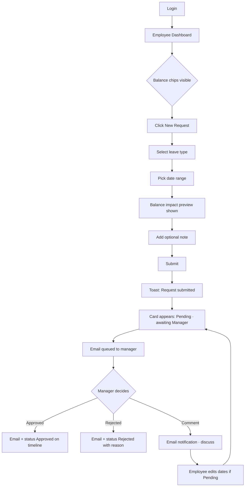
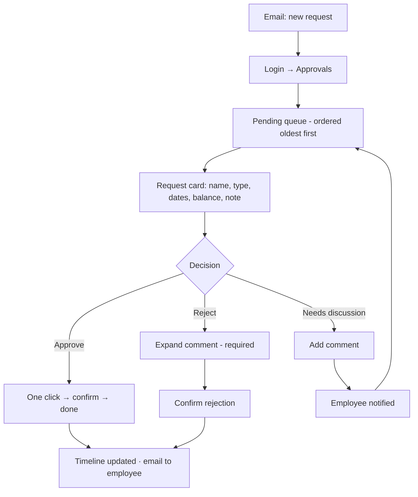
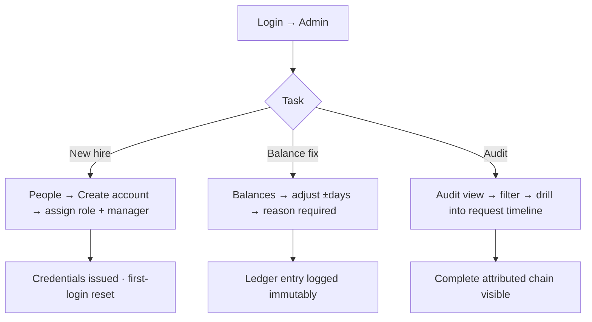

# UX Design Specification - Employee Leave Tracking System

**Author:** Anil  
**Date:** 2026-10-15

---

## Executive Summary

### Project Vision

The Employee Leave Tracking System transforms leave management from a fragmented, trust-deficit process into a seamless, transparent, and trustworthy experience. The core UX thesis: **the problem isn't leave tracking — it's the lack of visibility and trust between employees, managers, and HR.** Every screen, state, and interaction is designed around "accountability through transparency within role boundaries": users always know the status of a request, who acted on it, and what happens next.

**Value proposition for UX:** From leave request to final approval, every step is simple, transparent, and fully traceable.

### Target Users

Three role-scoped experiences, sharing one design language:

| Role | Persona | Primary Needs | Emotional Driver |
|------|---------|---------------|------------------|
| **Employee** | Sarah — Product Manager, distributed team | Submit requests in minutes, see status instantly, check balances | Peace of mind through visibility — no more chasing |
| **Manager** | Alex — Engineering Manager, 8 reports | See all pending approvals, decide with full context in <30s per request | Confidence through accountability — informed decisions |
| **HR/Admin** | Jamie — HR Manager | Complete audit trail, balance management, user provisioning | Defensibility through governance — compliance confidence |

**Usage context:** Primarily desktop web (Chrome/Edge), with mobile used for quick status checks and notifications. ~100 users, ~20 concurrent. Sessions are short and task-focused — a few minutes, a few times per month for employees; daily brief check-ins for managers.

### Key Design Challenges

1. **Role-based information architecture** — Three roles see three different "apps" (own data / team data / all data) from the same codebase. Navigation, dashboards, and empty states must adapt per role without confusion or data leakage.
2. **Status transparency without noise** — The differentiator is visibility (who did what, when), but status history must be glanceable, not overwhelming. The History/timeline pattern needs careful hierarchy.
3. **Decision density for managers** — Approval cards must carry enough context (dates, type, balance, team conflicts) to enable one-click decisions, while staying scannable across a queue.
4. **Immutability in the UI** — Records can't be deleted; "cancel" and "modify" are audit-trailed transitions. The interface must communicate permanence (corrections, not erasure) without frightening users.

### Design Opportunities

1. **Make the audit trail a first-class citizen** — Most leave tools hide history. Surfacing a clean "who/when/what" timeline on every request turns a compliance feature into the product's signature interaction.
2. **Zero-chase status visibility** — A persistent status badge + timeline means employees never wonder "did they see it?" — the emotional core of the product.
3. **Sub-30-second approvals** — If a manager can act on a request in under 30 seconds with full confidence, the product wins on efficiency. Every element of the approval card is optimized for this.
4. **Calm, trustworthy aesthetics** — HR tools are often visually sterile or dated. A calm teal/blue palette with clear status color semantics builds trust while feeling modern.

---

## Core User Experience

### Defining Experience

**"Submit → See → Trust."** The defining experience is the employee's first leave request: they fill a short form, submit, and *immediately* see a request card stamped "Pending — submitted 10:42 AM, awaiting Alex M." From that moment they watch a living timeline. No email refresh, no Slack ping, no anxiety.

The counterpart defining experience for managers: open the Approvals dashboard, see a queue of context-rich cards, and clear all three pending requests in under three minutes.

### Platform Strategy

- **Desktop-first responsive web app** (per PRD), single-page-application feel with server-rendered simplicity acceptable for MVP
- **Breakpoints:** desktop ≥1024px (full experience), tablet 768–1023px (condensed layouts), mobile ≤767px (read/status-check optimized, submission still fully supported)
- **Email as the notification channel** for MVP — notifications deep-link into the request detail view (no in-app notification center until Phase 2)
- **No legacy browser support** — Chrome/Edge latest; system font stack for performance and native feel

### Effortless Interactions

| Interaction | Effort Target | Design Approach |
|-------------|---------------|-----------------|
| Submit leave request | <60 seconds, 1 screen | Single form, smart defaults, inline date validation, balance preview |
| Approve/reject a request | <30 seconds, 2 clicks | One-click Approve; Reject requires comment (FR13) via inline expand |
| Check request status | <5 seconds | Dashboard card always shows status badge + last event |
| Check leave balance | <5 seconds | Balance chips/cards pinned at top of dashboard |
| Find audit history | 1 click | "History" tab on every request — timeline, no digging |

### Critical Success Moments

1. **First submission confirmation** — The instant the card appears with "Pending" + timestamp, trust is established. This moment must feel immediate and definite (optimistic UI + toast + email queued).
2. **Manager's first approval** — Seeing complete context (balance, conflicts, history) in one glance converts skepticism into habit.
3. **Rejection with reason** — A rejected request must show *why* prominently — turning a negative moment into a trust-building one.
4. **HR audit drill-down** — Jamie opening any request and seeing a complete, timestamped chain of custody.
5. **Modification tracking** — When dates change post-submission, the diff is visible in history — "accountability" made tangible.

### Experience Principles

1. **Status is always visible** — No request exists without a visible state and last-action timestamp.
2. **Every action names an actor** — "Approved by Alex M. · Oct 15, 2:14 PM" — never anonymous system states.
3. **Immutable but correctable** — Nothing disappears; corrections are appended and visible.
4. **Role-appropriate transparency** — Show everything the role is entitled to; never hint at what they can't see.
5. **Calm by default** — Restrained color, generous-but-efficient spacing, no decorative noise. Status colors carry all semantic weight.
6. **Keyboard-first parity** — All primary flows fully keyboard operable (WCAG 2.1 A).

---

## Desired Emotional Response

### Primary Emotional Goals

| Stage | Employee | Manager | HR/Admin |
|-------|----------|---------|----------|
| First contact | "This looks simple and safe" | "Everything I need is here" | "I can see everything" |
| Core action | Relief — "done, and I can see it" | Confidence — "I have the facts" | Control — "this is defensible" |
| Completion | Peace of mind | Satisfaction — queue cleared | Assurance — audit-ready |
| Error/edge | Informed, not blamed | Guided, not blocked | Alerted, not surprised |
| Return visit | Habit — "check status" | Routine — "clear queue" | Trust — "pull report" |

### Emotional Journey Mapping

**Anxiety → Visibility → Relief (employee):** The pre-system emotion is anxiety ("did my manager see it?"). Design must convert uncertainty into visibility *immediately* — the timestamped pending card is the antidote to the follow-up email.

**Overwhelm → Clarity → Confidence (manager):** Requests scattered across email/Slack become a single ordered queue with complete context. Each decision feels defensible.

**Dread → Confidence (HR):** Manual report compilation fear becomes "generate → review → export" calm.

### Micro-Emotions

- **Confidence vs. Confusion** → always show current state + next expected action ("Awaiting approval from Alex M.")
- **Trust vs. Skepticism** → attribution on every event; balances show "last adjusted by HR on [date]"
- **Accomplishment vs. Frustration** → progress feedback on submission; cleared-queue empty states celebrate ("All caught up")
- **Delight vs. Satisfaction** → modest delight: instant status visibility, conflict warnings shown *before* submission

### Design Implications

| Emotion | UX Design Approach |
|---------|-------------------|
| Peace of mind | Persistent status badges, timeline on every request, email confirmations |
| Confidence | Context-complete approval cards; required reason on rejection |
| Trust | Immutable history, visible timestamps, actor attribution everywhere |
| Calm | Restrained palette, one primary action per card, consistent placement |
| Avoid: anxiety | No silent failures; every submit shows confirmation + queued-email note |
| Avoid: blame | Rejections always carry the manager's comment; language is neutral |

### Emotional Design Principles

1. Design for the anxious refresher — status must be honest and current.
2. Never make a user wonder "did that work?" — every action gets visible feedback.
3. Turn required friction (rejection reasons, balance corrections) into trust moments.
4. Empty states teach and reassure rather than just declare emptiness.

---

## UX Pattern Analysis & Inspiration

### Inspiring Products Analysis

| Product | What It Does Well | Transferable Lesson |
|---------|-------------------|---------------------|
| **Linear** | Instant state changes with optimistic UI; terse issue history that reads like a timeline | Status transitions should feel instant; history can be compact without losing completeness |
| **GitHub** | PR review = context-dense decision card (diff, checks, comments, approve button in one place); event timeline interleaves comments and actions | Approval card = all context + action in one surface; timeline merges comments + status events |
| **BambooHR / Gusto** | Friendly HR tone, clean balances display, approachable forms | HR tools can be calm and warm; balance visualization as simple "X of Y days" chips |
| **Notion** | Activity/audit log per page; "@person did X" attribution | Audit history phrased as human-readable sentences |

### Transferable UX Patterns

**Navigation:** Role-scoped sidebar nav (dark rail, clear active state) — each role sees only its sections. Breadcrumb on detail views.

**Interaction patterns:**
- Card-based queues for approvals (scannable, action-on-card)
- Tabbed detail views (Details / History / Comments) — history as a vertical timeline
- Inline expanding rejection-comment field rather than a modal
- Toast confirmations + optimistic state transitions
- Date-range picker with working-day count and balance impact preview

**Visual patterns:**
- Semantic status colors (pending=amber, approved=green, rejected=red, cancelled=gray) with icon + text (never color alone)
- Balance chips: `Vacation · 12 of 20 days` — glanceable without charts

### Anti-Patterns to Avoid

- **Hidden status** — requiring a click/refresh to see state (defeats the core promise)
- **Modal-heavy flows** — stacking modals for approve/comment creates friction and breaks keyboard flow
- **Anonymous system messages** — "Status updated" without actor/timestamp undermines accountability
- **Over-dense admin grids** — 15-column tables nobody reads; prefer cards + progressive disclosure
- **Delete affordances on records** — contradicts immutability; use "Cancel" as a transition instead

### Design Inspiration Strategy

- **Adopt:** GitHub-style decision card; Linear-style instant status; BambooHR calm tone; Notion-style attributed history sentences
- **Adapt:** Timeline component simplified for MVP (status events + comments, no reactions); sidebar nav scoped to three roles only
- **Avoid:** Gamification, dashboard-charts-everywhere, consumer-app playfulness — this is a tool of record

---

## Design System Foundation

### Design System Choice

**Themeable system: Tailwind CSS + shadcn/ui-style component architecture** (utility-first tokens + accessible primitives patterned on Radix).

### Rationale for Selection

- **Speed for MVP:** utility classes + pre-built accessible primitives fit an 8–12 week, 2–3 dev timeline
- **Brand flexibility:** token-driven theming delivers the calm teal identity without a bespoke component build
- **Accessibility:** Radix-style primitives give keyboard/focus/ARIA behavior for free — supports WCAG 2.1 A
- **Prototyping parity:** the same tokens are expressed as CSS custom properties in the HTML prototype
- **Scales to Phase 2:** dark mode, theming, and component extraction are incremental, not rewrites

### Implementation Approach

1. Define design tokens as CSS custom properties (colors, spacing, radii, type scale) — single source of truth
2. Compose components from accessible primitives (dialog, select, tabs, toast, date picker)
3. Page-level patterns composed from tokens + components (sidebar shell, card queue, timeline)
4. Keep component API surfaces small; custom components only where the domain demands (StatusBadge, BalanceChip, RequestCard, HistoryTimeline)

### Customization Strategy

- Re-hue primitives via CSS variables; no component forks
- Status color semantics locked (do not theme) — accessibility and meaning are fixed
- Spacing/type scales fixed; only brand palette + logo area customizable per deployment

### Design Tokens

```css
/* Brand & Semantic */
--primary:        #0f766e;  /* teal-700  — primary actions, brand */
--primary-dark:   #115e59;  /* teal-800  — hover/active */
--primary-light:  #ccfbf1;  /* teal-100  — subtle fills */
--accent:         #0369a1;  /* sky-700   — links, info */

/* Status semantics (locked) */
--status-pending:   #b45309;  /* amber-700 */
--status-pending-bg:#fef3c7;  /* amber-100 */
--status-approved:  #15803d;  /* green-700 */
--status-approved-bg:#dcfce7; /* green-100 */
--status-rejected:  #b91c1c;  /* red-700   */
--status-rejected-bg:#fee2e2; /* red-100   */
--status-cancelled: #4b5563;  /* gray-600  */
--status-cancelled-bg:#f3f4f6;/* gray-100  */
--info:             #0369a1;
--info-bg:          #e0f2fe;

/* Neutrals */
--neutral-50:  #f9fafb;  /* app background */
--neutral-100: #f3f4f6;
--neutral-200: #e5e7eb;  /* borders */
--neutral-500: #6b7280;  /* tertiary text */
--neutral-700: #374151;  /* secondary text */
--neutral-900: #111827;  /* primary text, sidebar */

/* Typography */
--font-family: -apple-system, BlinkMacSystemFont, 'Segoe UI', Roboto, 'Helvetica Neue', Arial, sans-serif;
--text-xs: 12px;  --text-sm: 13px;  --text-base: 14px;
--text-lg: 16px;  --text-xl: 18px;  --text-2xl: 24px;  --text-3xl: 28px;

/* Spacing (4px base) */
--space-1: 4px;  --space-2: 8px;   --space-3: 12px;  --space-4: 16px;
--space-6: 24px; --space-8: 32px;  --space-12: 48px;

/* Radii & Elevation */
--radius-sm: 4px;  --radius-md: 6px;  --radius-lg: 8px;
--shadow-sm: 0 1px 2px rgba(0,0,0,.05);
--shadow-md: 0 4px 6px -1px rgba(0,0,0,.10);
```

All text/background pairings above meet ≥4.5:1 contrast.

---

## Defining Core Experience

### The Defining Experience

**The visible chain of custody.** One request, one card, one timeline — every event attributed and timestamped. The product's promise is kept the moment an employee sees "Submitted by you · Pending with Alex M." and kept again when the manager sees a complete decision card.

### User Mental Model

Users think in **requests and balances**, not records:
- "My request" = a thing with a status, moving through a queue toward a decision
- "My balance" = an allowance that depletes; HR owns corrections
- Managers think in **queues and context**: "what needs my decision, and do I have enough to decide?"
- HR thinks in **oversight**: people, balances, and an immutable ledger

IA mirrors this: `Dashboard` (queue/status), `My Requests`, `Balances`, `Approvals` (manager), `People / Balances / Audit` (HR).

### Success Criteria for Core Experience

- Employee submits in <60s without help; status comprehension without a help doc
- Manager clears a request in <30s with zero follow-up questions to the employee
- 100% of requests show complete attributed history within one click
- Zero "where is my request?" support inquiries

### Novel vs. Established Patterns

| Established (adopt as-is) | Novel-ish (differentiator) |
|---------------------------|----------------------------|
| Sidebar nav, cards, tabs, toasts, date pickers | Transparency timeline as the hero object — every request is a mini case file |
| Role-based dashboards | "Awaiting X" attribution in the status badge itself (names the blocker) |
| Email notifications | Balance impact preview *inside* the request form before submission |

### Experience Mechanics

- **Request lifecycle states:** `Draft → Pending → Approved | Rejected | Cancelled` (+ `Modified` events while Pending). State machine drives badge, available actions, and timeline entries.
- **Attribution mechanic:** every event stores actor + timestamp + optional comment; UI renders as a sentence: "Alex M. approved · Oct 15, 2:14 PM".
- **Modification mechanic:** pending requests editable by owner; edits produce "Modified: Jul 15–22 → Jul 17–24" history entries; approval resets nothing — history is append-only.
- **Cancellation mechanic:** pending (and future: approved) requests can be cancelled → `Cancelled` terminal state, still visible in history.
- **Balance mechanic:** employee sees `used/remaining/total` per type; HR adjustments appear as ledger entries with reason.

---

## Visual Design Foundation

### Color System

Calm professional teal/blue (user-selected). Deep teal `#0f766e` primary communicates calm competence — professional without corporate coldness. Status colors are semantic and locked; brand may retheme around them.

- **Surfaces:** neutral-50 app canvas, white cards, neutral-900 sidebar rail
- **Emphasis order:** status colors > primary actions > accent links — status always wins visual priority

### Typography System

- **Stack:** system font stack (performance + native feel; no webfont cost for MVP)
- **Scale:** 12 / 13 / 14 / 16 / 18 / 24 / 28 — base 14px for dense, efficient data views
- **Hierarchy:** page title 24px/700, section 18px/600, card title 16px/600, body 14px, meta/timestamps 12–13px in neutral-500
- **Status text:** always paired with icon; weight 600 for badges

### Spacing & Layout Foundation

- **4px base grid**; card padding 16–24px; section gaps 24–32px — efficient density (not cramped, not airy)
- **App shell:** 260px dark sidebar + fluid content column (max-width ~1200px)
- **Card queue:** single-column list of full-width request cards — 1 decision context per row
- **Detail view:** header (title + status badge + key facts), body tabs (Details / History / Comments)

### Visual Design Principles

1. Status colors reserved exclusively for status — never decorative
2. One primary button per view; destructive actions outlined/secondary + confirm
3. Timestamps and actors rendered in muted meta style — present everywhere, shouting nowhere
4. Whitespace separates *decisions*, not just elements

### Accessibility Considerations

- All status conveyed by color **and** icon **and** text
- Focus ring: 2px `--accent` outline, visible on all interactive elements
- Contrast: text ≥4.5:1, UI components ≥3:1
- Form errors: inline, icon + message, `aria-live` announced
- Touch targets ≥24px (A); keyboard operability across nav, tabs, forms, timelines

---

## Design Direction Decision

### Design Directions Explored

| # | Direction | Summary | Verdict |
|---|-----------|---------|---------|
| 1 | **Table-centric admin** | Dense tables for everything | Too cold; poor context for decisions |
| 2 | **Dashboard-widgets** | Charts and KPI tiles | Phase-2 analytics, not MVP core |
| 3 | **Card-based queues + timeline detail** | Scannable request cards; detail page with History timeline | ✅ Chosen |
| 4 | **Wizard-style submission** | Multi-step request flow | Unnecessary friction for a 4-field form |
| 5 | **Kanban board** | Drag requests between status columns | Wrong mental model — employees don't move cards, approvers do |

### Chosen Direction

**Direction 3 — Card-based queues with a tabbed request detail (Details / History / Comments) and a first-class transparency timeline.**

### Design Rationale

- Directly serves the differentiator: the timeline *is* the transparency feature
- Card queues give managers decision context at a glance (name, dates, type, balance, conflict flag)
- Tabs keep detail views clean while keeping history one click away (FR45)
- Scales across all three roles with the same primitives (employee's "My Requests" = same cards, different actions)

### Implementation Approach

- Employee dashboard: balance chips row → "New Request" CTA → pending card → history list
- Manager dashboard: pending queue (cards) → per-card Approve/Reject (+comment expand) → decided section
- Request detail: header facts + tabs; History = vertical timeline of attributed events
- HR admin: People table (roles, balances inline edit w/ reason), global audit list
- Visual mockups: `_planning/ux-design-directions.html`; color themes: `_planning/ux-color-themes.html`

---

## User Journey Flows

### Journey 1 — Employee: Submit & Track Leave



### Journey 2 — Manager: Review & Decide



### Journey 3 — HR/Admin: Provision & Govern



### Journey Patterns

- **Hub-and-spoke:** every flow starts at a role dashboard and returns to it — no deep nesting
- **Decision surfaces colocate context + action:** never send the user elsewhere to decide
- **Notifications deep-link to detail view,** never to a generic list
- **Recovery paths are edits/comments,** not deletions

### Flow Optimization Principles

1. Shortest path to status: dashboard = status, no intermediate pages
2. Shortest path to decision: card = context + action
3. Queue ordered oldest-first (fairness); conflict flags surface before opening
4. Rejection requires exactly one extra field — friction only where accountability demands it

---

## Component Strategy

### Design System Components (from themeable library)

Button, Input, Select, Textarea, DatePicker, Tabs, Toast, Dialog (confirm), Tooltip, Table, Badge, Avatar, Dropdown — used as-is under the token theme.

### Custom Components

#### StatusBadge
**Purpose:** Communicate request state at a glance.  
**Usage:** On every request card, detail header, list row.  
**Anatomy:** icon + label, semantic bg/fg pair.  
**States:** Pending (amber, clock icon), Approved (green, check), Rejected (red, x), Cancelled (gray, slash), Modified flag overlay when edited.  
**Accessibility:** text label always present — never color-only. `role="status"` where dynamically updated.

#### BalanceChip
**Purpose:** Glanceable leave allowance.  
**Anatomy:** leave-type label + `12 of 20 days` + mini progress bar.  
**States:** healthy / low (<25%, subtle warning) / exhausted (0 days, grayed).  
**Interaction:** hover tooltip shows "as of [date] · set by HR".

#### RequestCard
**Purpose:** The unit of work for employees and managers.  
**Anatomy:** employee name+avatar (manager/HR views), type icon, date range + duration, StatusBadge, note excerpt, actions (Approve/Reject for managers; Edit/Cancel for owner while Pending).  
**States:** pending (actions live), decided (actions replaced by decision summary), modified (diff icon).  
**Behavior:** whole card links to detail; action buttons stop propagation.

#### HistoryTimeline
**Purpose:** The signature transparency component — vertical attributed event feed.  
**Anatomy:** event dot (type-colored) + actor + action sentence + absolute timestamp + optional comment + diff block for modifications.  
**Content:** "Submitted by Sarah K.", "Alex M. approved", "Modified: Jul 15–22 → Jul 17–24", "Rejected by Alex M. — 'team deadline conflict'".  
**Accessibility:** `<ol>` semantics; screen-reader friendly absolute times.

#### ConflictFlag
**Purpose:** Warn before decisions (overlapping team leave / low balance).  
**Usage:** inline on request card + form preview; informational, not blocking (Phase 2 makes it richer).

### Component Implementation Strategy

Build order: tokens → primitives (Button, Input, Select, DatePicker, Tabs, Toast) → StatusBadge/BalanceChip → RequestCard → HistoryTimeline → page shells. Storybook-style isolated states optional but recommended.

### Implementation Roadmap

| Phase | Components |
|-------|-----------|
| 1 (MVP core) | Tokens, primitives, StatusBadge, BalanceChip, RequestCard, HistoryTimeline, forms, app shell |
| 2 | Team calendar, in-app notification center, charts, bulk actions |
| 3 | Delegation UI, policy config, integrations |

---

## UX Consistency Patterns

### Button Hierarchy

- **One primary button** per view/card region (Submit request, Approve)
- **Secondary** = outline (Edit, View, Add comment)
- **Destructive/cautionary** = Reject (red outline → red fill on confirm); Cancel uses neutral secondary + confirm dialog
- **Icon + label** on all action buttons; no icon-only actions except ubiquitous patterns (close, menu)

### Feedback Patterns

- **Submit/save:** optimistic UI + success toast ("Request submitted — Alex M. notified"), card renders immediately
- **Errors:** inline field-level messages on blur/submit; form-level summary at top on submit fail; `aria-live="polite"`
- **Loading:** skeletons for lists >300ms; spinners only on buttons during action
- **Empty states:** always action-oriented ("No pending requests — you're all caught up" / "Submit your first request")

### Form Patterns

- Labels above fields, required marked `*`, helper text below field
- Date range picker: calendar with range highlight, working-days count, balance impact preview line
- Inline validation on blur; disabled submit until valid
- Rejection comment: expands inline on the card (not a modal); required, min 1 char, placeholder "Explain the reason to the employee…"

### Navigation Patterns

- Dark sidebar rail: role badge + grouped nav + user menu at bottom
- Role-scoped items: Employee (Dashboard, My Requests, Balances), Manager (+ Approvals, Team), HR (+ People, Balances, Audit)
- Active item: primary fill + left border; breadcrumbs on detail pages (`Approvals / REQ-1042`)
- Deep-linkable URLs for every request (`/requests/:id`) — notification emails rely on this

### Additional Patterns

- **Tables:** used only where data is genuinely tabular (People, Audit log); default sort by recency; sticky header; row click → detail
- **Dialogs:** reserved for true confirmations (cancel request, irreversible-ish actions); never for information
- **Timestamps:** absolute in timelines ("Oct 15, 2026 · 2:14 PM"), relative allowed in card meta ("2h ago") with absolute on hover
- **Attribution:** pattern is always `Actor + Verb + Object + Time` — consistent grammar across all surfaces

---

## Responsive Design & Accessibility

### Responsive Strategy

Desktop-first (primary work context) with full mobile parity for read/status flows. Mobile prioritizes: status checking, balance view, approvals — the "glance and act" use cases.

### Breakpoint Strategy

| Breakpoint | Layout Adaptation |
|------------|-------------------|
| ≥1024px desktop | Sidebar visible; full cards; detail tabs horizontal |
| 768–1023px tablet | Collapsible sidebar (icons only); single-column cards |
| ≤767px mobile | Sidebar → top bar + drawer; cards stack; tabs scroll; forms single-column; touch targets ≥24px |

Content reordering: on mobile, status badge + key facts lead; actions collapse into a footer bar.

### Accessibility Strategy

- **WCAG 2.1 Level A** baseline (per PRD), aiming A-adjacent AA practices where free (contrast 4.5:1, focus visibility)
- Semantic landmarks: `nav`, `main`, `header`; skip-link to main content
- All forms keyboard completable; logical tab order; visible focus
- Timeline/events announced via `<ol>` + text; status changes use `role="status"`
- No content conveyed by color alone; icons have accessible names; alt text on avatars ("Sarah K.")

### Testing Strategy

- Automated axe checks in CI on key screens (login, dashboards, request detail, forms)
- Manual keyboard walkthrough of the three core journeys before release
- Screen reader smoke test (VoiceOver/NVDA) on request submit + approve flows
- Contrast verification for the locked status palette

### Implementation Guidelines

- CSS logical properties where practical; `rem`-based typography (respects user text scaling)
- `prefers-reduced-motion`: disable transitions/animated toasts
- Form inputs min 44px height on mobile breakpoints
- Error summary + field `aria-describedby` wiring as a standard component contract

---

## Supporting Visual Assets

- **Color theme visualizer:** `_planning/ux-color-themes.html` — palette options rendered in real UI context
- **Design direction mockups:** `_planning/ux-design-directions.html` — card-queue, detail/timeline, and form directions

---

*UX Design Specification complete — ready to guide implementation of the Employee Leave Tracking System MVP.*
